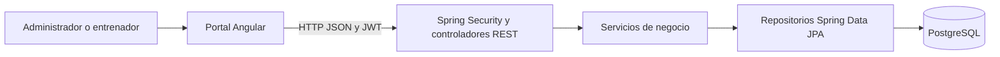

# Gym Track — proyecto final de Métricas y Estándares de Calidad

## 1. Propósito y procedencia

Gym Track organiza los estudiantes y sus sesiones de entrenamiento. Los administradores gestionan usuarios y consultan los registros autorizados; los entrenadores gestionan sus estudiantes y registran sesiones, grupos musculares y duración. Proyecto académico de CORHUILA para el docente José Miguel Llanos Mosquera.

La aplicación es **código base reutilizado de Desarrollo Fullstack**. En esta materia se integró el repositorio y se añadieron pruebas, mediciones, análisis, refactors y documentación. La [declaración de procedencia y uso de IA](docs/informe/00-procedencia.md) distingue el código importado del trabajo nuevo. El repositorio de entrega es [proyecto-final](https://github.com/laura-marcela05/proyecto-final).

## 2. Integrantes

| Integrante | GitHub | Aporte principal |
|---|---|---|
| Juan Camilo Bernal Gordillo | [JuanBernalCorhuila](https://github.com/JuanBernalCorhuila) | Auth/users, pruebas, V(G), LOC y README |
| Laura Marcela Quintero Poveda | [laura-marcela05](https://github.com/laura-marcela05) | Coordinación, students, pruebas, CK, MI y trazabilidad |
| Cristian Andrés Muñoz Montenegro | [cristianmunoz2006](https://github.com/cristianmunoz2006) | Sessions, pruebas, mantenimiento y Anexo C |

## 3. Resumen de requisitos

Este resumen agrupa el alcance; los criterios exactos y la trazabilidad pertenecen al documento original `docs/requisitos.md`, pendiente de incorporar al repositorio de entrega. El resumen no redefine los RF/RNF.

| Alcance | Función |
|---|---|
| RF-01 a RF-03 | Autenticación y gestión de usuarios, con permisos por rol |
| RF-04 a RF-06 | Registro, consulta, actualización y eliminación de estudiantes según las reglas de acceso y negocio |
| RF-07 a RF-10 | Apertura, registro de grupos musculares, cierre, historial y eliminación de sesiones según el rol |
| RNF-01 — rendimiento | Pendiente de acreditar con medición de tiempos frente al criterio original |
| RNF-02 — seguridad | Autenticación JWT y autorización por rol; las pruebas aportan evidencia de casos concretos, no una auditoría completa |
| RNF-03 — mantenibilidad | Evaluación con V(G), LOC, CK e índice de mantenibilidad; consultar alcance y umbrales en las fichas |

## 4. Arquitectura

El portal Angular consume la API REST. En el backend, los controladores reciben y validan solicitudes, los servicios aplican reglas de negocio y los repositorios acceden a PostgreSQL. Spring Security valida JWT y aplica restricciones antes de las operaciones protegidas. Las capas permiten probar reglas y contratos HTTP con dependencias aisladas. Docker Compose reúne el entorno local.



Este diagrama resume la implementación observada. El original `docs/arquitectura.md` está pendiente de incorporar a la entrega.

## 5. Tecnologías

- API: Java 17 como objetivo de compilación, Spring Boot 3.5.6, Spring Security, JPA, JWT, Maven Wrapper, JUnit y Mockito.
- Portal: Angular 20.3, TypeScript 5.9, npm, Jasmine y Karma; Nginx sirve la compilación del contenedor.
- Datos e infraestructura: PostgreSQL 16, scripts de esquema y datos demo, Docker Compose.
- Calidad: Postman, Python 3.12 para los analizadores con tree-sitter, CK 0.7.0 y Matplotlib 3.10.8 para los gráficos. Las versiones de los parsers quedan fijadas en `requirements.txt`.

## 6. Instalación, ejecución y pruebas

Para levantar la aplicación: Git y Docker Desktop con Compose v2 en ejecución. Deben estar libres los puertos 4200, 8080 y 5432. Para pruebas fuera de Docker: JDK 17, Node 22 compatible con Angular 20.3 (desde 22.12 dentro de la serie 22), npm y Chrome para Karma.

Desde PowerShell, clona **solo el repositorio de esta materia**:

```powershell
git clone https://github.com/laura-marcela05/proyecto-final.git
cd proyecto-final
cd src\g-t-infra
```

Crea el archivo de entorno local únicamente si aún no existe:

```powershell
Copy-Item .env.example .env
```

Para la demostración local se usan los valores del ejemplo. Conserva `.env` fuera de Git; no uses datos de producción. Revisa `CORS_ALLOWED_ORIGIN` si cambias el origen del portal. El esquema y el seed se aplican al inicializar un volumen nuevo.

```powershell
docker compose up -d --build
docker compose ps
docker compose logs --tail 40 api
```

Cuando la API termine de iniciar, abre el [portal](http://localhost:4200) y usa una cuenta demo de la sección [Test users](src/g-t-infra/README.md#6-test-users). La API usa `http://localhost:8080/api/v1`; [Swagger UI](http://localhost:8080/swagger-ui.html) expone el contrato. Para detener el entorno conservando los datos: `docker compose down` desde `src/g-t-infra`.

**API y portal.** Desde la raíz del clon, ejecuta cada bloque y revisa la salida antes de continuar:

```powershell
cd src\g-t-api
.\mvnw.cmd clean test
cd ..\..
cd src\g-t-portal
npm.cmd ci
npm.cmd run build
npx.cmd ng test --watch=false --browsers=ChromeHeadless
cd ..\..
```

**Postman.** Con la app local levantada, importa la [colección de sesiones](tests/postman/sessions-quality.postman_collection.json). Selecciona un entorno local con `sessionsBaseUrl=http://localhost:8080/api/v1`, `sessionsTrainerUsername` y `sessionsTrainerPassword` de un entrenador demo. Ejecuta una iteración con Collection Runner local. Crea datos de prueba: úsala sobre un entorno de demostración. También se conserva la [colección base](src/g-t-api/postman/gym-tracker.postman_collection.json) del proyecto importado.

**Verificación integrada en `fa80144` (9 de noviembre de 2026).** La API pasó 95 pruebas, con 0 fallos, errores u omisiones. El portal compiló y pasó 1 de 1 prueba en Chrome Headless. El entorno arrancó con Docker, el inicio de sesión funcionó y Postman ejecutó 12 peticiones con 24 aserciones aprobadas y 0 fallos.

## 7. Métricas aplicadas

Consulta [V(G) y LOC](docs/metricas/fichas/vg-loc.md), [CK y MI](docs/metricas/fichas/ck-mi.md), [mantenimiento](docs/metricas/fichas/mantenimiento.md) y el [Anexo C con tablas y gráficos](docs/metricas/anexo-c/resultados.md). La línea base se conserva en `docs/metricas/resultados/baseline/` con revisiones y hashes.

En la línea base, V(G) permanece en el rango bajo del curso dentro del alcance medido. CK señala acoplamiento en varias clases; su interpretación considera las dependencias de framework y el alcance del análisis. El MI bruto y el normalizado se reportan por separado con la convención lexical del equipo. El registro de mantenimiento recoge principalmente trabajo preventivo estimado; el costo monetario queda sin dato al no existir tarifas documentadas.

Para una **corrida nueva**, desde la raíz del repositorio y con Python 3.12 y Java disponibles, usa un directorio de salida nuevo fuera del clon. Reutiliza el entorno si ya existe; no sobrescribas `baseline`:

```powershell
py -3.12 -m venv metricas/vg_loc/.venv
.\metricas\vg_loc\.venv\Scripts\python.exe -m pip install -r metricas/vg_loc/requirements.txt
.\metricas\vg_loc\.venv\Scripts\python.exe metricas/vg_loc/measure.py --out ../gymtrack-medicion/vg_loc
.\metricas\vg_loc\.venv\Scripts\python.exe metricas/ck_mi/ck.py --out ../gymtrack-medicion/ck
.\metricas\vg_loc\.venv\Scripts\python.exe metricas/ck_mi/mi.py --vg ../gymtrack-medicion/vg_loc --out ../gymtrack-medicion/mi
```

Para esfuerzo registrado, consulta primero la ficha y verifica el CSV con el equipo. La exportación obtiene un corte nuevo de issues públicos y no modifica GitHub:

```powershell
py -3 metricas/mantenimiento/measure.py --export-issues ../gymtrack-medicion/issues.json
py -3 metricas/mantenimiento/measure.py --issues ../gymtrack-medicion/issues.json --out ../gymtrack-medicion/mantenimiento
```

## 8. Mejoras y comparación antes/después

| Área | Cambio y evidencia |
|---|---|
| Usuarios | Centralizar el rechazo del nombre duplicado conservando la consulta de alta y la de actualización. [Comparación users](docs/metricas/refactors/users/comparacion.md) |
| Estudiantes | Centralizar el rechazo del documento duplicado, preservando primero las verificaciones de acceso. [Comparación students](docs/metricas/refactors/students/comparacion.md) |
| Sesiones | Agrupar las verificaciones de sesión accesible y abierta, manteniendo su orden. [Comparación sessions](docs/metricas/refactors/sessions/comparacion.md) |

Las tablas enlazadas muestran el efecto observado por servicio, incluido el costo de introducir auxiliares en tamaño o WMC. Son mediciones por rama, comparadas con la línea base; la verificación conjunta sobre `main` comprueba la integración. Los análisis previos están en [docs/metricas/analisis](docs/metricas/analisis).

## 9. Estructura e informe

```text
src/g-t-api/      API y pruebas Java en src/test
src/g-t-portal/   portal Angular y sus pruebas
src/g-t-db/       SQL y esquema de datos
src/g-t-infra/    Docker Compose y ejemplo de entorno
tests/postman/   colección de sesiones
metricas/        herramientas de medición y comparación
docs/metricas/   fichas, resultados, gráficos y análisis
docs/informe/    procedencia y material del informe
```

**Informe final:** pendiente de consolidación. Se añadirá en `docs/informe-final.pdf` y se enlazará aquí cuando esté publicado.

## 10. Licencia y estado

Entrega académica en preparación. No se ha confirmado una licencia para el código reutilizado; no se declara una licencia no documentada. La entrega final queda pendiente del informe y del tag. La aplicación no incluye reportes funcionales; el alcance de ese requisito debe confirmarse con el docente. Las tablas y gráficos de calidad documentan la evaluación del proyecto.
