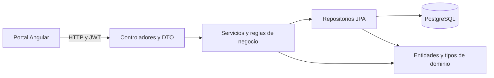

# Arquitectura de Gym Track

Gym Track cubre un solo dominio: la administración de estudiantes y sus sesiones de entrenamiento. El portal Angular consume la API REST de Spring Boot. La API organiza el código por capas y persiste los datos en PostgreSQL.

| Componente | Ubicación | Responsabilidad |
|---|---|---|
| Portal | `src/g-t-portal/src/app/` | Pantallas de acceso, usuarios, estudiantes y sesiones. |
| API REST | `src/g-t-api/src/main/java/com/corhuila/gymtracker/controller/` y `dto/` | Contrato HTTP, validación de entradas y representación de respuestas. |
| Aplicación | `src/g-t-api/src/main/java/com/corhuila/gymtracker/service/` | Reglas de negocio, permisos sobre recursos y coordinación de persistencia. |
| Persistencia y dominio | `src/g-t-api/src/main/java/com/corhuila/gymtracker/repository/` y `entity/` | Consultas JPA y representación de usuarios, estudiantes y sesiones. |
| Infraestructura | `src/g-t-db/` y `src/g-t-infra/` | Esquema de datos y ejecución integrada con Docker Compose. |

La separación permite verificar reglas de estudiantes y sesiones en pruebas de servicio y comprobar respuestas HTTP y permisos por rol con pruebas de controlador. El costo es mantener consistentes DTO, reglas, consultas y pantallas cuando cambia un contrato. La suite CK registra dependencias de framework que deben interpretarse según la responsabilidad de cada clase.

JWT y Spring Security aplican controles de acceso a las rutas. Los servicios verifican reglas de visibilidad y pertenencia. La separación de responsabilidades facilita localizar la política de contraseñas para corregirla. La arquitectura no acredita tiempos de respuesta: el RNF de rendimiento requiere una medición específica.

Fuentes: diseño en capas de Fullstack (`g-t-docs/05-architecture/layered-architecture.md`) y código integrado de Gym Track. Consulta [requisitos y trazabilidad](requisitos.md) y [resultados de métricas](metricas/anexo-c/resultados.md).