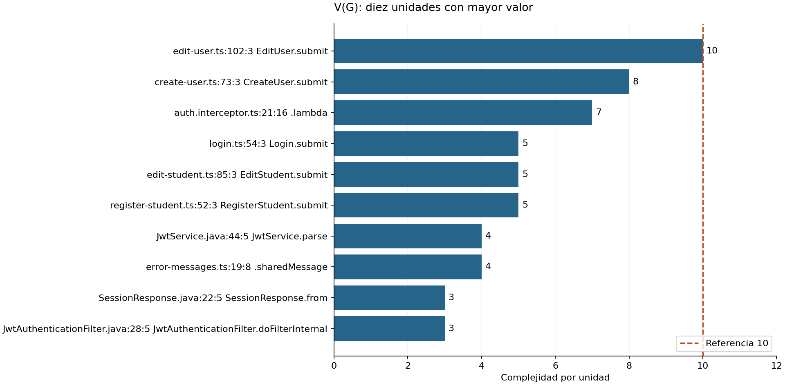
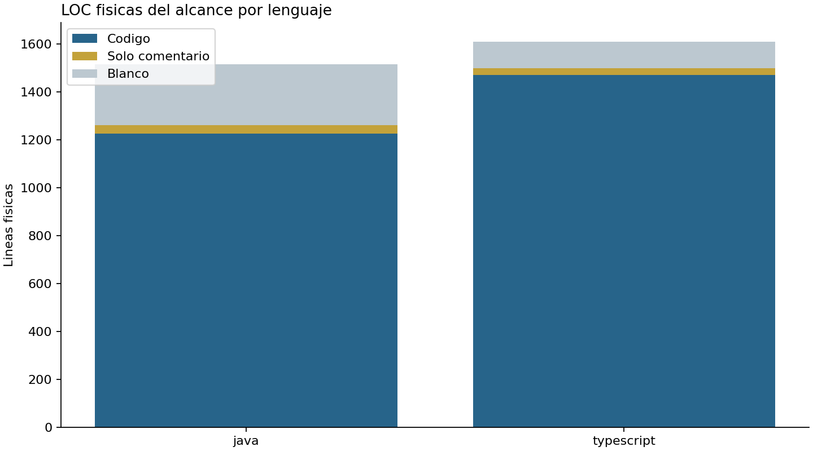
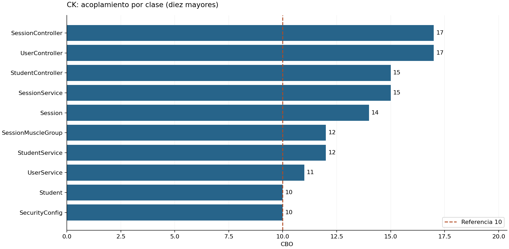
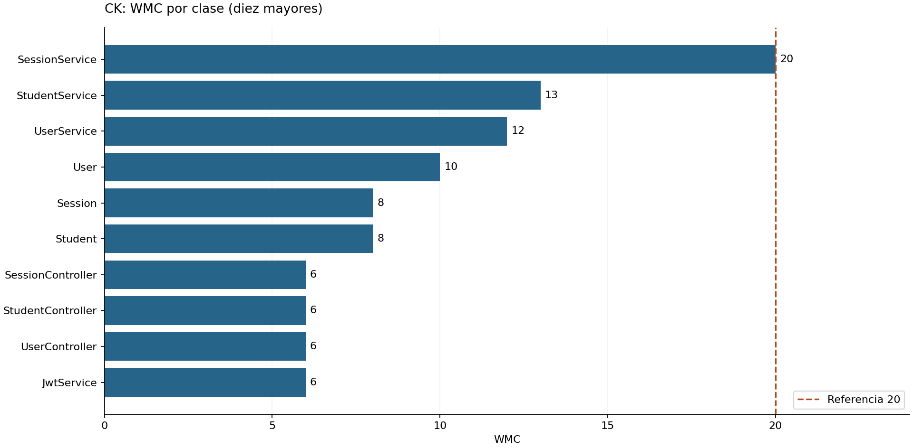
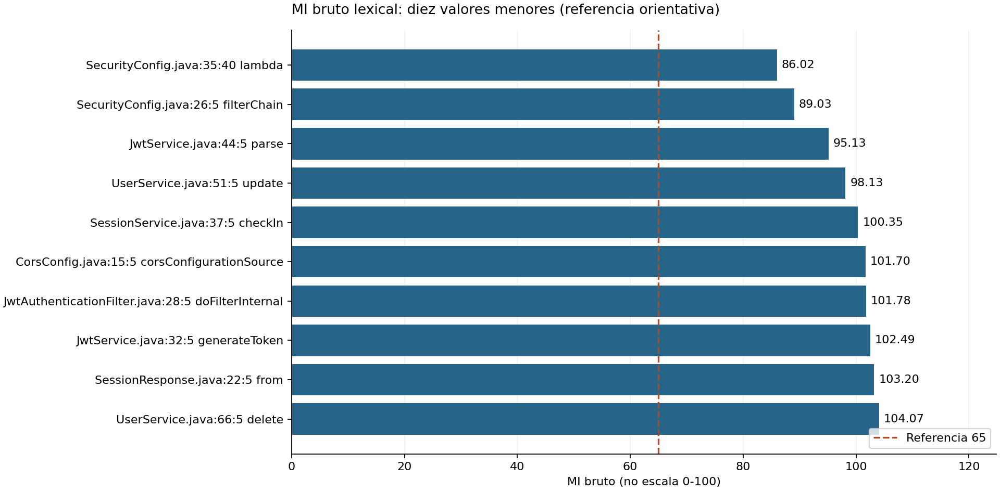
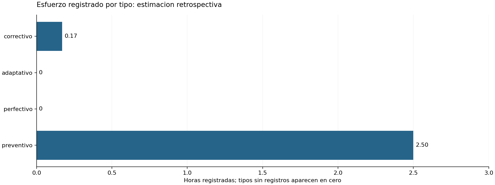

# Anexo C - resultados iniciales

Revision medida: `f0669d6f2898906a565fb179e2359f1bcd06fbca`.

Fuente: salidas originales en ../resultados/baseline; fichas y umbrales en ../fichas.

Generado sin volver a medir ni modificar fuentes. Cada tabla conserva las cinco columnas del Anexo C de la guia.

## Alcance y limites

V(G)/LOC: Java y TypeScript de produccion del alcance declarado. LOC del cuerpo incluye llaves y declaraciones; no sumar cuerpos anidados para obtener LOC del proyecto.

CK: clases publicas de service/security/controller/entity; sin resolver JAR externos. CBO cuenta dependencias de frameworks: alerta no equivale a defecto. WMC de CK no se sustituye por suma de V(G).

LCOM bruto y LCOM* son distintos. LCOM* fuera de escala o indefinido requiere revision manual; una entidad con getters/setters no se divide automaticamente por su LCOM*.

MI: lexer propio experimental, solo Java. El umbral 65 se muestra en escala bruta, con cautela; no se aplica a escala normalizada ni se afirma equivalencia con Visual Studio.

Mantenimiento: solo esfuerzo registrado; los tipos sin filas no demuestran ausencia de ese trabajo. Las estimaciones deben haber sido validadas por cada integrante. Costo null significa sin dato, no cero.

## V(G) por unidad

| Elemento medido | Metrica | Valor obtenido | Umbral | Estado / Accion propuesta |
|---|---|---:|---|---|
| src/g-t-portal/src/app/users/edit-user.ts:102:3 (EditUser.submit) | V(G) | 10 | 1-10 bajo; 11-20 moderado; 21-50 alto; >50 muy alto | Bajo; mantener pruebas y revisar cambios futuros |
| src/g-t-portal/src/app/users/create-user.ts:73:3 (CreateUser.submit) | V(G) | 8 | 1-10 bajo; 11-20 moderado; 21-50 alto; >50 muy alto | Bajo; mantener pruebas y revisar cambios futuros |
| src/g-t-portal/src/app/core/auth.interceptor.ts:21:16 (lambda) | V(G) | 7 | 1-10 bajo; 11-20 moderado; 21-50 alto; >50 muy alto | Bajo; mantener pruebas y revisar cambios futuros |
| src/g-t-portal/src/app/auth/login.ts:54:3 (Login.submit) | V(G) | 5 | 1-10 bajo; 11-20 moderado; 21-50 alto; >50 muy alto | Bajo; mantener pruebas y revisar cambios futuros |
| src/g-t-portal/src/app/students/edit-student.ts:85:3 (EditStudent.submit) | V(G) | 5 | 1-10 bajo; 11-20 moderado; 21-50 alto; >50 muy alto | Bajo; mantener pruebas y revisar cambios futuros |
| src/g-t-portal/src/app/students/register-student.ts:52:3 (RegisterStudent.submit) | V(G) | 5 | 1-10 bajo; 11-20 moderado; 21-50 alto; >50 muy alto | Bajo; mantener pruebas y revisar cambios futuros |
| src/g-t-api/src/main/java/com/corhuila/gymtracker/security/JwtService.java:44:5 (JwtService.parse) | V(G) | 4 | 1-10 bajo; 11-20 moderado; 21-50 alto; >50 muy alto | Bajo; mantener pruebas y revisar cambios futuros |
| src/g-t-portal/src/app/core/error-messages.ts:19:8 (sharedMessage) | V(G) | 4 | 1-10 bajo; 11-20 moderado; 21-50 alto; >50 muy alto | Bajo; mantener pruebas y revisar cambios futuros |
| src/g-t-api/src/main/java/com/corhuila/gymtracker/dto/SessionResponse.java:22:5 (SessionResponse.from) | V(G) | 3 | 1-10 bajo; 11-20 moderado; 21-50 alto; >50 muy alto | Bajo; mantener pruebas y revisar cambios futuros |
| src/g-t-api/src/main/java/com/corhuila/gymtracker/security/JwtAuthenticationFilter.java:28:5 (JwtAuthenticationFilter.doFilterInternal) | V(G) | 3 | 1-10 bajo; 11-20 moderado; 21-50 alto; >50 muy alto | Bajo; mantener pruebas y revisar cambios futuros |
| src/g-t-api/src/main/java/com/corhuila/gymtracker/service/SessionService.java:37:5 (SessionService.checkIn) | V(G) | 3 | 1-10 bajo; 11-20 moderado; 21-50 alto; >50 muy alto | Bajo; mantener pruebas y revisar cambios futuros |
| src/g-t-api/src/main/java/com/corhuila/gymtracker/service/SessionService.java:91:5 (SessionService.requireOwnSession) | V(G) | 3 | 1-10 bajo; 11-20 moderado; 21-50 alto; >50 muy alto | Bajo; mantener pruebas y revisar cambios futuros |
| src/g-t-api/src/main/java/com/corhuila/gymtracker/service/StudentService.java:78:5 (StudentService.requireAccessible) | V(G) | 3 | 1-10 bajo; 11-20 moderado; 21-50 alto; >50 muy alto | Bajo; mantener pruebas y revisar cambios futuros |
| src/g-t-api/src/main/java/com/corhuila/gymtracker/service/UserService.java:51:5 (UserService.update) | V(G) | 3 | 1-10 bajo; 11-20 moderado; 21-50 alto; >50 muy alto | Bajo; mantener pruebas y revisar cambios futuros |
| src/g-t-api/src/main/java/com/corhuila/gymtracker/service/UserService.java:66:5 (UserService.delete) | V(G) | 3 | 1-10 bajo; 11-20 moderado; 21-50 alto; >50 muy alto | Bajo; mantener pruebas y revisar cambios futuros |
| src/g-t-portal/src/app/core/auth.interceptor.ts:11:51 (lambda) | V(G) | 3 | 1-10 bajo; 11-20 moderado; 21-50 alto; >50 muy alto | Bajo; mantener pruebas y revisar cambios futuros |
| src/g-t-portal/src/app/core/auth.service.ts:36:3 (AuthService.isLoggedIn) | V(G) | 3 | 1-10 bajo; 11-20 moderado; 21-50 alto; >50 muy alto | Bajo; mantener pruebas y revisar cambios futuros |
| src/g-t-portal/src/app/core/auth.service.ts:63:3 (AuthService.read) | V(G) | 3 | 1-10 bajo; 11-20 moderado; 21-50 alto; >50 muy alto | Bajo; mantener pruebas y revisar cambios futuros |
| src/g-t-portal/src/app/sessions/session-history.ts:124:14 (SessionHistory.lambda) | V(G) | 3 | 1-10 bajo; 11-20 moderado; 21-50 alto; >50 muy alto | Bajo; mantener pruebas y revisar cambios futuros |
| src/g-t-portal/src/app/sessions/student-session.ts:155:14 (StudentSession.lambda) | V(G) | 3 | 1-10 bajo; 11-20 moderado; 21-50 alto; >50 muy alto | Bajo; mantener pruebas y revisar cambios futuros |
| src/g-t-portal/src/app/students/edit-student.ts:98:14 (EditStudent.lambda) | V(G) | 3 | 1-10 bajo; 11-20 moderado; 21-50 alto; >50 muy alto | Bajo; mantener pruebas y revisar cambios futuros |
| src/g-t-portal/src/app/students/student-list.ts:120:14 (StudentList.lambda) | V(G) | 3 | 1-10 bajo; 11-20 moderado; 21-50 alto; >50 muy alto | Bajo; mantener pruebas y revisar cambios futuros |
| src/g-t-portal/src/app/users/edit-user.ts:122:14 (EditUser.lambda) | V(G) | 3 | 1-10 bajo; 11-20 moderado; 21-50 alto; >50 muy alto | Bajo; mantener pruebas y revisar cambios futuros |
| src/g-t-api/src/main/java/com/corhuila/gymtracker/dto/Trimmed.java:9:5 (Trimmed.of) | V(G) | 2 | 1-10 bajo; 11-20 moderado; 21-50 alto; >50 muy alto | Bajo; mantener pruebas y revisar cambios futuros |
| src/g-t-api/src/main/java/com/corhuila/gymtracker/dto/UserUpdateRequest.java:18:5 (UserUpdateRequest.hasPassword) | V(G) | 2 | 1-10 bajo; 11-20 moderado; 21-50 alto; >50 muy alto | Bajo; mantener pruebas y revisar cambios futuros |
| src/g-t-api/src/main/java/com/corhuila/gymtracker/exception/ErrorResponse.java:13:5 (ErrorResponse.of) | V(G) | 2 | 1-10 bajo; 11-20 moderado; 21-50 alto; >50 muy alto | Bajo; mantener pruebas y revisar cambios futuros |
| src/g-t-api/src/main/java/com/corhuila/gymtracker/service/SessionService.java:57:25 (SessionService.lambda) | V(G) | 2 | 1-10 bajo; 11-20 moderado; 21-50 alto; >50 muy alto | Bajo; mantener pruebas y revisar cambios futuros |
| src/g-t-api/src/main/java/com/corhuila/gymtracker/service/SessionService.java:62:5 (SessionService.logMuscleGroup) | V(G) | 2 | 1-10 bajo; 11-20 moderado; 21-50 alto; >50 muy alto | Bajo; mantener pruebas y revisar cambios futuros |
| src/g-t-api/src/main/java/com/corhuila/gymtracker/service/SessionService.java:74:5 (SessionService.checkOut) | V(G) | 2 | 1-10 bajo; 11-20 moderado; 21-50 alto; >50 muy alto | Bajo; mantener pruebas y revisar cambios futuros |
| src/g-t-api/src/main/java/com/corhuila/gymtracker/service/SessionService.java:100:5 (SessionService.requireOpen) | V(G) | 2 | 1-10 bajo; 11-20 moderado; 21-50 alto; >50 muy alto | Bajo; mantener pruebas y revisar cambios futuros |
| src/g-t-api/src/main/java/com/corhuila/gymtracker/service/SessionService.java:114:5 (SessionService.parseStatus) | V(G) | 2 | 1-10 bajo; 11-20 moderado; 21-50 alto; >50 muy alto | Bajo; mantener pruebas y revisar cambios futuros |
| src/g-t-api/src/main/java/com/corhuila/gymtracker/service/StudentService.java:32:5 (StudentService.list) | V(G) | 2 | 1-10 bajo; 11-20 moderado; 21-50 alto; >50 muy alto | Bajo; mantener pruebas y revisar cambios futuros |
| src/g-t-api/src/main/java/com/corhuila/gymtracker/service/StudentService.java:46:5 (StudentService.create) | V(G) | 2 | 1-10 bajo; 11-20 moderado; 21-50 alto; >50 muy alto | Bajo; mantener pruebas y revisar cambios futuros |
| src/g-t-api/src/main/java/com/corhuila/gymtracker/service/StudentService.java:56:5 (StudentService.update) | V(G) | 2 | 1-10 bajo; 11-20 moderado; 21-50 alto; >50 muy alto | Bajo; mantener pruebas y revisar cambios futuros |
| src/g-t-api/src/main/java/com/corhuila/gymtracker/service/StudentService.java:68:5 (StudentService.delete) | V(G) | 2 | 1-10 bajo; 11-20 moderado; 21-50 alto; >50 muy alto | Bajo; mantener pruebas y revisar cambios futuros |
| src/g-t-api/src/main/java/com/corhuila/gymtracker/service/UserService.java:41:5 (UserService.create) | V(G) | 2 | 1-10 bajo; 11-20 moderado; 21-50 alto; >50 muy alto | Bajo; mantener pruebas y revisar cambios futuros |
| src/g-t-portal/src/app/auth/login.ts:64:14 (Login.lambda) | V(G) | 2 | 1-10 bajo; 11-20 moderado; 21-50 alto; >50 muy alto | Bajo; mantener pruebas y revisar cambios futuros |
| src/g-t-portal/src/app/core/auth.guard.ts:6:41 (lambda) | V(G) | 2 | 1-10 bajo; 11-20 moderado; 21-50 alto; >50 muy alto | Bajo; mantener pruebas y revisar cambios futuros |
| src/g-t-portal/src/app/core/auth.service.ts:27:3 (AuthService.logout) | V(G) | 2 | 1-10 bajo; 11-20 moderado; 21-50 alto; >50 muy alto | Bajo; mantener pruebas y revisar cambios futuros |
| src/g-t-portal/src/app/core/auth.service.ts:49:3 (AuthService.userId) | V(G) | 2 | 1-10 bajo; 11-20 moderado; 21-50 alto; >50 muy alto | Bajo; mantener pruebas y revisar cambios futuros |
| src/g-t-portal/src/app/core/auth.service.ts:54:3 (AuthService.store) | V(G) | 2 | 1-10 bajo; 11-20 moderado; 21-50 alto; >50 muy alto | Bajo; mantener pruebas y revisar cambios futuros |
| src/g-t-portal/src/app/core/auth.service.ts:72:3 (AuthService.isExpired) | V(G) | 2 | 1-10 bajo; 11-20 moderado; 21-50 alto; >50 muy alto | Bajo; mantener pruebas y revisar cambios futuros |
| src/g-t-portal/src/app/core/auth.service.ts:77:3 (AuthService.payload) | V(G) | 2 | 1-10 bajo; 11-20 moderado; 21-50 alto; >50 muy alto | Bajo; mantener pruebas y revisar cambios futuros |
| src/g-t-portal/src/app/core/error-messages.ts:11:8 (errorCode) | V(G) | 2 | 1-10 bajo; 11-20 moderado; 21-50 alto; >50 muy alto | Bajo; mantener pruebas y revisar cambios futuros |
| src/g-t-portal/src/app/core/role.guard.ts:7:26 (lambda) | V(G) | 2 | 1-10 bajo; 11-20 moderado; 21-50 alto; >50 muy alto | Bajo; mantener pruebas y revisar cambios futuros |
| src/g-t-portal/src/app/core/role.guard.ts:7:60 (lambda) | V(G) | 2 | 1-10 bajo; 11-20 moderado; 21-50 alto; >50 muy alto | Bajo; mantener pruebas y revisar cambios futuros |
| src/g-t-portal/src/app/sessions/session-history.ts:86:42 (SessionHistory.lambda) | V(G) | 2 | 1-10 bajo; 11-20 moderado; 21-50 alto; >50 muy alto | Bajo; mantener pruebas y revisar cambios futuros |
| src/g-t-portal/src/app/sessions/session-history.ts:105:16 (SessionHistory.lambda) | V(G) | 2 | 1-10 bajo; 11-20 moderado; 21-50 alto; >50 muy alto | Bajo; mantener pruebas y revisar cambios futuros |
| src/g-t-portal/src/app/sessions/sessions.service.ts:12:3 (SessionsService.listByStudent) | V(G) | 2 | 1-10 bajo; 11-20 moderado; 21-50 alto; >50 muy alto | Bajo; mantener pruebas y revisar cambios futuros |
| src/g-t-portal/src/app/sessions/student-session.ts:108:14 (StudentSession.lambda) | V(G) | 2 | 1-10 bajo; 11-20 moderado; 21-50 alto; >50 muy alto | Bajo; mantener pruebas y revisar cambios futuros |
| src/g-t-portal/src/app/shared/page-header.ts:43:43 (PageHeader.lambda) | V(G) | 2 | 1-10 bajo; 11-20 moderado; 21-50 alto; >50 muy alto | Bajo; mantener pruebas y revisar cambios futuros |
| src/g-t-portal/src/app/students/edit-student.ts:81:14 (EditStudent.lambda) | V(G) | 2 | 1-10 bajo; 11-20 moderado; 21-50 alto; >50 muy alto | Bajo; mantener pruebas y revisar cambios futuros |
| src/g-t-portal/src/app/students/register-student.ts:65:14 (RegisterStudent.lambda) | V(G) | 2 | 1-10 bajo; 11-20 moderado; 21-50 alto; >50 muy alto | Bajo; mantener pruebas y revisar cambios futuros |
| src/g-t-portal/src/app/students/student-list.ts:83:39 (StudentList.lambda) | V(G) | 2 | 1-10 bajo; 11-20 moderado; 21-50 alto; >50 muy alto | Bajo; mantener pruebas y revisar cambios futuros |
| src/g-t-portal/src/app/students/student-list.ts:101:3 (StudentList.target) | V(G) | 2 | 1-10 bajo; 11-20 moderado; 21-50 alto; >50 muy alto | Bajo; mantener pruebas y revisar cambios futuros |
| src/g-t-portal/src/app/users/create-user.ts:93:16 (CreateUser.lambda) | V(G) | 2 | 1-10 bajo; 11-20 moderado; 21-50 alto; >50 muy alto | Bajo; mantener pruebas y revisar cambios futuros |
| src/g-t-portal/src/app/users/edit-user.ts:80:39 (EditUser.lambda) | V(G) | 2 | 1-10 bajo; 11-20 moderado; 21-50 alto; >50 muy alto | Bajo; mantener pruebas y revisar cambios futuros |
| src/g-t-portal/src/app/users/edit-user.ts:98:14 (EditUser.lambda) | V(G) | 2 | 1-10 bajo; 11-20 moderado; 21-50 alto; >50 muy alto | Bajo; mantener pruebas y revisar cambios futuros |
| src/g-t-portal/src/app/users/user-list.ts:90:14 (UserList.lambda) | V(G) | 2 | 1-10 bajo; 11-20 moderado; 21-50 alto; >50 muy alto | Bajo; mantener pruebas y revisar cambios futuros |
| src/g-t-api/src/main/java/com/corhuila/gymtracker/GymTrackerApplication.java:9:5 (GymTrackerApplication.main) | V(G) | 1 | 1-10 bajo; 11-20 moderado; 21-50 alto; >50 muy alto | Bajo; mantener pruebas y revisar cambios futuros |
| src/g-t-api/src/main/java/com/corhuila/gymtracker/config/CorsConfig.java:15:5 (CorsConfig.corsConfigurationSource) | V(G) | 1 | 1-10 bajo; 11-20 moderado; 21-50 alto; >50 muy alto | Bajo; mantener pruebas y revisar cambios futuros |
| src/g-t-api/src/main/java/com/corhuila/gymtracker/config/OpenApiConfig.java:17:5 (OpenApiConfig.gymTrackOpenApi) | V(G) | 1 | 1-10 bajo; 11-20 moderado; 21-50 alto; >50 muy alto | Bajo; mantener pruebas y revisar cambios futuros |
| src/g-t-api/src/main/java/com/corhuila/gymtracker/controller/AuthController.java:18:5 (AuthController.AuthController) | V(G) | 1 | 1-10 bajo; 11-20 moderado; 21-50 alto; >50 muy alto | Bajo; mantener pruebas y revisar cambios futuros |
| src/g-t-api/src/main/java/com/corhuila/gymtracker/controller/AuthController.java:22:5 (AuthController.login) | V(G) | 1 | 1-10 bajo; 11-20 moderado; 21-50 alto; >50 muy alto | Bajo; mantener pruebas y revisar cambios futuros |
| src/g-t-api/src/main/java/com/corhuila/gymtracker/controller/SessionController.java:30:5 (SessionController.SessionController) | V(G) | 1 | 1-10 bajo; 11-20 moderado; 21-50 alto; >50 muy alto | Bajo; mantener pruebas y revisar cambios futuros |
| src/g-t-api/src/main/java/com/corhuila/gymtracker/controller/SessionController.java:34:5 (SessionController.checkIn) | V(G) | 1 | 1-10 bajo; 11-20 moderado; 21-50 alto; >50 muy alto | Bajo; mantener pruebas y revisar cambios futuros |
| src/g-t-api/src/main/java/com/corhuila/gymtracker/controller/SessionController.java:41:5 (SessionController.list) | V(G) | 1 | 1-10 bajo; 11-20 moderado; 21-50 alto; >50 muy alto | Bajo; mantener pruebas y revisar cambios futuros |
| src/g-t-api/src/main/java/com/corhuila/gymtracker/controller/SessionController.java:48:5 (SessionController.logMuscleGroup) | V(G) | 1 | 1-10 bajo; 11-20 moderado; 21-50 alto; >50 muy alto | Bajo; mantener pruebas y revisar cambios futuros |
| src/g-t-api/src/main/java/com/corhuila/gymtracker/controller/SessionController.java:54:5 (SessionController.checkOut) | V(G) | 1 | 1-10 bajo; 11-20 moderado; 21-50 alto; >50 muy alto | Bajo; mantener pruebas y revisar cambios futuros |
| src/g-t-api/src/main/java/com/corhuila/gymtracker/controller/SessionController.java:60:5 (SessionController.delete) | V(G) | 1 | 1-10 bajo; 11-20 moderado; 21-50 alto; >50 muy alto | Bajo; mantener pruebas y revisar cambios futuros |
| src/g-t-api/src/main/java/com/corhuila/gymtracker/controller/StudentController.java:28:5 (StudentController.StudentController) | V(G) | 1 | 1-10 bajo; 11-20 moderado; 21-50 alto; >50 muy alto | Bajo; mantener pruebas y revisar cambios futuros |
| src/g-t-api/src/main/java/com/corhuila/gymtracker/controller/StudentController.java:32:5 (StudentController.list) | V(G) | 1 | 1-10 bajo; 11-20 moderado; 21-50 alto; >50 muy alto | Bajo; mantener pruebas y revisar cambios futuros |
| src/g-t-api/src/main/java/com/corhuila/gymtracker/controller/StudentController.java:37:5 (StudentController.create) | V(G) | 1 | 1-10 bajo; 11-20 moderado; 21-50 alto; >50 muy alto | Bajo; mantener pruebas y revisar cambios futuros |
| src/g-t-api/src/main/java/com/corhuila/gymtracker/controller/StudentController.java:44:5 (StudentController.get) | V(G) | 1 | 1-10 bajo; 11-20 moderado; 21-50 alto; >50 muy alto | Bajo; mantener pruebas y revisar cambios futuros |
| src/g-t-api/src/main/java/com/corhuila/gymtracker/controller/StudentController.java:49:5 (StudentController.update) | V(G) | 1 | 1-10 bajo; 11-20 moderado; 21-50 alto; >50 muy alto | Bajo; mantener pruebas y revisar cambios futuros |
| src/g-t-api/src/main/java/com/corhuila/gymtracker/controller/StudentController.java:55:5 (StudentController.delete) | V(G) | 1 | 1-10 bajo; 11-20 moderado; 21-50 alto; >50 muy alto | Bajo; mantener pruebas y revisar cambios futuros |
| src/g-t-api/src/main/java/com/corhuila/gymtracker/controller/UserController.java:29:5 (UserController.UserController) | V(G) | 1 | 1-10 bajo; 11-20 moderado; 21-50 alto; >50 muy alto | Bajo; mantener pruebas y revisar cambios futuros |
| src/g-t-api/src/main/java/com/corhuila/gymtracker/controller/UserController.java:33:5 (UserController.list) | V(G) | 1 | 1-10 bajo; 11-20 moderado; 21-50 alto; >50 muy alto | Bajo; mantener pruebas y revisar cambios futuros |
| src/g-t-api/src/main/java/com/corhuila/gymtracker/controller/UserController.java:38:5 (UserController.create) | V(G) | 1 | 1-10 bajo; 11-20 moderado; 21-50 alto; >50 muy alto | Bajo; mantener pruebas y revisar cambios futuros |
| src/g-t-api/src/main/java/com/corhuila/gymtracker/controller/UserController.java:44:5 (UserController.get) | V(G) | 1 | 1-10 bajo; 11-20 moderado; 21-50 alto; >50 muy alto | Bajo; mantener pruebas y revisar cambios futuros |
| src/g-t-api/src/main/java/com/corhuila/gymtracker/controller/UserController.java:49:5 (UserController.update) | V(G) | 1 | 1-10 bajo; 11-20 moderado; 21-50 alto; >50 muy alto | Bajo; mantener pruebas y revisar cambios futuros |
| src/g-t-api/src/main/java/com/corhuila/gymtracker/controller/UserController.java:54:5 (UserController.delete) | V(G) | 1 | 1-10 bajo; 11-20 moderado; 21-50 alto; >50 muy alto | Bajo; mantener pruebas y revisar cambios futuros |
| src/g-t-api/src/main/java/com/corhuila/gymtracker/dto/LoginRequest.java:11:5 (LoginRequest.LoginRequest) | V(G) | 1 | 1-10 bajo; 11-20 moderado; 21-50 alto; >50 muy alto | Bajo; mantener pruebas y revisar cambios futuros |
| src/g-t-api/src/main/java/com/corhuila/gymtracker/dto/StudentRequest.java:11:5 (StudentRequest.StudentRequest) | V(G) | 1 | 1-10 bajo; 11-20 moderado; 21-50 alto; >50 muy alto | Bajo; mantener pruebas y revisar cambios futuros |
| src/g-t-api/src/main/java/com/corhuila/gymtracker/dto/StudentResponse.java:8:5 (StudentResponse.from) | V(G) | 1 | 1-10 bajo; 11-20 moderado; 21-50 alto; >50 muy alto | Bajo; mantener pruebas y revisar cambios futuros |
| src/g-t-api/src/main/java/com/corhuila/gymtracker/dto/Trimmed.java:6:5 (Trimmed.Trimmed) | V(G) | 1 | 1-10 bajo; 11-20 moderado; 21-50 alto; >50 muy alto | Bajo; mantener pruebas y revisar cambios futuros |
| src/g-t-api/src/main/java/com/corhuila/gymtracker/dto/UserCreateRequest.java:14:5 (UserCreateRequest.UserCreateRequest) | V(G) | 1 | 1-10 bajo; 11-20 moderado; 21-50 alto; >50 muy alto | Bajo; mantener pruebas y revisar cambios futuros |
| src/g-t-api/src/main/java/com/corhuila/gymtracker/dto/UserResponse.java:10:5 (UserResponse.from) | V(G) | 1 | 1-10 bajo; 11-20 moderado; 21-50 alto; >50 muy alto | Bajo; mantener pruebas y revisar cambios futuros |
| src/g-t-api/src/main/java/com/corhuila/gymtracker/dto/UserUpdateRequest.java:13:5 (UserUpdateRequest.UserUpdateRequest) | V(G) | 1 | 1-10 bajo; 11-20 moderado; 21-50 alto; >50 muy alto | Bajo; mantener pruebas y revisar cambios futuros |
| src/g-t-api/src/main/java/com/corhuila/gymtracker/entity/Session.java:54:5 (Session.Session) | V(G) | 1 | 1-10 bajo; 11-20 moderado; 21-50 alto; >50 muy alto | Bajo; mantener pruebas y revisar cambios futuros |
| src/g-t-api/src/main/java/com/corhuila/gymtracker/entity/Session.java:57:5 (Session.Session) | V(G) | 1 | 1-10 bajo; 11-20 moderado; 21-50 alto; >50 muy alto | Bajo; mantener pruebas y revisar cambios futuros |
| src/g-t-api/src/main/java/com/corhuila/gymtracker/entity/Session.java:62:5 (Session.getId) | V(G) | 1 | 1-10 bajo; 11-20 moderado; 21-50 alto; >50 muy alto | Bajo; mantener pruebas y revisar cambios futuros |
| src/g-t-api/src/main/java/com/corhuila/gymtracker/entity/Session.java:66:5 (Session.getStudent) | V(G) | 1 | 1-10 bajo; 11-20 moderado; 21-50 alto; >50 muy alto | Bajo; mantener pruebas y revisar cambios futuros |
| src/g-t-api/src/main/java/com/corhuila/gymtracker/entity/Session.java:70:5 (Session.getCheckInAt) | V(G) | 1 | 1-10 bajo; 11-20 moderado; 21-50 alto; >50 muy alto | Bajo; mantener pruebas y revisar cambios futuros |
| src/g-t-api/src/main/java/com/corhuila/gymtracker/entity/Session.java:74:5 (Session.getCheckOutAt) | V(G) | 1 | 1-10 bajo; 11-20 moderado; 21-50 alto; >50 muy alto | Bajo; mantener pruebas y revisar cambios futuros |
| src/g-t-api/src/main/java/com/corhuila/gymtracker/entity/Session.java:78:5 (Session.setCheckOutAt) | V(G) | 1 | 1-10 bajo; 11-20 moderado; 21-50 alto; >50 muy alto | Bajo; mantener pruebas y revisar cambios futuros |
| src/g-t-api/src/main/java/com/corhuila/gymtracker/entity/Session.java:82:5 (Session.getMuscleGroups) | V(G) | 1 | 1-10 bajo; 11-20 moderado; 21-50 alto; >50 muy alto | Bajo; mantener pruebas y revisar cambios futuros |
| src/g-t-api/src/main/java/com/corhuila/gymtracker/entity/SessionMuscleGroup.java:43:5 (SessionMuscleGroup.SessionMuscleGroup) | V(G) | 1 | 1-10 bajo; 11-20 moderado; 21-50 alto; >50 muy alto | Bajo; mantener pruebas y revisar cambios futuros |
| src/g-t-api/src/main/java/com/corhuila/gymtracker/entity/SessionMuscleGroup.java:46:5 (SessionMuscleGroup.SessionMuscleGroup) | V(G) | 1 | 1-10 bajo; 11-20 moderado; 21-50 alto; >50 muy alto | Bajo; mantener pruebas y revisar cambios futuros |
| src/g-t-api/src/main/java/com/corhuila/gymtracker/entity/SessionMuscleGroup.java:51:5 (SessionMuscleGroup.getId) | V(G) | 1 | 1-10 bajo; 11-20 moderado; 21-50 alto; >50 muy alto | Bajo; mantener pruebas y revisar cambios futuros |
| src/g-t-api/src/main/java/com/corhuila/gymtracker/entity/SessionMuscleGroup.java:55:5 (SessionMuscleGroup.getMuscleGroup) | V(G) | 1 | 1-10 bajo; 11-20 moderado; 21-50 alto; >50 muy alto | Bajo; mantener pruebas y revisar cambios futuros |
| src/g-t-api/src/main/java/com/corhuila/gymtracker/entity/Student.java:43:5 (Student.Student) | V(G) | 1 | 1-10 bajo; 11-20 moderado; 21-50 alto; >50 muy alto | Bajo; mantener pruebas y revisar cambios futuros |
| src/g-t-api/src/main/java/com/corhuila/gymtracker/entity/Student.java:46:5 (Student.Student) | V(G) | 1 | 1-10 bajo; 11-20 moderado; 21-50 alto; >50 muy alto | Bajo; mantener pruebas y revisar cambios futuros |
| src/g-t-api/src/main/java/com/corhuila/gymtracker/entity/Student.java:52:5 (Student.getId) | V(G) | 1 | 1-10 bajo; 11-20 moderado; 21-50 alto; >50 muy alto | Bajo; mantener pruebas y revisar cambios futuros |
| src/g-t-api/src/main/java/com/corhuila/gymtracker/entity/Student.java:56:5 (Student.getTrainer) | V(G) | 1 | 1-10 bajo; 11-20 moderado; 21-50 alto; >50 muy alto | Bajo; mantener pruebas y revisar cambios futuros |
| src/g-t-api/src/main/java/com/corhuila/gymtracker/entity/Student.java:60:5 (Student.getName) | V(G) | 1 | 1-10 bajo; 11-20 moderado; 21-50 alto; >50 muy alto | Bajo; mantener pruebas y revisar cambios futuros |
| src/g-t-api/src/main/java/com/corhuila/gymtracker/entity/Student.java:64:5 (Student.setName) | V(G) | 1 | 1-10 bajo; 11-20 moderado; 21-50 alto; >50 muy alto | Bajo; mantener pruebas y revisar cambios futuros |
| src/g-t-api/src/main/java/com/corhuila/gymtracker/entity/Student.java:68:5 (Student.getDocument) | V(G) | 1 | 1-10 bajo; 11-20 moderado; 21-50 alto; >50 muy alto | Bajo; mantener pruebas y revisar cambios futuros |
| src/g-t-api/src/main/java/com/corhuila/gymtracker/entity/Student.java:72:5 (Student.setDocument) | V(G) | 1 | 1-10 bajo; 11-20 moderado; 21-50 alto; >50 muy alto | Bajo; mantener pruebas y revisar cambios futuros |
| src/g-t-api/src/main/java/com/corhuila/gymtracker/entity/User.java:45:5 (User.User) | V(G) | 1 | 1-10 bajo; 11-20 moderado; 21-50 alto; >50 muy alto | Bajo; mantener pruebas y revisar cambios futuros |
| src/g-t-api/src/main/java/com/corhuila/gymtracker/entity/User.java:48:5 (User.User) | V(G) | 1 | 1-10 bajo; 11-20 moderado; 21-50 alto; >50 muy alto | Bajo; mantener pruebas y revisar cambios futuros |
| src/g-t-api/src/main/java/com/corhuila/gymtracker/entity/User.java:55:5 (User.getId) | V(G) | 1 | 1-10 bajo; 11-20 moderado; 21-50 alto; >50 muy alto | Bajo; mantener pruebas y revisar cambios futuros |
| src/g-t-api/src/main/java/com/corhuila/gymtracker/entity/User.java:59:5 (User.getUsername) | V(G) | 1 | 1-10 bajo; 11-20 moderado; 21-50 alto; >50 muy alto | Bajo; mantener pruebas y revisar cambios futuros |
| src/g-t-api/src/main/java/com/corhuila/gymtracker/entity/User.java:63:5 (User.setUsername) | V(G) | 1 | 1-10 bajo; 11-20 moderado; 21-50 alto; >50 muy alto | Bajo; mantener pruebas y revisar cambios futuros |
| src/g-t-api/src/main/java/com/corhuila/gymtracker/entity/User.java:67:5 (User.getFullName) | V(G) | 1 | 1-10 bajo; 11-20 moderado; 21-50 alto; >50 muy alto | Bajo; mantener pruebas y revisar cambios futuros |
| src/g-t-api/src/main/java/com/corhuila/gymtracker/entity/User.java:71:5 (User.setFullName) | V(G) | 1 | 1-10 bajo; 11-20 moderado; 21-50 alto; >50 muy alto | Bajo; mantener pruebas y revisar cambios futuros |
| src/g-t-api/src/main/java/com/corhuila/gymtracker/entity/User.java:75:5 (User.getPasswordHash) | V(G) | 1 | 1-10 bajo; 11-20 moderado; 21-50 alto; >50 muy alto | Bajo; mantener pruebas y revisar cambios futuros |
| src/g-t-api/src/main/java/com/corhuila/gymtracker/entity/User.java:79:5 (User.setPasswordHash) | V(G) | 1 | 1-10 bajo; 11-20 moderado; 21-50 alto; >50 muy alto | Bajo; mantener pruebas y revisar cambios futuros |
| src/g-t-api/src/main/java/com/corhuila/gymtracker/entity/User.java:83:5 (User.getRole) | V(G) | 1 | 1-10 bajo; 11-20 moderado; 21-50 alto; >50 muy alto | Bajo; mantener pruebas y revisar cambios futuros |
| src/g-t-api/src/main/java/com/corhuila/gymtracker/exception/ApiException.java:8:5 (ApiException.ApiException) | V(G) | 1 | 1-10 bajo; 11-20 moderado; 21-50 alto; >50 muy alto | Bajo; mantener pruebas y revisar cambios futuros |
| src/g-t-api/src/main/java/com/corhuila/gymtracker/exception/ApiException.java:13:5 (ApiException.getCode) | V(G) | 1 | 1-10 bajo; 11-20 moderado; 21-50 alto; >50 muy alto | Bajo; mantener pruebas y revisar cambios futuros |
| src/g-t-api/src/main/java/com/corhuila/gymtracker/exception/ErrorCode.java:30:5 (ErrorCode.ErrorCode) | V(G) | 1 | 1-10 bajo; 11-20 moderado; 21-50 alto; >50 muy alto | Bajo; mantener pruebas y revisar cambios futuros |
| src/g-t-api/src/main/java/com/corhuila/gymtracker/exception/ErrorCode.java:35:5 (ErrorCode.getStatus) | V(G) | 1 | 1-10 bajo; 11-20 moderado; 21-50 alto; >50 muy alto | Bajo; mantener pruebas y revisar cambios futuros |
| src/g-t-api/src/main/java/com/corhuila/gymtracker/exception/ErrorCode.java:39:5 (ErrorCode.getMessage) | V(G) | 1 | 1-10 bajo; 11-20 moderado; 21-50 alto; >50 muy alto | Bajo; mantener pruebas y revisar cambios futuros |
| src/g-t-api/src/main/java/com/corhuila/gymtracker/exception/ErrorResponse.java:19:5 (ErrorResponse.validation) | V(G) | 1 | 1-10 bajo; 11-20 moderado; 21-50 alto; >50 muy alto | Bajo; mantener pruebas y revisar cambios futuros |
| src/g-t-api/src/main/java/com/corhuila/gymtracker/exception/GlobalExceptionHandler.java:20:5 (GlobalExceptionHandler.handleApi) | V(G) | 1 | 1-10 bajo; 11-20 moderado; 21-50 alto; >50 muy alto | Bajo; mantener pruebas y revisar cambios futuros |
| src/g-t-api/src/main/java/com/corhuila/gymtracker/exception/GlobalExceptionHandler.java:25:5 (GlobalExceptionHandler.handleInvalidBody) | V(G) | 1 | 1-10 bajo; 11-20 moderado; 21-50 alto; >50 muy alto | Bajo; mantener pruebas y revisar cambios futuros |
| src/g-t-api/src/main/java/com/corhuila/gymtracker/exception/GlobalExceptionHandler.java:28:22 (GlobalExceptionHandler.lambda) | V(G) | 1 | 1-10 bajo; 11-20 moderado; 21-50 alto; >50 muy alto | Bajo; mantener pruebas y revisar cambios futuros |
| src/g-t-api/src/main/java/com/corhuila/gymtracker/exception/GlobalExceptionHandler.java:33:5 (GlobalExceptionHandler.handleUnreadableBody) | V(G) | 1 | 1-10 bajo; 11-20 moderado; 21-50 alto; >50 muy alto | Bajo; mantener pruebas y revisar cambios futuros |
| src/g-t-api/src/main/java/com/corhuila/gymtracker/exception/GlobalExceptionHandler.java:38:5 (GlobalExceptionHandler.handleWrongType) | V(G) | 1 | 1-10 bajo; 11-20 moderado; 21-50 alto; >50 muy alto | Bajo; mantener pruebas y revisar cambios futuros |
| src/g-t-api/src/main/java/com/corhuila/gymtracker/exception/GlobalExceptionHandler.java:46:5 (GlobalExceptionHandler.handleUnknownRoute) | V(G) | 1 | 1-10 bajo; 11-20 moderado; 21-50 alto; >50 muy alto | Bajo; mantener pruebas y revisar cambios futuros |
| src/g-t-api/src/main/java/com/corhuila/gymtracker/exception/GlobalExceptionHandler.java:51:5 (GlobalExceptionHandler.handleUnexpected) | V(G) | 1 | 1-10 bajo; 11-20 moderado; 21-50 alto; >50 muy alto | Bajo; mantener pruebas y revisar cambios futuros |
| src/g-t-api/src/main/java/com/corhuila/gymtracker/exception/GlobalExceptionHandler.java:57:5 (GlobalExceptionHandler.respond) | V(G) | 1 | 1-10 bajo; 11-20 moderado; 21-50 alto; >50 muy alto | Bajo; mantener pruebas y revisar cambios futuros |
| src/g-t-api/src/main/java/com/corhuila/gymtracker/security/JwtAuthenticationFilter.java:24:5 (JwtAuthenticationFilter.JwtAuthenticationFilter) | V(G) | 1 | 1-10 bajo; 11-20 moderado; 21-50 alto; >50 muy alto | Bajo; mantener pruebas y revisar cambios futuros |
| src/g-t-api/src/main/java/com/corhuila/gymtracker/security/JwtAuthenticationFilter.java:33:82 (JwtAuthenticationFilter.lambda) | V(G) | 1 | 1-10 bajo; 11-20 moderado; 21-50 alto; >50 muy alto | Bajo; mantener pruebas y revisar cambios futuros |
| src/g-t-api/src/main/java/com/corhuila/gymtracker/security/JwtService.java:26:5 (JwtService.JwtService) | V(G) | 1 | 1-10 bajo; 11-20 moderado; 21-50 alto; >50 muy alto | Bajo; mantener pruebas y revisar cambios futuros |
| src/g-t-api/src/main/java/com/corhuila/gymtracker/security/JwtService.java:32:5 (JwtService.generateToken) | V(G) | 1 | 1-10 bajo; 11-20 moderado; 21-50 alto; >50 muy alto | Bajo; mantener pruebas y revisar cambios futuros |
| src/g-t-api/src/main/java/com/corhuila/gymtracker/security/RestAccessDeniedHandler.java:20:5 (RestAccessDeniedHandler.RestAccessDeniedHandler) | V(G) | 1 | 1-10 bajo; 11-20 moderado; 21-50 alto; >50 muy alto | Bajo; mantener pruebas y revisar cambios futuros |
| src/g-t-api/src/main/java/com/corhuila/gymtracker/security/RestAccessDeniedHandler.java:24:5 (RestAccessDeniedHandler.handle) | V(G) | 1 | 1-10 bajo; 11-20 moderado; 21-50 alto; >50 muy alto | Bajo; mantener pruebas y revisar cambios futuros |
| src/g-t-api/src/main/java/com/corhuila/gymtracker/security/RestAuthenticationEntryPoint.java:20:5 (RestAuthenticationEntryPoint.RestAuthenticationEntryPoint) | V(G) | 1 | 1-10 bajo; 11-20 moderado; 21-50 alto; >50 muy alto | Bajo; mantener pruebas y revisar cambios futuros |
| src/g-t-api/src/main/java/com/corhuila/gymtracker/security/RestAuthenticationEntryPoint.java:24:5 (RestAuthenticationEntryPoint.commence) | V(G) | 1 | 1-10 bajo; 11-20 moderado; 21-50 alto; >50 muy alto | Bajo; mantener pruebas y revisar cambios futuros |
| src/g-t-api/src/main/java/com/corhuila/gymtracker/security/SecurityConfig.java:26:5 (SecurityConfig.filterChain) | V(G) | 1 | 1-10 bajo; 11-20 moderado; 21-50 alto; >50 muy alto | Bajo; mantener pruebas y revisar cambios futuros |
| src/g-t-api/src/main/java/com/corhuila/gymtracker/security/SecurityConfig.java:33:36 (SecurityConfig.lambda) | V(G) | 1 | 1-10 bajo; 11-20 moderado; 21-50 alto; >50 muy alto | Bajo; mantener pruebas y revisar cambios futuros |
| src/g-t-api/src/main/java/com/corhuila/gymtracker/security/SecurityConfig.java:34:36 (SecurityConfig.lambda) | V(G) | 1 | 1-10 bajo; 11-20 moderado; 21-50 alto; >50 muy alto | Bajo; mantener pruebas y revisar cambios futuros |
| src/g-t-api/src/main/java/com/corhuila/gymtracker/security/SecurityConfig.java:35:40 (SecurityConfig.lambda) | V(G) | 1 | 1-10 bajo; 11-20 moderado; 21-50 alto; >50 muy alto | Bajo; mantener pruebas y revisar cambios futuros |
| src/g-t-api/src/main/java/com/corhuila/gymtracker/security/SecurityConfig.java:58:5 (SecurityConfig.passwordEncoder) | V(G) | 1 | 1-10 bajo; 11-20 moderado; 21-50 alto; >50 muy alto | Bajo; mantener pruebas y revisar cambios futuros |
| src/g-t-api/src/main/java/com/corhuila/gymtracker/service/AuthService.java:21:5 (AuthService.AuthService) | V(G) | 1 | 1-10 bajo; 11-20 moderado; 21-50 alto; >50 muy alto | Bajo; mantener pruebas y revisar cambios futuros |
| src/g-t-api/src/main/java/com/corhuila/gymtracker/service/AuthService.java:28:5 (AuthService.login) | V(G) | 1 | 1-10 bajo; 11-20 moderado; 21-50 alto; >50 muy alto | Bajo; mantener pruebas y revisar cambios futuros |
| src/g-t-api/src/main/java/com/corhuila/gymtracker/service/AuthService.java:31:25 (AuthService.lambda) | V(G) | 1 | 1-10 bajo; 11-20 moderado; 21-50 alto; >50 muy alto | Bajo; mantener pruebas y revisar cambios futuros |
| src/g-t-api/src/main/java/com/corhuila/gymtracker/service/AuthService.java:32:30 (AuthService.lambda) | V(G) | 1 | 1-10 bajo; 11-20 moderado; 21-50 alto; >50 muy alto | Bajo; mantener pruebas y revisar cambios futuros |
| src/g-t-api/src/main/java/com/corhuila/gymtracker/service/SessionService.java:29:5 (SessionService.SessionService) | V(G) | 1 | 1-10 bajo; 11-20 moderado; 21-50 alto; >50 muy alto | Bajo; mantener pruebas y revisar cambios futuros |
| src/g-t-api/src/main/java/com/corhuila/gymtracker/service/SessionService.java:51:5 (SessionService.list) | V(G) | 1 | 1-10 bajo; 11-20 moderado; 21-50 alto; >50 muy alto | Bajo; mantener pruebas y revisar cambios futuros |
| src/g-t-api/src/main/java/com/corhuila/gymtracker/service/SessionService.java:86:5 (SessionService.delete) | V(G) | 1 | 1-10 bajo; 11-20 moderado; 21-50 alto; >50 muy alto | Bajo; mantener pruebas y revisar cambios futuros |
| src/g-t-api/src/main/java/com/corhuila/gymtracker/service/SessionService.java:93:30 (SessionService.lambda) | V(G) | 1 | 1-10 bajo; 11-20 moderado; 21-50 alto; >50 muy alto | Bajo; mantener pruebas y revisar cambios futuros |
| src/g-t-api/src/main/java/com/corhuila/gymtracker/service/SessionService.java:107:5 (SessionService.parseMuscleGroup) | V(G) | 1 | 1-10 bajo; 11-20 moderado; 21-50 alto; >50 muy alto | Bajo; mantener pruebas y revisar cambios futuros |
| src/g-t-api/src/main/java/com/corhuila/gymtracker/service/SessionService.java:109:25 (SessionService.lambda) | V(G) | 1 | 1-10 bajo; 11-20 moderado; 21-50 alto; >50 muy alto | Bajo; mantener pruebas y revisar cambios futuros |
| src/g-t-api/src/main/java/com/corhuila/gymtracker/service/SessionService.java:111:30 (SessionService.lambda) | V(G) | 1 | 1-10 bajo; 11-20 moderado; 21-50 alto; >50 muy alto | Bajo; mantener pruebas y revisar cambios futuros |
| src/g-t-api/src/main/java/com/corhuila/gymtracker/service/SessionService.java:119:25 (SessionService.lambda) | V(G) | 1 | 1-10 bajo; 11-20 moderado; 21-50 alto; >50 muy alto | Bajo; mantener pruebas y revisar cambios futuros |
| src/g-t-api/src/main/java/com/corhuila/gymtracker/service/SessionService.java:121:30 (SessionService.lambda) | V(G) | 1 | 1-10 bajo; 11-20 moderado; 21-50 alto; >50 muy alto | Bajo; mantener pruebas y revisar cambios futuros |
| src/g-t-api/src/main/java/com/corhuila/gymtracker/service/StudentService.java:25:5 (StudentService.StudentService) | V(G) | 1 | 1-10 bajo; 11-20 moderado; 21-50 alto; >50 muy alto | Bajo; mantener pruebas y revisar cambios futuros |
| src/g-t-api/src/main/java/com/corhuila/gymtracker/service/StudentService.java:40:5 (StudentService.get) | V(G) | 1 | 1-10 bajo; 11-20 moderado; 21-50 alto; >50 muy alto | Bajo; mantener pruebas y revisar cambios futuros |
| src/g-t-api/src/main/java/com/corhuila/gymtracker/service/StudentService.java:49:61 (StudentService.lambda) | V(G) | 1 | 1-10 bajo; 11-20 moderado; 21-50 alto; >50 muy alto | Bajo; mantener pruebas y revisar cambios futuros |
| src/g-t-api/src/main/java/com/corhuila/gymtracker/service/StudentService.java:81:30 (StudentService.lambda) | V(G) | 1 | 1-10 bajo; 11-20 moderado; 21-50 alto; >50 muy alto | Bajo; mantener pruebas y revisar cambios futuros |
| src/g-t-api/src/main/java/com/corhuila/gymtracker/service/UserService.java:24:5 (UserService.UserService) | V(G) | 1 | 1-10 bajo; 11-20 moderado; 21-50 alto; >50 muy alto | Bajo; mantener pruebas y revisar cambios futuros |
| src/g-t-api/src/main/java/com/corhuila/gymtracker/service/UserService.java:30:5 (UserService.list) | V(G) | 1 | 1-10 bajo; 11-20 moderado; 21-50 alto; >50 muy alto | Bajo; mantener pruebas y revisar cambios futuros |
| src/g-t-api/src/main/java/com/corhuila/gymtracker/service/UserService.java:35:5 (UserService.get) | V(G) | 1 | 1-10 bajo; 11-20 moderado; 21-50 alto; >50 muy alto | Bajo; mantener pruebas y revisar cambios futuros |
| src/g-t-api/src/main/java/com/corhuila/gymtracker/service/UserService.java:78:5 (UserService.find) | V(G) | 1 | 1-10 bajo; 11-20 moderado; 21-50 alto; >50 muy alto | Bajo; mantener pruebas y revisar cambios futuros |
| src/g-t-api/src/main/java/com/corhuila/gymtracker/service/UserService.java:79:51 (UserService.lambda) | V(G) | 1 | 1-10 bajo; 11-20 moderado; 21-50 alto; >50 muy alto | Bajo; mantener pruebas y revisar cambios futuros |
| src/g-t-portal/src/app/app.routes.ts:7:35 (lambda) | V(G) | 1 | 1-10 bajo; 11-20 moderado; 21-50 alto; >50 muy alto | Bajo; mantener pruebas y revisar cambios futuros |
| src/g-t-portal/src/app/app.routes.ts:7:69 (lambda) | V(G) | 1 | 1-10 bajo; 11-20 moderado; 21-50 alto; >50 muy alto | Bajo; mantener pruebas y revisar cambios futuros |
| src/g-t-portal/src/app/app.routes.ts:13:42 (lambda) | V(G) | 1 | 1-10 bajo; 11-20 moderado; 21-50 alto; >50 muy alto | Bajo; mantener pruebas y revisar cambios futuros |
| src/g-t-portal/src/app/app.routes.ts:13:87 (lambda) | V(G) | 1 | 1-10 bajo; 11-20 moderado; 21-50 alto; >50 muy alto | Bajo; mantener pruebas y revisar cambios futuros |
| src/g-t-portal/src/app/app.routes.ts:17:24 (lambda) | V(G) | 1 | 1-10 bajo; 11-20 moderado; 21-50 alto; >50 muy alto | Bajo; mantener pruebas y revisar cambios futuros |
| src/g-t-portal/src/app/app.routes.ts:17:73 (lambda) | V(G) | 1 | 1-10 bajo; 11-20 moderado; 21-50 alto; >50 muy alto | Bajo; mantener pruebas y revisar cambios futuros |
| src/g-t-portal/src/app/app.routes.ts:22:24 (lambda) | V(G) | 1 | 1-10 bajo; 11-20 moderado; 21-50 alto; >50 muy alto | Bajo; mantener pruebas y revisar cambios futuros |
| src/g-t-portal/src/app/app.routes.ts:22:69 (lambda) | V(G) | 1 | 1-10 bajo; 11-20 moderado; 21-50 alto; >50 muy alto | Bajo; mantener pruebas y revisar cambios futuros |
| src/g-t-portal/src/app/app.routes.ts:26:24 (lambda) | V(G) | 1 | 1-10 bajo; 11-20 moderado; 21-50 alto; >50 muy alto | Bajo; mantener pruebas y revisar cambios futuros |
| src/g-t-portal/src/app/app.routes.ts:26:72 (lambda) | V(G) | 1 | 1-10 bajo; 11-20 moderado; 21-50 alto; >50 muy alto | Bajo; mantener pruebas y revisar cambios futuros |
| src/g-t-portal/src/app/app.routes.ts:31:24 (lambda) | V(G) | 1 | 1-10 bajo; 11-20 moderado; 21-50 alto; >50 muy alto | Bajo; mantener pruebas y revisar cambios futuros |
| src/g-t-portal/src/app/app.routes.ts:31:72 (lambda) | V(G) | 1 | 1-10 bajo; 11-20 moderado; 21-50 alto; >50 muy alto | Bajo; mantener pruebas y revisar cambios futuros |
| src/g-t-portal/src/app/app.routes.ts:36:24 (lambda) | V(G) | 1 | 1-10 bajo; 11-20 moderado; 21-50 alto; >50 muy alto | Bajo; mantener pruebas y revisar cambios futuros |
| src/g-t-portal/src/app/app.routes.ts:36:63 (lambda) | V(G) | 1 | 1-10 bajo; 11-20 moderado; 21-50 alto; >50 muy alto | Bajo; mantener pruebas y revisar cambios futuros |
| src/g-t-portal/src/app/app.routes.ts:41:24 (lambda) | V(G) | 1 | 1-10 bajo; 11-20 moderado; 21-50 alto; >50 muy alto | Bajo; mantener pruebas y revisar cambios futuros |
| src/g-t-portal/src/app/app.routes.ts:41:65 (lambda) | V(G) | 1 | 1-10 bajo; 11-20 moderado; 21-50 alto; >50 muy alto | Bajo; mantener pruebas y revisar cambios futuros |
| src/g-t-portal/src/app/app.routes.ts:46:24 (lambda) | V(G) | 1 | 1-10 bajo; 11-20 moderado; 21-50 alto; >50 muy alto | Bajo; mantener pruebas y revisar cambios futuros |
| src/g-t-portal/src/app/app.routes.ts:46:63 (lambda) | V(G) | 1 | 1-10 bajo; 11-20 moderado; 21-50 alto; >50 muy alto | Bajo; mantener pruebas y revisar cambios futuros |
| src/g-t-portal/src/app/auth/login.ts:63:13 (Login.lambda) | V(G) | 1 | 1-10 bajo; 11-20 moderado; 21-50 alto; >50 muy alto | Bajo; mantener pruebas y revisar cambios futuros |
| src/g-t-portal/src/app/core/auth.interceptor.ts:30:25 (lambda) | V(G) | 1 | 1-10 bajo; 11-20 moderado; 21-50 alto; >50 muy alto | Bajo; mantener pruebas y revisar cambios futuros |
| src/g-t-portal/src/app/core/auth.service.ts:15:41 (AuthService.lambda) | V(G) | 1 | 1-10 bajo; 11-20 moderado; 21-50 alto; >50 muy alto | Bajo; mantener pruebas y revisar cambios futuros |
| src/g-t-portal/src/app/core/auth.service.ts:16:32 (AuthService.lambda) | V(G) | 1 | 1-10 bajo; 11-20 moderado; 21-50 alto; >50 muy alto | Bajo; mantener pruebas y revisar cambios futuros |
| src/g-t-portal/src/app/core/auth.service.ts:17:29 (AuthService.lambda) | V(G) | 1 | 1-10 bajo; 11-20 moderado; 21-50 alto; >50 muy alto | Bajo; mantener pruebas y revisar cambios futuros |
| src/g-t-portal/src/app/core/auth.service.ts:19:3 (AuthService.login) | V(G) | 1 | 1-10 bajo; 11-20 moderado; 21-50 alto; >50 muy alto | Bajo; mantener pruebas y revisar cambios futuros |
| src/g-t-portal/src/app/core/auth.service.ts:21:11 (AuthService.lambda) | V(G) | 1 | 1-10 bajo; 11-20 moderado; 21-50 alto; >50 muy alto | Bajo; mantener pruebas y revisar cambios futuros |
| src/g-t-portal/src/app/core/auth.service.ts:22:11 (AuthService.lambda) | V(G) | 1 | 1-10 bajo; 11-20 moderado; 21-50 alto; >50 muy alto | Bajo; mantener pruebas y revisar cambios futuros |
| src/g-t-portal/src/app/core/notice.service.ts:9:3 (NoticeService.show) | V(G) | 1 | 1-10 bajo; 11-20 moderado; 21-50 alto; >50 muy alto | Bajo; mantener pruebas y revisar cambios futuros |
| src/g-t-portal/src/app/core/notice.service.ts:12:29 (NoticeService.lambda) | V(G) | 1 | 1-10 bajo; 11-20 moderado; 21-50 alto; >50 muy alto | Bajo; mantener pruebas y revisar cambios futuros |
| src/g-t-portal/src/app/core/notice.service.ts:15:3 (NoticeService.dismiss) | V(G) | 1 | 1-10 bajo; 11-20 moderado; 21-50 alto; >50 muy alto | Bajo; mantener pruebas y revisar cambios futuros |
| src/g-t-portal/src/app/sessions/session-history.ts:84:41 (SessionHistory.lambda) | V(G) | 1 | 1-10 bajo; 11-20 moderado; 21-50 alto; >50 muy alto | Bajo; mantener pruebas y revisar cambios futuros |
| src/g-t-portal/src/app/sessions/session-history.ts:88:3 (SessionHistory.ngOnInit) | V(G) | 1 | 1-10 bajo; 11-20 moderado; 21-50 alto; >50 muy alto | Bajo; mantener pruebas y revisar cambios futuros |
| src/g-t-portal/src/app/sessions/session-history.ts:92:3 (SessionHistory.load) | V(G) | 1 | 1-10 bajo; 11-20 moderado; 21-50 alto; >50 muy alto | Bajo; mantener pruebas y revisar cambios futuros |
| src/g-t-portal/src/app/sessions/session-history.ts:96:59 (SessionHistory.lambda) | V(G) | 1 | 1-10 bajo; 11-20 moderado; 21-50 alto; >50 muy alto | Bajo; mantener pruebas y revisar cambios futuros |
| src/g-t-portal/src/app/sessions/session-history.ts:100:15 (SessionHistory.lambda) | V(G) | 1 | 1-10 bajo; 11-20 moderado; 21-50 alto; >50 muy alto | Bajo; mantener pruebas y revisar cambios futuros |
| src/g-t-portal/src/app/sessions/session-history.ts:109:3 (SessionHistory.groupNames) | V(G) | 1 | 1-10 bajo; 11-20 moderado; 21-50 alto; >50 muy alto | Bajo; mantener pruebas y revisar cambios futuros |
| src/g-t-portal/src/app/sessions/session-history.ts:110:37 (SessionHistory.lambda) | V(G) | 1 | 1-10 bajo; 11-20 moderado; 21-50 alto; >50 muy alto | Bajo; mantener pruebas y revisar cambios futuros |
| src/g-t-portal/src/app/sessions/session-history.ts:113:3 (SessionHistory.goToSession) | V(G) | 1 | 1-10 bajo; 11-20 moderado; 21-50 alto; >50 muy alto | Bajo; mantener pruebas y revisar cambios futuros |
| src/g-t-portal/src/app/sessions/session-history.ts:117:3 (SessionHistory.remove) | V(G) | 1 | 1-10 bajo; 11-20 moderado; 21-50 alto; >50 muy alto | Bajo; mantener pruebas y revisar cambios futuros |
| src/g-t-portal/src/app/sessions/session-history.ts:120:13 (SessionHistory.lambda) | V(G) | 1 | 1-10 bajo; 11-20 moderado; 21-50 alto; >50 muy alto | Bajo; mantener pruebas y revisar cambios futuros |
| src/g-t-portal/src/app/sessions/session-history.ts:121:30 (SessionHistory.lambda) | V(G) | 1 | 1-10 bajo; 11-20 moderado; 21-50 alto; >50 muy alto | Bajo; mantener pruebas y revisar cambios futuros |
| src/g-t-portal/src/app/sessions/session-history.ts:121:52 (SessionHistory.lambda) | V(G) | 1 | 1-10 bajo; 11-20 moderado; 21-50 alto; >50 muy alto | Bajo; mantener pruebas y revisar cambios futuros |
| src/g-t-portal/src/app/sessions/sessions.service.ts:17:3 (SessionsService.checkIn) | V(G) | 1 | 1-10 bajo; 11-20 moderado; 21-50 alto; >50 muy alto | Bajo; mantener pruebas y revisar cambios futuros |
| src/g-t-portal/src/app/sessions/sessions.service.ts:21:3 (SessionsService.logMuscleGroup) | V(G) | 1 | 1-10 bajo; 11-20 moderado; 21-50 alto; >50 muy alto | Bajo; mantener pruebas y revisar cambios futuros |
| src/g-t-portal/src/app/sessions/sessions.service.ts:25:3 (SessionsService.checkOut) | V(G) | 1 | 1-10 bajo; 11-20 moderado; 21-50 alto; >50 muy alto | Bajo; mantener pruebas y revisar cambios futuros |
| src/g-t-portal/src/app/sessions/sessions.service.ts:29:3 (SessionsService.remove) | V(G) | 1 | 1-10 bajo; 11-20 moderado; 21-50 alto; >50 muy alto | Bajo; mantener pruebas y revisar cambios futuros |
| src/g-t-portal/src/app/sessions/student-session.ts:90:38 (StudentSession.lambda) | V(G) | 1 | 1-10 bajo; 11-20 moderado; 21-50 alto; >50 muy alto | Bajo; mantener pruebas y revisar cambios futuros |
| src/g-t-portal/src/app/sessions/student-session.ts:92:3 (StudentSession.ngOnInit) | V(G) | 1 | 1-10 bajo; 11-20 moderado; 21-50 alto; >50 muy alto | Bajo; mantener pruebas y revisar cambios futuros |
| src/g-t-portal/src/app/sessions/student-session.ts:96:3 (StudentSession.load) | V(G) | 1 | 1-10 bajo; 11-20 moderado; 21-50 alto; >50 muy alto | Bajo; mantener pruebas y revisar cambios futuros |
| src/g-t-portal/src/app/sessions/student-session.ts:103:13 (StudentSession.lambda) | V(G) | 1 | 1-10 bajo; 11-20 moderado; 21-50 alto; >50 muy alto | Bajo; mantener pruebas y revisar cambios futuros |
| src/g-t-portal/src/app/sessions/student-session.ts:112:3 (StudentSession.isLogged) | V(G) | 1 | 1-10 bajo; 11-20 moderado; 21-50 alto; >50 muy alto | Bajo; mantener pruebas y revisar cambios futuros |
| src/g-t-portal/src/app/sessions/student-session.ts:116:3 (StudentSession.checkIn) | V(G) | 1 | 1-10 bajo; 11-20 moderado; 21-50 alto; >50 muy alto | Bajo; mantener pruebas y revisar cambios futuros |
| src/g-t-portal/src/app/sessions/student-session.ts:117:64 (StudentSession.lambda) | V(G) | 1 | 1-10 bajo; 11-20 moderado; 21-50 alto; >50 muy alto | Bajo; mantener pruebas y revisar cambios futuros |
| src/g-t-portal/src/app/sessions/student-session.ts:124:3 (StudentSession.log) | V(G) | 1 | 1-10 bajo; 11-20 moderado; 21-50 alto; >50 muy alto | Bajo; mantener pruebas y revisar cambios futuros |
| src/g-t-portal/src/app/sessions/student-session.ts:129:7 (StudentSession.lambda) | V(G) | 1 | 1-10 bajo; 11-20 moderado; 21-50 alto; >50 muy alto | Bajo; mantener pruebas y revisar cambios futuros |
| src/g-t-portal/src/app/sessions/student-session.ts:130:7 (StudentSession.lambda) | V(G) | 1 | 1-10 bajo; 11-20 moderado; 21-50 alto; >50 muy alto | Bajo; mantener pruebas y revisar cambios futuros |
| src/g-t-portal/src/app/sessions/student-session.ts:134:3 (StudentSession.checkOut) | V(G) | 1 | 1-10 bajo; 11-20 moderado; 21-50 alto; >50 muy alto | Bajo; mantener pruebas y revisar cambios futuros |
| src/g-t-portal/src/app/sessions/student-session.ts:135:62 (StudentSession.lambda) | V(G) | 1 | 1-10 bajo; 11-20 moderado; 21-50 alto; >50 muy alto | Bajo; mantener pruebas y revisar cambios futuros |
| src/g-t-portal/src/app/sessions/student-session.ts:136:46 (StudentSession.lambda) | V(G) | 1 | 1-10 bajo; 11-20 moderado; 21-50 alto; >50 muy alto | Bajo; mantener pruebas y revisar cambios futuros |
| src/g-t-portal/src/app/sessions/student-session.ts:142:3 (StudentSession.run) | V(G) | 1 | 1-10 bajo; 11-20 moderado; 21-50 alto; >50 muy alto | Bajo; mantener pruebas y revisar cambios futuros |
| src/g-t-portal/src/app/sessions/student-session.ts:151:13 (StudentSession.lambda) | V(G) | 1 | 1-10 bajo; 11-20 moderado; 21-50 alto; >50 muy alto | Bajo; mantener pruebas y revisar cambios futuros |
| src/g-t-portal/src/app/shared/page-header.ts:48:3 (PageHeader.logout) | V(G) | 1 | 1-10 bajo; 11-20 moderado; 21-50 alto; >50 muy alto | Bajo; mantener pruebas y revisar cambios futuros |
| src/g-t-portal/src/app/students/edit-student.ts:69:3 (EditStudent.ngOnInit) | V(G) | 1 | 1-10 bajo; 11-20 moderado; 21-50 alto; >50 muy alto | Bajo; mantener pruebas y revisar cambios futuros |
| src/g-t-portal/src/app/students/edit-student.ts:73:3 (EditStudent.load) | V(G) | 1 | 1-10 bajo; 11-20 moderado; 21-50 alto; >50 muy alto | Bajo; mantener pruebas y revisar cambios futuros |
| src/g-t-portal/src/app/students/edit-student.ts:76:13 (EditStudent.lambda) | V(G) | 1 | 1-10 bajo; 11-20 moderado; 21-50 alto; >50 muy alto | Bajo; mantener pruebas y revisar cambios futuros |
| src/g-t-portal/src/app/students/edit-student.ts:94:13 (EditStudent.lambda) | V(G) | 1 | 1-10 bajo; 11-20 moderado; 21-50 alto; >50 muy alto | Bajo; mantener pruebas y revisar cambios futuros |
| src/g-t-portal/src/app/students/register-student.ts:61:13 (RegisterStudent.lambda) | V(G) | 1 | 1-10 bajo; 11-20 moderado; 21-50 alto; >50 muy alto | Bajo; mantener pruebas y revisar cambios futuros |
| src/g-t-portal/src/app/students/student-list.ts:82:43 (StudentList.lambda) | V(G) | 1 | 1-10 bajo; 11-20 moderado; 21-50 alto; >50 muy alto | Bajo; mantener pruebas y revisar cambios futuros |
| src/g-t-portal/src/app/students/student-list.ts:85:3 (StudentList.ngOnInit) | V(G) | 1 | 1-10 bajo; 11-20 moderado; 21-50 alto; >50 muy alto | Bajo; mantener pruebas y revisar cambios futuros |
| src/g-t-portal/src/app/students/student-list.ts:89:3 (StudentList.load) | V(G) | 1 | 1-10 bajo; 11-20 moderado; 21-50 alto; >50 muy alto | Bajo; mantener pruebas y revisar cambios futuros |
| src/g-t-portal/src/app/students/student-list.ts:92:13 (StudentList.lambda) | V(G) | 1 | 1-10 bajo; 11-20 moderado; 21-50 alto; >50 muy alto | Bajo; mantener pruebas y revisar cambios futuros |
| src/g-t-portal/src/app/students/student-list.ts:96:14 (StudentList.lambda) | V(G) | 1 | 1-10 bajo; 11-20 moderado; 21-50 alto; >50 muy alto | Bajo; mantener pruebas y revisar cambios futuros |
| src/g-t-portal/src/app/students/student-list.ts:105:3 (StudentList.open) | V(G) | 1 | 1-10 bajo; 11-20 moderado; 21-50 alto; >50 muy alto | Bajo; mantener pruebas y revisar cambios futuros |
| src/g-t-portal/src/app/students/student-list.ts:109:3 (StudentList.register) | V(G) | 1 | 1-10 bajo; 11-20 moderado; 21-50 alto; >50 muy alto | Bajo; mantener pruebas y revisar cambios futuros |
| src/g-t-portal/src/app/students/student-list.ts:113:3 (StudentList.remove) | V(G) | 1 | 1-10 bajo; 11-20 moderado; 21-50 alto; >50 muy alto | Bajo; mantener pruebas y revisar cambios futuros |
| src/g-t-portal/src/app/students/student-list.ts:116:13 (StudentList.lambda) | V(G) | 1 | 1-10 bajo; 11-20 moderado; 21-50 alto; >50 muy alto | Bajo; mantener pruebas y revisar cambios futuros |
| src/g-t-portal/src/app/students/student-list.ts:117:30 (StudentList.lambda) | V(G) | 1 | 1-10 bajo; 11-20 moderado; 21-50 alto; >50 muy alto | Bajo; mantener pruebas y revisar cambios futuros |
| src/g-t-portal/src/app/students/student-list.ts:117:52 (StudentList.lambda) | V(G) | 1 | 1-10 bajo; 11-20 moderado; 21-50 alto; >50 muy alto | Bajo; mantener pruebas y revisar cambios futuros |
| src/g-t-portal/src/app/students/students.service.ts:12:3 (StudentsService.list) | V(G) | 1 | 1-10 bajo; 11-20 moderado; 21-50 alto; >50 muy alto | Bajo; mantener pruebas y revisar cambios futuros |
| src/g-t-portal/src/app/students/students.service.ts:16:3 (StudentsService.get) | V(G) | 1 | 1-10 bajo; 11-20 moderado; 21-50 alto; >50 muy alto | Bajo; mantener pruebas y revisar cambios futuros |
| src/g-t-portal/src/app/students/students.service.ts:20:3 (StudentsService.create) | V(G) | 1 | 1-10 bajo; 11-20 moderado; 21-50 alto; >50 muy alto | Bajo; mantener pruebas y revisar cambios futuros |
| src/g-t-portal/src/app/students/students.service.ts:24:3 (StudentsService.update) | V(G) | 1 | 1-10 bajo; 11-20 moderado; 21-50 alto; >50 muy alto | Bajo; mantener pruebas y revisar cambios futuros |
| src/g-t-portal/src/app/students/students.service.ts:28:3 (StudentsService.remove) | V(G) | 1 | 1-10 bajo; 11-20 moderado; 21-50 alto; >50 muy alto | Bajo; mantener pruebas y revisar cambios futuros |
| src/g-t-portal/src/app/users/create-user.ts:89:15 (CreateUser.lambda) | V(G) | 1 | 1-10 bajo; 11-20 moderado; 21-50 alto; >50 muy alto | Bajo; mantener pruebas y revisar cambios futuros |
| src/g-t-portal/src/app/users/edit-user.ts:85:3 (EditUser.ngOnInit) | V(G) | 1 | 1-10 bajo; 11-20 moderado; 21-50 alto; >50 muy alto | Bajo; mantener pruebas y revisar cambios futuros |
| src/g-t-portal/src/app/users/edit-user.ts:89:3 (EditUser.load) | V(G) | 1 | 1-10 bajo; 11-20 moderado; 21-50 alto; >50 muy alto | Bajo; mantener pruebas y revisar cambios futuros |
| src/g-t-portal/src/app/users/edit-user.ts:92:13 (EditUser.lambda) | V(G) | 1 | 1-10 bajo; 11-20 moderado; 21-50 alto; >50 muy alto | Bajo; mantener pruebas y revisar cambios futuros |
| src/g-t-portal/src/app/users/edit-user.ts:118:13 (EditUser.lambda) | V(G) | 1 | 1-10 bajo; 11-20 moderado; 21-50 alto; >50 muy alto | Bajo; mantener pruebas y revisar cambios futuros |
| src/g-t-portal/src/app/users/user-list.ts:68:3 (UserList.ngOnInit) | V(G) | 1 | 1-10 bajo; 11-20 moderado; 21-50 alto; >50 muy alto | Bajo; mantener pruebas y revisar cambios futuros |
| src/g-t-portal/src/app/users/user-list.ts:72:3 (UserList.load) | V(G) | 1 | 1-10 bajo; 11-20 moderado; 21-50 alto; >50 muy alto | Bajo; mantener pruebas y revisar cambios futuros |
| src/g-t-portal/src/app/users/user-list.ts:75:13 (UserList.lambda) | V(G) | 1 | 1-10 bajo; 11-20 moderado; 21-50 alto; >50 muy alto | Bajo; mantener pruebas y revisar cambios futuros |
| src/g-t-portal/src/app/users/user-list.ts:79:14 (UserList.lambda) | V(G) | 1 | 1-10 bajo; 11-20 moderado; 21-50 alto; >50 muy alto | Bajo; mantener pruebas y revisar cambios futuros |
| src/g-t-portal/src/app/users/user-list.ts:83:3 (UserList.remove) | V(G) | 1 | 1-10 bajo; 11-20 moderado; 21-50 alto; >50 muy alto | Bajo; mantener pruebas y revisar cambios futuros |
| src/g-t-portal/src/app/users/user-list.ts:86:13 (UserList.lambda) | V(G) | 1 | 1-10 bajo; 11-20 moderado; 21-50 alto; >50 muy alto | Bajo; mantener pruebas y revisar cambios futuros |
| src/g-t-portal/src/app/users/user-list.ts:87:27 (UserList.lambda) | V(G) | 1 | 1-10 bajo; 11-20 moderado; 21-50 alto; >50 muy alto | Bajo; mantener pruebas y revisar cambios futuros |
| src/g-t-portal/src/app/users/user-list.ts:87:49 (UserList.lambda) | V(G) | 1 | 1-10 bajo; 11-20 moderado; 21-50 alto; >50 muy alto | Bajo; mantener pruebas y revisar cambios futuros |
| src/g-t-portal/src/app/users/users.service.ts:12:3 (UsersService.list) | V(G) | 1 | 1-10 bajo; 11-20 moderado; 21-50 alto; >50 muy alto | Bajo; mantener pruebas y revisar cambios futuros |
| src/g-t-portal/src/app/users/users.service.ts:16:3 (UsersService.get) | V(G) | 1 | 1-10 bajo; 11-20 moderado; 21-50 alto; >50 muy alto | Bajo; mantener pruebas y revisar cambios futuros |
| src/g-t-portal/src/app/users/users.service.ts:20:3 (UsersService.create) | V(G) | 1 | 1-10 bajo; 11-20 moderado; 21-50 alto; >50 muy alto | Bajo; mantener pruebas y revisar cambios futuros |
| src/g-t-portal/src/app/users/users.service.ts:24:3 (UsersService.update) | V(G) | 1 | 1-10 bajo; 11-20 moderado; 21-50 alto; >50 muy alto | Bajo; mantener pruebas y revisar cambios futuros |
| src/g-t-portal/src/app/users/users.service.ts:28:3 (UsersService.remove) | V(G) | 1 | 1-10 bajo; 11-20 moderado; 21-50 alto; >50 muy alto | Bajo; mantener pruebas y revisar cambios futuros |
| src/g-t-portal/src/main.ts:6:10 (lambda) | V(G) | 1 | 1-10 bajo; 11-20 moderado; 21-50 alto; >50 muy alto | Bajo; mantener pruebas y revisar cambios futuros |

## LOC por unidad y lenguaje

| Elemento medido | Metrica | Valor obtenido | Umbral | Estado / Accion propuesta |
|---|---|---:|---|---|
| src/g-t-portal/src/app/users/edit-user.ts:102:3 (EditUser.submit) | LOC del cuerpo | 34 | <= 50 orientativo | Dentro de referencia; incluye llaves y declaraciones |
| src/g-t-portal/src/app/users/create-user.ts:73:3 (CreateUser.submit) | LOC del cuerpo | 31 | <= 50 orientativo | Dentro de referencia; incluye llaves y declaraciones |
| src/g-t-portal/src/app/core/auth.interceptor.ts:21:16 (lambda) | LOC del cuerpo | 11 | <= 50 orientativo | Dentro de referencia; incluye llaves y declaraciones |
| src/g-t-portal/src/app/auth/login.ts:54:3 (Login.submit) | LOC del cuerpo | 19 | <= 50 orientativo | Dentro de referencia; incluye llaves y declaraciones |
| src/g-t-portal/src/app/students/edit-student.ts:85:3 (EditStudent.submit) | LOC del cuerpo | 26 | <= 50 orientativo | Dentro de referencia; incluye llaves y declaraciones |
| src/g-t-portal/src/app/students/register-student.ts:52:3 (RegisterStudent.submit) | LOC del cuerpo | 23 | <= 50 orientativo | Dentro de referencia; incluye llaves y declaraciones |
| src/g-t-api/src/main/java/com/corhuila/gymtracker/security/JwtService.java:44:5 (JwtService.parse) | LOC del cuerpo | 13 | <= 50 orientativo | Dentro de referencia; incluye llaves y declaraciones |
| src/g-t-portal/src/app/core/error-messages.ts:19:8 (sharedMessage) | LOC del cuerpo | 6 | <= 50 orientativo | Dentro de referencia; incluye llaves y declaraciones |
| src/g-t-api/src/main/java/com/corhuila/gymtracker/dto/SessionResponse.java:22:5 (SessionResponse.from) | LOC del cuerpo | 8 | <= 50 orientativo | Dentro de referencia; incluye llaves y declaraciones |
| src/g-t-api/src/main/java/com/corhuila/gymtracker/security/JwtAuthenticationFilter.java:28:5 (JwtAuthenticationFilter.doFilterInternal) | LOC del cuerpo | 11 | <= 50 orientativo | Dentro de referencia; incluye llaves y declaraciones |
| src/g-t-api/src/main/java/com/corhuila/gymtracker/service/SessionService.java:37:5 (SessionService.checkIn) | LOC del cuerpo | 11 | <= 50 orientativo | Dentro de referencia; incluye llaves y declaraciones |
| src/g-t-api/src/main/java/com/corhuila/gymtracker/service/SessionService.java:91:5 (SessionService.requireOwnSession) | LOC del cuerpo | 8 | <= 50 orientativo | Dentro de referencia; incluye llaves y declaraciones |
| src/g-t-api/src/main/java/com/corhuila/gymtracker/service/StudentService.java:78:5 (StudentService.requireAccessible) | LOC del cuerpo | 8 | <= 50 orientativo | Dentro de referencia; incluye llaves y declaraciones |
| src/g-t-api/src/main/java/com/corhuila/gymtracker/service/UserService.java:51:5 (UserService.update) | LOC del cuerpo | 12 | <= 50 orientativo | Dentro de referencia; incluye llaves y declaraciones |
| src/g-t-api/src/main/java/com/corhuila/gymtracker/service/UserService.java:66:5 (UserService.delete) | LOC del cuerpo | 10 | <= 50 orientativo | Dentro de referencia; incluye llaves y declaraciones |
| src/g-t-portal/src/app/core/auth.interceptor.ts:11:51 (lambda) | LOC del cuerpo | 21 | <= 50 orientativo | Dentro de referencia; incluye llaves y declaraciones |
| src/g-t-portal/src/app/core/auth.service.ts:36:3 (AuthService.isLoggedIn) | LOC del cuerpo | 11 | <= 50 orientativo | Dentro de referencia; incluye llaves y declaraciones |
| src/g-t-portal/src/app/core/auth.service.ts:63:3 (AuthService.read) | LOC del cuerpo | 8 | <= 50 orientativo | Dentro de referencia; incluye llaves y declaraciones |
| src/g-t-portal/src/app/sessions/session-history.ts:124:14 (SessionHistory.lambda) | LOC del cuerpo | 11 | <= 50 orientativo | Dentro de referencia; incluye llaves y declaraciones |
| src/g-t-portal/src/app/sessions/student-session.ts:155:14 (StudentSession.lambda) | LOC del cuerpo | 10 | <= 50 orientativo | Dentro de referencia; incluye llaves y declaraciones |
| src/g-t-portal/src/app/students/edit-student.ts:98:14 (EditStudent.lambda) | LOC del cuerpo | 11 | <= 50 orientativo | Dentro de referencia; incluye llaves y declaraciones |
| src/g-t-portal/src/app/students/student-list.ts:120:14 (StudentList.lambda) | LOC del cuerpo | 9 | <= 50 orientativo | Dentro de referencia; incluye llaves y declaraciones |
| src/g-t-portal/src/app/users/edit-user.ts:122:14 (EditUser.lambda) | LOC del cuerpo | 12 | <= 50 orientativo | Dentro de referencia; incluye llaves y declaraciones |
| src/g-t-api/src/main/java/com/corhuila/gymtracker/dto/Trimmed.java:9:5 (Trimmed.of) | LOC del cuerpo | 3 | <= 50 orientativo | Dentro de referencia; incluye llaves y declaraciones |
| src/g-t-api/src/main/java/com/corhuila/gymtracker/dto/UserUpdateRequest.java:18:5 (UserUpdateRequest.hasPassword) | LOC del cuerpo | 3 | <= 50 orientativo | Dentro de referencia; incluye llaves y declaraciones |
| src/g-t-api/src/main/java/com/corhuila/gymtracker/exception/ErrorResponse.java:13:5 (ErrorResponse.of) | LOC del cuerpo | 4 | <= 50 orientativo | Dentro de referencia; incluye llaves y declaraciones |
| src/g-t-api/src/main/java/com/corhuila/gymtracker/service/SessionService.java:57:25 (SessionService.lambda) | LOC del cuerpo | 1 | <= 50 orientativo | Dentro de referencia; incluye llaves y declaraciones |
| src/g-t-api/src/main/java/com/corhuila/gymtracker/service/SessionService.java:62:5 (SessionService.logMuscleGroup) | LOC del cuerpo | 9 | <= 50 orientativo | Dentro de referencia; incluye llaves y declaraciones |
| src/g-t-api/src/main/java/com/corhuila/gymtracker/service/SessionService.java:74:5 (SessionService.checkOut) | LOC del cuerpo | 9 | <= 50 orientativo | Dentro de referencia; incluye llaves y declaraciones |
| src/g-t-api/src/main/java/com/corhuila/gymtracker/service/SessionService.java:100:5 (SessionService.requireOpen) | LOC del cuerpo | 5 | <= 50 orientativo | Dentro de referencia; incluye llaves y declaraciones |
| src/g-t-api/src/main/java/com/corhuila/gymtracker/service/SessionService.java:114:5 (SessionService.parseStatus) | LOC del cuerpo | 9 | <= 50 orientativo | Dentro de referencia; incluye llaves y declaraciones |
| src/g-t-api/src/main/java/com/corhuila/gymtracker/service/StudentService.java:32:5 (StudentService.list) | LOC del cuerpo | 6 | <= 50 orientativo | Dentro de referencia; incluye llaves y declaraciones |
| src/g-t-api/src/main/java/com/corhuila/gymtracker/service/StudentService.java:46:5 (StudentService.create) | LOC del cuerpo | 7 | <= 50 orientativo | Dentro de referencia; incluye llaves y declaraciones |
| src/g-t-api/src/main/java/com/corhuila/gymtracker/service/StudentService.java:56:5 (StudentService.update) | LOC del cuerpo | 9 | <= 50 orientativo | Dentro de referencia; incluye llaves y declaraciones |
| src/g-t-api/src/main/java/com/corhuila/gymtracker/service/StudentService.java:68:5 (StudentService.delete) | LOC del cuerpo | 7 | <= 50 orientativo | Dentro de referencia; incluye llaves y declaraciones |
| src/g-t-api/src/main/java/com/corhuila/gymtracker/service/UserService.java:41:5 (UserService.create) | LOC del cuerpo | 8 | <= 50 orientativo | Dentro de referencia; incluye llaves y declaraciones |
| src/g-t-portal/src/app/auth/login.ts:64:14 (Login.lambda) | LOC del cuerpo | 7 | <= 50 orientativo | Dentro de referencia; incluye llaves y declaraciones |
| src/g-t-portal/src/app/core/auth.guard.ts:6:41 (lambda) | LOC del cuerpo | 5 | <= 50 orientativo | Dentro de referencia; incluye llaves y declaraciones |
| src/g-t-portal/src/app/core/auth.service.ts:27:3 (AuthService.logout) | LOC del cuerpo | 7 | <= 50 orientativo | Dentro de referencia; incluye llaves y declaraciones |
| src/g-t-portal/src/app/core/auth.service.ts:49:3 (AuthService.userId) | LOC del cuerpo | 4 | <= 50 orientativo | Dentro de referencia; incluye llaves y declaraciones |
| src/g-t-portal/src/app/core/auth.service.ts:54:3 (AuthService.store) | LOC del cuerpo | 7 | <= 50 orientativo | Dentro de referencia; incluye llaves y declaraciones |
| src/g-t-portal/src/app/core/auth.service.ts:72:3 (AuthService.isExpired) | LOC del cuerpo | 4 | <= 50 orientativo | Dentro de referencia; incluye llaves y declaraciones |
| src/g-t-portal/src/app/core/auth.service.ts:77:3 (AuthService.payload) | LOC del cuerpo | 8 | <= 50 orientativo | Dentro de referencia; incluye llaves y declaraciones |
| src/g-t-portal/src/app/core/error-messages.ts:11:8 (errorCode) | LOC del cuerpo | 3 | <= 50 orientativo | Dentro de referencia; incluye llaves y declaraciones |
| src/g-t-portal/src/app/core/role.guard.ts:7:26 (lambda) | LOC del cuerpo | 5 | <= 50 orientativo | Dentro de referencia; incluye llaves y declaraciones |
| src/g-t-portal/src/app/core/role.guard.ts:7:60 (lambda) | LOC del cuerpo | 5 | <= 50 orientativo | Dentro de referencia; incluye llaves y declaraciones |
| src/g-t-portal/src/app/sessions/session-history.ts:86:42 (SessionHistory.lambda) | LOC del cuerpo | 1 | <= 50 orientativo | Dentro de referencia; incluye llaves y declaraciones |
| src/g-t-portal/src/app/sessions/session-history.ts:105:16 (SessionHistory.lambda) | LOC del cuerpo | 1 | <= 50 orientativo | Dentro de referencia; incluye llaves y declaraciones |
| src/g-t-portal/src/app/sessions/sessions.service.ts:12:3 (SessionsService.listByStudent) | LOC del cuerpo | 4 | <= 50 orientativo | Dentro de referencia; incluye llaves y declaraciones |
| src/g-t-portal/src/app/sessions/student-session.ts:108:14 (StudentSession.lambda) | LOC del cuerpo | 1 | <= 50 orientativo | Dentro de referencia; incluye llaves y declaraciones |
| src/g-t-portal/src/app/shared/page-header.ts:43:43 (PageHeader.lambda) | LOC del cuerpo | 4 | <= 50 orientativo | Dentro de referencia; incluye llaves y declaraciones |
| src/g-t-portal/src/app/students/edit-student.ts:81:14 (EditStudent.lambda) | LOC del cuerpo | 1 | <= 50 orientativo | Dentro de referencia; incluye llaves y declaraciones |
| src/g-t-portal/src/app/students/register-student.ts:65:14 (RegisterStudent.lambda) | LOC del cuerpo | 8 | <= 50 orientativo | Dentro de referencia; incluye llaves y declaraciones |
| src/g-t-portal/src/app/students/student-list.ts:83:39 (StudentList.lambda) | LOC del cuerpo | 1 | <= 50 orientativo | Dentro de referencia; incluye llaves y declaraciones |
| src/g-t-portal/src/app/students/student-list.ts:101:3 (StudentList.target) | LOC del cuerpo | 3 | <= 50 orientativo | Dentro de referencia; incluye llaves y declaraciones |
| src/g-t-portal/src/app/users/create-user.ts:93:16 (CreateUser.lambda) | LOC del cuerpo | 9 | <= 50 orientativo | Dentro de referencia; incluye llaves y declaraciones |
| src/g-t-portal/src/app/users/edit-user.ts:80:39 (EditUser.lambda) | LOC del cuerpo | 4 | <= 50 orientativo | Dentro de referencia; incluye llaves y declaraciones |
| src/g-t-portal/src/app/users/edit-user.ts:98:14 (EditUser.lambda) | LOC del cuerpo | 1 | <= 50 orientativo | Dentro de referencia; incluye llaves y declaraciones |
| src/g-t-portal/src/app/users/user-list.ts:90:14 (UserList.lambda) | LOC del cuerpo | 10 | <= 50 orientativo | Dentro de referencia; incluye llaves y declaraciones |
| src/g-t-api/src/main/java/com/corhuila/gymtracker/GymTrackerApplication.java:9:5 (GymTrackerApplication.main) | LOC del cuerpo | 3 | <= 50 orientativo | Dentro de referencia; incluye llaves y declaraciones |
| src/g-t-api/src/main/java/com/corhuila/gymtracker/config/CorsConfig.java:15:5 (CorsConfig.corsConfigurationSource) | LOC del cuerpo | 10 | <= 50 orientativo | Dentro de referencia; incluye llaves y declaraciones |
| src/g-t-api/src/main/java/com/corhuila/gymtracker/config/OpenApiConfig.java:17:5 (OpenApiConfig.gymTrackOpenApi) | LOC del cuerpo | 7 | <= 50 orientativo | Dentro de referencia; incluye llaves y declaraciones |
| src/g-t-api/src/main/java/com/corhuila/gymtracker/controller/AuthController.java:18:5 (AuthController.AuthController) | LOC del cuerpo | 3 | <= 50 orientativo | Dentro de referencia; incluye llaves y declaraciones |
| src/g-t-api/src/main/java/com/corhuila/gymtracker/controller/AuthController.java:22:5 (AuthController.login) | LOC del cuerpo | 3 | <= 50 orientativo | Dentro de referencia; incluye llaves y declaraciones |
| src/g-t-api/src/main/java/com/corhuila/gymtracker/controller/SessionController.java:30:5 (SessionController.SessionController) | LOC del cuerpo | 3 | <= 50 orientativo | Dentro de referencia; incluye llaves y declaraciones |
| src/g-t-api/src/main/java/com/corhuila/gymtracker/controller/SessionController.java:34:5 (SessionController.checkIn) | LOC del cuerpo | 4 | <= 50 orientativo | Dentro de referencia; incluye llaves y declaraciones |
| src/g-t-api/src/main/java/com/corhuila/gymtracker/controller/SessionController.java:41:5 (SessionController.list) | LOC del cuerpo | 3 | <= 50 orientativo | Dentro de referencia; incluye llaves y declaraciones |
| src/g-t-api/src/main/java/com/corhuila/gymtracker/controller/SessionController.java:48:5 (SessionController.logMuscleGroup) | LOC del cuerpo | 3 | <= 50 orientativo | Dentro de referencia; incluye llaves y declaraciones |
| src/g-t-api/src/main/java/com/corhuila/gymtracker/controller/SessionController.java:54:5 (SessionController.checkOut) | LOC del cuerpo | 3 | <= 50 orientativo | Dentro de referencia; incluye llaves y declaraciones |
| src/g-t-api/src/main/java/com/corhuila/gymtracker/controller/SessionController.java:60:5 (SessionController.delete) | LOC del cuerpo | 4 | <= 50 orientativo | Dentro de referencia; incluye llaves y declaraciones |
| src/g-t-api/src/main/java/com/corhuila/gymtracker/controller/StudentController.java:28:5 (StudentController.StudentController) | LOC del cuerpo | 3 | <= 50 orientativo | Dentro de referencia; incluye llaves y declaraciones |
| src/g-t-api/src/main/java/com/corhuila/gymtracker/controller/StudentController.java:32:5 (StudentController.list) | LOC del cuerpo | 3 | <= 50 orientativo | Dentro de referencia; incluye llaves y declaraciones |
| src/g-t-api/src/main/java/com/corhuila/gymtracker/controller/StudentController.java:37:5 (StudentController.create) | LOC del cuerpo | 4 | <= 50 orientativo | Dentro de referencia; incluye llaves y declaraciones |
| src/g-t-api/src/main/java/com/corhuila/gymtracker/controller/StudentController.java:44:5 (StudentController.get) | LOC del cuerpo | 3 | <= 50 orientativo | Dentro de referencia; incluye llaves y declaraciones |
| src/g-t-api/src/main/java/com/corhuila/gymtracker/controller/StudentController.java:49:5 (StudentController.update) | LOC del cuerpo | 3 | <= 50 orientativo | Dentro de referencia; incluye llaves y declaraciones |
| src/g-t-api/src/main/java/com/corhuila/gymtracker/controller/StudentController.java:55:5 (StudentController.delete) | LOC del cuerpo | 4 | <= 50 orientativo | Dentro de referencia; incluye llaves y declaraciones |
| src/g-t-api/src/main/java/com/corhuila/gymtracker/controller/UserController.java:29:5 (UserController.UserController) | LOC del cuerpo | 3 | <= 50 orientativo | Dentro de referencia; incluye llaves y declaraciones |
| src/g-t-api/src/main/java/com/corhuila/gymtracker/controller/UserController.java:33:5 (UserController.list) | LOC del cuerpo | 3 | <= 50 orientativo | Dentro de referencia; incluye llaves y declaraciones |
| src/g-t-api/src/main/java/com/corhuila/gymtracker/controller/UserController.java:38:5 (UserController.create) | LOC del cuerpo | 4 | <= 50 orientativo | Dentro de referencia; incluye llaves y declaraciones |
| src/g-t-api/src/main/java/com/corhuila/gymtracker/controller/UserController.java:44:5 (UserController.get) | LOC del cuerpo | 3 | <= 50 orientativo | Dentro de referencia; incluye llaves y declaraciones |
| src/g-t-api/src/main/java/com/corhuila/gymtracker/controller/UserController.java:49:5 (UserController.update) | LOC del cuerpo | 3 | <= 50 orientativo | Dentro de referencia; incluye llaves y declaraciones |
| src/g-t-api/src/main/java/com/corhuila/gymtracker/controller/UserController.java:54:5 (UserController.delete) | LOC del cuerpo | 4 | <= 50 orientativo | Dentro de referencia; incluye llaves y declaraciones |
| src/g-t-api/src/main/java/com/corhuila/gymtracker/dto/LoginRequest.java:11:5 (LoginRequest.LoginRequest) | LOC del cuerpo | 3 | <= 50 orientativo | Dentro de referencia; incluye llaves y declaraciones |
| src/g-t-api/src/main/java/com/corhuila/gymtracker/dto/StudentRequest.java:11:5 (StudentRequest.StudentRequest) | LOC del cuerpo | 4 | <= 50 orientativo | Dentro de referencia; incluye llaves y declaraciones |
| src/g-t-api/src/main/java/com/corhuila/gymtracker/dto/StudentResponse.java:8:5 (StudentResponse.from) | LOC del cuerpo | 4 | <= 50 orientativo | Dentro de referencia; incluye llaves y declaraciones |
| src/g-t-api/src/main/java/com/corhuila/gymtracker/dto/Trimmed.java:6:5 (Trimmed.Trimmed) | LOC del cuerpo | 2 | <= 50 orientativo | Dentro de referencia; incluye llaves y declaraciones |
| src/g-t-api/src/main/java/com/corhuila/gymtracker/dto/UserCreateRequest.java:14:5 (UserCreateRequest.UserCreateRequest) | LOC del cuerpo | 4 | <= 50 orientativo | Dentro de referencia; incluye llaves y declaraciones |
| src/g-t-api/src/main/java/com/corhuila/gymtracker/dto/UserResponse.java:10:5 (UserResponse.from) | LOC del cuerpo | 3 | <= 50 orientativo | Dentro de referencia; incluye llaves y declaraciones |
| src/g-t-api/src/main/java/com/corhuila/gymtracker/dto/UserUpdateRequest.java:13:5 (UserUpdateRequest.UserUpdateRequest) | LOC del cuerpo | 4 | <= 50 orientativo | Dentro de referencia; incluye llaves y declaraciones |
| src/g-t-api/src/main/java/com/corhuila/gymtracker/entity/Session.java:54:5 (Session.Session) | LOC del cuerpo | 2 | <= 50 orientativo | Dentro de referencia; incluye llaves y declaraciones |
| src/g-t-api/src/main/java/com/corhuila/gymtracker/entity/Session.java:57:5 (Session.Session) | LOC del cuerpo | 4 | <= 50 orientativo | Dentro de referencia; incluye llaves y declaraciones |
| src/g-t-api/src/main/java/com/corhuila/gymtracker/entity/Session.java:62:5 (Session.getId) | LOC del cuerpo | 3 | <= 50 orientativo | Dentro de referencia; incluye llaves y declaraciones |
| src/g-t-api/src/main/java/com/corhuila/gymtracker/entity/Session.java:66:5 (Session.getStudent) | LOC del cuerpo | 3 | <= 50 orientativo | Dentro de referencia; incluye llaves y declaraciones |
| src/g-t-api/src/main/java/com/corhuila/gymtracker/entity/Session.java:70:5 (Session.getCheckInAt) | LOC del cuerpo | 3 | <= 50 orientativo | Dentro de referencia; incluye llaves y declaraciones |
| src/g-t-api/src/main/java/com/corhuila/gymtracker/entity/Session.java:74:5 (Session.getCheckOutAt) | LOC del cuerpo | 3 | <= 50 orientativo | Dentro de referencia; incluye llaves y declaraciones |
| src/g-t-api/src/main/java/com/corhuila/gymtracker/entity/Session.java:78:5 (Session.setCheckOutAt) | LOC del cuerpo | 3 | <= 50 orientativo | Dentro de referencia; incluye llaves y declaraciones |
| src/g-t-api/src/main/java/com/corhuila/gymtracker/entity/Session.java:82:5 (Session.getMuscleGroups) | LOC del cuerpo | 3 | <= 50 orientativo | Dentro de referencia; incluye llaves y declaraciones |
| src/g-t-api/src/main/java/com/corhuila/gymtracker/entity/SessionMuscleGroup.java:43:5 (SessionMuscleGroup.SessionMuscleGroup) | LOC del cuerpo | 2 | <= 50 orientativo | Dentro de referencia; incluye llaves y declaraciones |
| src/g-t-api/src/main/java/com/corhuila/gymtracker/entity/SessionMuscleGroup.java:46:5 (SessionMuscleGroup.SessionMuscleGroup) | LOC del cuerpo | 4 | <= 50 orientativo | Dentro de referencia; incluye llaves y declaraciones |
| src/g-t-api/src/main/java/com/corhuila/gymtracker/entity/SessionMuscleGroup.java:51:5 (SessionMuscleGroup.getId) | LOC del cuerpo | 3 | <= 50 orientativo | Dentro de referencia; incluye llaves y declaraciones |
| src/g-t-api/src/main/java/com/corhuila/gymtracker/entity/SessionMuscleGroup.java:55:5 (SessionMuscleGroup.getMuscleGroup) | LOC del cuerpo | 3 | <= 50 orientativo | Dentro de referencia; incluye llaves y declaraciones |
| src/g-t-api/src/main/java/com/corhuila/gymtracker/entity/Student.java:43:5 (Student.Student) | LOC del cuerpo | 2 | <= 50 orientativo | Dentro de referencia; incluye llaves y declaraciones |
| src/g-t-api/src/main/java/com/corhuila/gymtracker/entity/Student.java:46:5 (Student.Student) | LOC del cuerpo | 5 | <= 50 orientativo | Dentro de referencia; incluye llaves y declaraciones |
| src/g-t-api/src/main/java/com/corhuila/gymtracker/entity/Student.java:52:5 (Student.getId) | LOC del cuerpo | 3 | <= 50 orientativo | Dentro de referencia; incluye llaves y declaraciones |
| src/g-t-api/src/main/java/com/corhuila/gymtracker/entity/Student.java:56:5 (Student.getTrainer) | LOC del cuerpo | 3 | <= 50 orientativo | Dentro de referencia; incluye llaves y declaraciones |
| src/g-t-api/src/main/java/com/corhuila/gymtracker/entity/Student.java:60:5 (Student.getName) | LOC del cuerpo | 3 | <= 50 orientativo | Dentro de referencia; incluye llaves y declaraciones |
| src/g-t-api/src/main/java/com/corhuila/gymtracker/entity/Student.java:64:5 (Student.setName) | LOC del cuerpo | 3 | <= 50 orientativo | Dentro de referencia; incluye llaves y declaraciones |
| src/g-t-api/src/main/java/com/corhuila/gymtracker/entity/Student.java:68:5 (Student.getDocument) | LOC del cuerpo | 3 | <= 50 orientativo | Dentro de referencia; incluye llaves y declaraciones |
| src/g-t-api/src/main/java/com/corhuila/gymtracker/entity/Student.java:72:5 (Student.setDocument) | LOC del cuerpo | 3 | <= 50 orientativo | Dentro de referencia; incluye llaves y declaraciones |
| src/g-t-api/src/main/java/com/corhuila/gymtracker/entity/User.java:45:5 (User.User) | LOC del cuerpo | 2 | <= 50 orientativo | Dentro de referencia; incluye llaves y declaraciones |
| src/g-t-api/src/main/java/com/corhuila/gymtracker/entity/User.java:48:5 (User.User) | LOC del cuerpo | 6 | <= 50 orientativo | Dentro de referencia; incluye llaves y declaraciones |
| src/g-t-api/src/main/java/com/corhuila/gymtracker/entity/User.java:55:5 (User.getId) | LOC del cuerpo | 3 | <= 50 orientativo | Dentro de referencia; incluye llaves y declaraciones |
| src/g-t-api/src/main/java/com/corhuila/gymtracker/entity/User.java:59:5 (User.getUsername) | LOC del cuerpo | 3 | <= 50 orientativo | Dentro de referencia; incluye llaves y declaraciones |
| src/g-t-api/src/main/java/com/corhuila/gymtracker/entity/User.java:63:5 (User.setUsername) | LOC del cuerpo | 3 | <= 50 orientativo | Dentro de referencia; incluye llaves y declaraciones |
| src/g-t-api/src/main/java/com/corhuila/gymtracker/entity/User.java:67:5 (User.getFullName) | LOC del cuerpo | 3 | <= 50 orientativo | Dentro de referencia; incluye llaves y declaraciones |
| src/g-t-api/src/main/java/com/corhuila/gymtracker/entity/User.java:71:5 (User.setFullName) | LOC del cuerpo | 3 | <= 50 orientativo | Dentro de referencia; incluye llaves y declaraciones |
| src/g-t-api/src/main/java/com/corhuila/gymtracker/entity/User.java:75:5 (User.getPasswordHash) | LOC del cuerpo | 3 | <= 50 orientativo | Dentro de referencia; incluye llaves y declaraciones |
| src/g-t-api/src/main/java/com/corhuila/gymtracker/entity/User.java:79:5 (User.setPasswordHash) | LOC del cuerpo | 3 | <= 50 orientativo | Dentro de referencia; incluye llaves y declaraciones |
| src/g-t-api/src/main/java/com/corhuila/gymtracker/entity/User.java:83:5 (User.getRole) | LOC del cuerpo | 3 | <= 50 orientativo | Dentro de referencia; incluye llaves y declaraciones |
| src/g-t-api/src/main/java/com/corhuila/gymtracker/exception/ApiException.java:8:5 (ApiException.ApiException) | LOC del cuerpo | 4 | <= 50 orientativo | Dentro de referencia; incluye llaves y declaraciones |
| src/g-t-api/src/main/java/com/corhuila/gymtracker/exception/ApiException.java:13:5 (ApiException.getCode) | LOC del cuerpo | 3 | <= 50 orientativo | Dentro de referencia; incluye llaves y declaraciones |
| src/g-t-api/src/main/java/com/corhuila/gymtracker/exception/ErrorCode.java:30:5 (ErrorCode.ErrorCode) | LOC del cuerpo | 4 | <= 50 orientativo | Dentro de referencia; incluye llaves y declaraciones |
| src/g-t-api/src/main/java/com/corhuila/gymtracker/exception/ErrorCode.java:35:5 (ErrorCode.getStatus) | LOC del cuerpo | 3 | <= 50 orientativo | Dentro de referencia; incluye llaves y declaraciones |
| src/g-t-api/src/main/java/com/corhuila/gymtracker/exception/ErrorCode.java:39:5 (ErrorCode.getMessage) | LOC del cuerpo | 3 | <= 50 orientativo | Dentro de referencia; incluye llaves y declaraciones |
| src/g-t-api/src/main/java/com/corhuila/gymtracker/exception/ErrorResponse.java:19:5 (ErrorResponse.validation) | LOC del cuerpo | 3 | <= 50 orientativo | Dentro de referencia; incluye llaves y declaraciones |
| src/g-t-api/src/main/java/com/corhuila/gymtracker/exception/GlobalExceptionHandler.java:20:5 (GlobalExceptionHandler.handleApi) | LOC del cuerpo | 3 | <= 50 orientativo | Dentro de referencia; incluye llaves y declaraciones |
| src/g-t-api/src/main/java/com/corhuila/gymtracker/exception/GlobalExceptionHandler.java:25:5 (GlobalExceptionHandler.handleInvalidBody) | LOC del cuerpo | 6 | <= 50 orientativo | Dentro de referencia; incluye llaves y declaraciones |
| src/g-t-api/src/main/java/com/corhuila/gymtracker/exception/GlobalExceptionHandler.java:28:22 (GlobalExceptionHandler.lambda) | LOC del cuerpo | 1 | <= 50 orientativo | Dentro de referencia; incluye llaves y declaraciones |
| src/g-t-api/src/main/java/com/corhuila/gymtracker/exception/GlobalExceptionHandler.java:33:5 (GlobalExceptionHandler.handleUnreadableBody) | LOC del cuerpo | 3 | <= 50 orientativo | Dentro de referencia; incluye llaves y declaraciones |
| src/g-t-api/src/main/java/com/corhuila/gymtracker/exception/GlobalExceptionHandler.java:38:5 (GlobalExceptionHandler.handleWrongType) | LOC del cuerpo | 5 | <= 50 orientativo | Dentro de referencia; incluye llaves y declaraciones |
| src/g-t-api/src/main/java/com/corhuila/gymtracker/exception/GlobalExceptionHandler.java:46:5 (GlobalExceptionHandler.handleUnknownRoute) | LOC del cuerpo | 3 | <= 50 orientativo | Dentro de referencia; incluye llaves y declaraciones |
| src/g-t-api/src/main/java/com/corhuila/gymtracker/exception/GlobalExceptionHandler.java:51:5 (GlobalExceptionHandler.handleUnexpected) | LOC del cuerpo | 4 | <= 50 orientativo | Dentro de referencia; incluye llaves y declaraciones |
| src/g-t-api/src/main/java/com/corhuila/gymtracker/exception/GlobalExceptionHandler.java:57:5 (GlobalExceptionHandler.respond) | LOC del cuerpo | 3 | <= 50 orientativo | Dentro de referencia; incluye llaves y declaraciones |
| src/g-t-api/src/main/java/com/corhuila/gymtracker/security/JwtAuthenticationFilter.java:24:5 (JwtAuthenticationFilter.JwtAuthenticationFilter) | LOC del cuerpo | 3 | <= 50 orientativo | Dentro de referencia; incluye llaves y declaraciones |
| src/g-t-api/src/main/java/com/corhuila/gymtracker/security/JwtAuthenticationFilter.java:33:82 (JwtAuthenticationFilter.lambda) | LOC del cuerpo | 5 | <= 50 orientativo | Dentro de referencia; incluye llaves y declaraciones |
| src/g-t-api/src/main/java/com/corhuila/gymtracker/security/JwtService.java:26:5 (JwtService.JwtService) | LOC del cuerpo | 4 | <= 50 orientativo | Dentro de referencia; incluye llaves y declaraciones |
| src/g-t-api/src/main/java/com/corhuila/gymtracker/security/JwtService.java:32:5 (JwtService.generateToken) | LOC del cuerpo | 10 | <= 50 orientativo | Dentro de referencia; incluye llaves y declaraciones |
| src/g-t-api/src/main/java/com/corhuila/gymtracker/security/RestAccessDeniedHandler.java:20:5 (RestAccessDeniedHandler.RestAccessDeniedHandler) | LOC del cuerpo | 3 | <= 50 orientativo | Dentro de referencia; incluye llaves y declaraciones |
| src/g-t-api/src/main/java/com/corhuila/gymtracker/security/RestAccessDeniedHandler.java:24:5 (RestAccessDeniedHandler.handle) | LOC del cuerpo | 5 | <= 50 orientativo | Dentro de referencia; incluye llaves y declaraciones |
| src/g-t-api/src/main/java/com/corhuila/gymtracker/security/RestAuthenticationEntryPoint.java:20:5 (RestAuthenticationEntryPoint.RestAuthenticationEntryPoint) | LOC del cuerpo | 3 | <= 50 orientativo | Dentro de referencia; incluye llaves y declaraciones |
| src/g-t-api/src/main/java/com/corhuila/gymtracker/security/RestAuthenticationEntryPoint.java:24:5 (RestAuthenticationEntryPoint.commence) | LOC del cuerpo | 5 | <= 50 orientativo | Dentro de referencia; incluye llaves y declaraciones |
| src/g-t-api/src/main/java/com/corhuila/gymtracker/security/SecurityConfig.java:26:5 (SecurityConfig.filterChain) | LOC del cuerpo | 28 | <= 50 orientativo | Dentro de referencia; incluye llaves y declaraciones |
| src/g-t-api/src/main/java/com/corhuila/gymtracker/security/SecurityConfig.java:33:36 (SecurityConfig.lambda) | LOC del cuerpo | 1 | <= 50 orientativo | Dentro de referencia; incluye llaves y declaraciones |
| src/g-t-api/src/main/java/com/corhuila/gymtracker/security/SecurityConfig.java:34:36 (SecurityConfig.lambda) | LOC del cuerpo | 1 | <= 50 orientativo | Dentro de referencia; incluye llaves y declaraciones |
| src/g-t-api/src/main/java/com/corhuila/gymtracker/security/SecurityConfig.java:35:40 (SecurityConfig.lambda) | LOC del cuerpo | 19 | <= 50 orientativo | Dentro de referencia; incluye llaves y declaraciones |
| src/g-t-api/src/main/java/com/corhuila/gymtracker/security/SecurityConfig.java:58:5 (SecurityConfig.passwordEncoder) | LOC del cuerpo | 3 | <= 50 orientativo | Dentro de referencia; incluye llaves y declaraciones |
| src/g-t-api/src/main/java/com/corhuila/gymtracker/service/AuthService.java:21:5 (AuthService.AuthService) | LOC del cuerpo | 5 | <= 50 orientativo | Dentro de referencia; incluye llaves y declaraciones |
| src/g-t-api/src/main/java/com/corhuila/gymtracker/service/AuthService.java:28:5 (AuthService.login) | LOC del cuerpo | 7 | <= 50 orientativo | Dentro de referencia; incluye llaves y declaraciones |
| src/g-t-api/src/main/java/com/corhuila/gymtracker/service/AuthService.java:31:25 (AuthService.lambda) | LOC del cuerpo | 1 | <= 50 orientativo | Dentro de referencia; incluye llaves y declaraciones |
| src/g-t-api/src/main/java/com/corhuila/gymtracker/service/AuthService.java:32:30 (AuthService.lambda) | LOC del cuerpo | 1 | <= 50 orientativo | Dentro de referencia; incluye llaves y declaraciones |
| src/g-t-api/src/main/java/com/corhuila/gymtracker/service/SessionService.java:29:5 (SessionService.SessionService) | LOC del cuerpo | 5 | <= 50 orientativo | Dentro de referencia; incluye llaves y declaraciones |
| src/g-t-api/src/main/java/com/corhuila/gymtracker/service/SessionService.java:51:5 (SessionService.list) | LOC del cuerpo | 8 | <= 50 orientativo | Dentro de referencia; incluye llaves y declaraciones |
| src/g-t-api/src/main/java/com/corhuila/gymtracker/service/SessionService.java:86:5 (SessionService.delete) | LOC del cuerpo | 3 | <= 50 orientativo | Dentro de referencia; incluye llaves y declaraciones |
| src/g-t-api/src/main/java/com/corhuila/gymtracker/service/SessionService.java:93:30 (SessionService.lambda) | LOC del cuerpo | 1 | <= 50 orientativo | Dentro de referencia; incluye llaves y declaraciones |
| src/g-t-api/src/main/java/com/corhuila/gymtracker/service/SessionService.java:107:5 (SessionService.parseMuscleGroup) | LOC del cuerpo | 6 | <= 50 orientativo | Dentro de referencia; incluye llaves y declaraciones |
| src/g-t-api/src/main/java/com/corhuila/gymtracker/service/SessionService.java:109:25 (SessionService.lambda) | LOC del cuerpo | 1 | <= 50 orientativo | Dentro de referencia; incluye llaves y declaraciones |
| src/g-t-api/src/main/java/com/corhuila/gymtracker/service/SessionService.java:111:30 (SessionService.lambda) | LOC del cuerpo | 1 | <= 50 orientativo | Dentro de referencia; incluye llaves y declaraciones |
| src/g-t-api/src/main/java/com/corhuila/gymtracker/service/SessionService.java:119:25 (SessionService.lambda) | LOC del cuerpo | 1 | <= 50 orientativo | Dentro de referencia; incluye llaves y declaraciones |
| src/g-t-api/src/main/java/com/corhuila/gymtracker/service/SessionService.java:121:30 (SessionService.lambda) | LOC del cuerpo | 1 | <= 50 orientativo | Dentro de referencia; incluye llaves y declaraciones |
| src/g-t-api/src/main/java/com/corhuila/gymtracker/service/StudentService.java:25:5 (StudentService.StudentService) | LOC del cuerpo | 5 | <= 50 orientativo | Dentro de referencia; incluye llaves y declaraciones |
| src/g-t-api/src/main/java/com/corhuila/gymtracker/service/StudentService.java:40:5 (StudentService.get) | LOC del cuerpo | 3 | <= 50 orientativo | Dentro de referencia; incluye llaves y declaraciones |
| src/g-t-api/src/main/java/com/corhuila/gymtracker/service/StudentService.java:49:61 (StudentService.lambda) | LOC del cuerpo | 1 | <= 50 orientativo | Dentro de referencia; incluye llaves y declaraciones |
| src/g-t-api/src/main/java/com/corhuila/gymtracker/service/StudentService.java:81:30 (StudentService.lambda) | LOC del cuerpo | 1 | <= 50 orientativo | Dentro de referencia; incluye llaves y declaraciones |
| src/g-t-api/src/main/java/com/corhuila/gymtracker/service/UserService.java:24:5 (UserService.UserService) | LOC del cuerpo | 5 | <= 50 orientativo | Dentro de referencia; incluye llaves y declaraciones |
| src/g-t-api/src/main/java/com/corhuila/gymtracker/service/UserService.java:30:5 (UserService.list) | LOC del cuerpo | 3 | <= 50 orientativo | Dentro de referencia; incluye llaves y declaraciones |
| src/g-t-api/src/main/java/com/corhuila/gymtracker/service/UserService.java:35:5 (UserService.get) | LOC del cuerpo | 3 | <= 50 orientativo | Dentro de referencia; incluye llaves y declaraciones |
| src/g-t-api/src/main/java/com/corhuila/gymtracker/service/UserService.java:78:5 (UserService.find) | LOC del cuerpo | 3 | <= 50 orientativo | Dentro de referencia; incluye llaves y declaraciones |
| src/g-t-api/src/main/java/com/corhuila/gymtracker/service/UserService.java:79:51 (UserService.lambda) | LOC del cuerpo | 1 | <= 50 orientativo | Dentro de referencia; incluye llaves y declaraciones |
| src/g-t-portal/src/app/app.routes.ts:7:35 (lambda) | LOC del cuerpo | 1 | <= 50 orientativo | Dentro de referencia; incluye llaves y declaraciones |
| src/g-t-portal/src/app/app.routes.ts:7:69 (lambda) | LOC del cuerpo | 1 | <= 50 orientativo | Dentro de referencia; incluye llaves y declaraciones |
| src/g-t-portal/src/app/app.routes.ts:13:42 (lambda) | LOC del cuerpo | 1 | <= 50 orientativo | Dentro de referencia; incluye llaves y declaraciones |
| src/g-t-portal/src/app/app.routes.ts:13:87 (lambda) | LOC del cuerpo | 1 | <= 50 orientativo | Dentro de referencia; incluye llaves y declaraciones |
| src/g-t-portal/src/app/app.routes.ts:17:24 (lambda) | LOC del cuerpo | 1 | <= 50 orientativo | Dentro de referencia; incluye llaves y declaraciones |
| src/g-t-portal/src/app/app.routes.ts:17:73 (lambda) | LOC del cuerpo | 1 | <= 50 orientativo | Dentro de referencia; incluye llaves y declaraciones |
| src/g-t-portal/src/app/app.routes.ts:22:24 (lambda) | LOC del cuerpo | 1 | <= 50 orientativo | Dentro de referencia; incluye llaves y declaraciones |
| src/g-t-portal/src/app/app.routes.ts:22:69 (lambda) | LOC del cuerpo | 1 | <= 50 orientativo | Dentro de referencia; incluye llaves y declaraciones |
| src/g-t-portal/src/app/app.routes.ts:26:24 (lambda) | LOC del cuerpo | 1 | <= 50 orientativo | Dentro de referencia; incluye llaves y declaraciones |
| src/g-t-portal/src/app/app.routes.ts:26:72 (lambda) | LOC del cuerpo | 1 | <= 50 orientativo | Dentro de referencia; incluye llaves y declaraciones |
| src/g-t-portal/src/app/app.routes.ts:31:24 (lambda) | LOC del cuerpo | 1 | <= 50 orientativo | Dentro de referencia; incluye llaves y declaraciones |
| src/g-t-portal/src/app/app.routes.ts:31:72 (lambda) | LOC del cuerpo | 1 | <= 50 orientativo | Dentro de referencia; incluye llaves y declaraciones |
| src/g-t-portal/src/app/app.routes.ts:36:24 (lambda) | LOC del cuerpo | 1 | <= 50 orientativo | Dentro de referencia; incluye llaves y declaraciones |
| src/g-t-portal/src/app/app.routes.ts:36:63 (lambda) | LOC del cuerpo | 1 | <= 50 orientativo | Dentro de referencia; incluye llaves y declaraciones |
| src/g-t-portal/src/app/app.routes.ts:41:24 (lambda) | LOC del cuerpo | 1 | <= 50 orientativo | Dentro de referencia; incluye llaves y declaraciones |
| src/g-t-portal/src/app/app.routes.ts:41:65 (lambda) | LOC del cuerpo | 1 | <= 50 orientativo | Dentro de referencia; incluye llaves y declaraciones |
| src/g-t-portal/src/app/app.routes.ts:46:24 (lambda) | LOC del cuerpo | 1 | <= 50 orientativo | Dentro de referencia; incluye llaves y declaraciones |
| src/g-t-portal/src/app/app.routes.ts:46:63 (lambda) | LOC del cuerpo | 1 | <= 50 orientativo | Dentro de referencia; incluye llaves y declaraciones |
| src/g-t-portal/src/app/auth/login.ts:63:13 (Login.lambda) | LOC del cuerpo | 1 | <= 50 orientativo | Dentro de referencia; incluye llaves y declaraciones |
| src/g-t-portal/src/app/core/auth.interceptor.ts:30:25 (lambda) | LOC del cuerpo | 1 | <= 50 orientativo | Dentro de referencia; incluye llaves y declaraciones |
| src/g-t-portal/src/app/core/auth.service.ts:15:41 (AuthService.lambda) | LOC del cuerpo | 1 | <= 50 orientativo | Dentro de referencia; incluye llaves y declaraciones |
| src/g-t-portal/src/app/core/auth.service.ts:16:32 (AuthService.lambda) | LOC del cuerpo | 1 | <= 50 orientativo | Dentro de referencia; incluye llaves y declaraciones |
| src/g-t-portal/src/app/core/auth.service.ts:17:29 (AuthService.lambda) | LOC del cuerpo | 1 | <= 50 orientativo | Dentro de referencia; incluye llaves y declaraciones |
| src/g-t-portal/src/app/core/auth.service.ts:19:3 (AuthService.login) | LOC del cuerpo | 6 | <= 50 orientativo | Dentro de referencia; incluye llaves y declaraciones |
| src/g-t-portal/src/app/core/auth.service.ts:21:11 (AuthService.lambda) | LOC del cuerpo | 1 | <= 50 orientativo | Dentro de referencia; incluye llaves y declaraciones |
| src/g-t-portal/src/app/core/auth.service.ts:22:11 (AuthService.lambda) | LOC del cuerpo | 1 | <= 50 orientativo | Dentro de referencia; incluye llaves y declaraciones |
| src/g-t-portal/src/app/core/notice.service.ts:9:3 (NoticeService.show) | LOC del cuerpo | 5 | <= 50 orientativo | Dentro de referencia; incluye llaves y declaraciones |
| src/g-t-portal/src/app/core/notice.service.ts:12:29 (NoticeService.lambda) | LOC del cuerpo | 1 | <= 50 orientativo | Dentro de referencia; incluye llaves y declaraciones |
| src/g-t-portal/src/app/core/notice.service.ts:15:3 (NoticeService.dismiss) | LOC del cuerpo | 4 | <= 50 orientativo | Dentro de referencia; incluye llaves y declaraciones |
| src/g-t-portal/src/app/sessions/session-history.ts:84:41 (SessionHistory.lambda) | LOC del cuerpo | 1 | <= 50 orientativo | Dentro de referencia; incluye llaves y declaraciones |
| src/g-t-portal/src/app/sessions/session-history.ts:88:3 (SessionHistory.ngOnInit) | LOC del cuerpo | 3 | <= 50 orientativo | Dentro de referencia; incluye llaves y declaraciones |
| src/g-t-portal/src/app/sessions/session-history.ts:92:3 (SessionHistory.load) | LOC del cuerpo | 15 | <= 50 orientativo | Dentro de referencia; incluye llaves y declaraciones |
| src/g-t-portal/src/app/sessions/session-history.ts:96:59 (SessionHistory.lambda) | LOC del cuerpo | 1 | <= 50 orientativo | Dentro de referencia; incluye llaves y declaraciones |
| src/g-t-portal/src/app/sessions/session-history.ts:100:15 (SessionHistory.lambda) | LOC del cuerpo | 5 | <= 50 orientativo | Dentro de referencia; incluye llaves y declaraciones |
| src/g-t-portal/src/app/sessions/session-history.ts:109:3 (SessionHistory.groupNames) | LOC del cuerpo | 3 | <= 50 orientativo | Dentro de referencia; incluye llaves y declaraciones |
| src/g-t-portal/src/app/sessions/session-history.ts:110:37 (SessionHistory.lambda) | LOC del cuerpo | 1 | <= 50 orientativo | Dentro de referencia; incluye llaves y declaraciones |
| src/g-t-portal/src/app/sessions/session-history.ts:113:3 (SessionHistory.goToSession) | LOC del cuerpo | 3 | <= 50 orientativo | Dentro de referencia; incluye llaves y declaraciones |
| src/g-t-portal/src/app/sessions/session-history.ts:117:3 (SessionHistory.remove) | LOC del cuerpo | 20 | <= 50 orientativo | Dentro de referencia; incluye llaves y declaraciones |
| src/g-t-portal/src/app/sessions/session-history.ts:120:13 (SessionHistory.lambda) | LOC del cuerpo | 4 | <= 50 orientativo | Dentro de referencia; incluye llaves y declaraciones |
| src/g-t-portal/src/app/sessions/session-history.ts:121:30 (SessionHistory.lambda) | LOC del cuerpo | 1 | <= 50 orientativo | Dentro de referencia; incluye llaves y declaraciones |
| src/g-t-portal/src/app/sessions/session-history.ts:121:52 (SessionHistory.lambda) | LOC del cuerpo | 1 | <= 50 orientativo | Dentro de referencia; incluye llaves y declaraciones |
| src/g-t-portal/src/app/sessions/sessions.service.ts:17:3 (SessionsService.checkIn) | LOC del cuerpo | 3 | <= 50 orientativo | Dentro de referencia; incluye llaves y declaraciones |
| src/g-t-portal/src/app/sessions/sessions.service.ts:21:3 (SessionsService.logMuscleGroup) | LOC del cuerpo | 3 | <= 50 orientativo | Dentro de referencia; incluye llaves y declaraciones |
| src/g-t-portal/src/app/sessions/sessions.service.ts:25:3 (SessionsService.checkOut) | LOC del cuerpo | 3 | <= 50 orientativo | Dentro de referencia; incluye llaves y declaraciones |
| src/g-t-portal/src/app/sessions/sessions.service.ts:29:3 (SessionsService.remove) | LOC del cuerpo | 3 | <= 50 orientativo | Dentro de referencia; incluye llaves y declaraciones |
| src/g-t-portal/src/app/sessions/student-session.ts:90:38 (StudentSession.lambda) | LOC del cuerpo | 1 | <= 50 orientativo | Dentro de referencia; incluye llaves y declaraciones |
| src/g-t-portal/src/app/sessions/student-session.ts:92:3 (StudentSession.ngOnInit) | LOC del cuerpo | 3 | <= 50 orientativo | Dentro de referencia; incluye llaves y declaraciones |
| src/g-t-portal/src/app/sessions/student-session.ts:96:3 (StudentSession.load) | LOC del cuerpo | 15 | <= 50 orientativo | Dentro de referencia; incluye llaves y declaraciones |
| src/g-t-portal/src/app/sessions/student-session.ts:103:13 (StudentSession.lambda) | LOC del cuerpo | 5 | <= 50 orientativo | Dentro de referencia; incluye llaves y declaraciones |
| src/g-t-portal/src/app/sessions/student-session.ts:112:3 (StudentSession.isLogged) | LOC del cuerpo | 3 | <= 50 orientativo | Dentro de referencia; incluye llaves y declaraciones |
| src/g-t-portal/src/app/sessions/student-session.ts:116:3 (StudentSession.checkIn) | LOC del cuerpo | 6 | <= 50 orientativo | Dentro de referencia; incluye llaves y declaraciones |
| src/g-t-portal/src/app/sessions/student-session.ts:117:64 (StudentSession.lambda) | LOC del cuerpo | 4 | <= 50 orientativo | Dentro de referencia; incluye llaves y declaraciones |
| src/g-t-portal/src/app/sessions/student-session.ts:124:3 (StudentSession.log) | LOC del cuerpo | 9 | <= 50 orientativo | Dentro de referencia; incluye llaves y declaraciones |
| src/g-t-portal/src/app/sessions/student-session.ts:129:7 (StudentSession.lambda) | LOC del cuerpo | 1 | <= 50 orientativo | Dentro de referencia; incluye llaves y declaraciones |
| src/g-t-portal/src/app/sessions/student-session.ts:130:7 (StudentSession.lambda) | LOC del cuerpo | 1 | <= 50 orientativo | Dentro de referencia; incluye llaves y declaraciones |
| src/g-t-portal/src/app/sessions/student-session.ts:134:3 (StudentSession.checkOut) | LOC del cuerpo | 7 | <= 50 orientativo | Dentro de referencia; incluye llaves y declaraciones |
| src/g-t-portal/src/app/sessions/student-session.ts:135:62 (StudentSession.lambda) | LOC del cuerpo | 5 | <= 50 orientativo | Dentro de referencia; incluye llaves y declaraciones |
| src/g-t-portal/src/app/sessions/student-session.ts:136:46 (StudentSession.lambda) | LOC del cuerpo | 1 | <= 50 orientativo | Dentro de referencia; incluye llaves y declaraciones |
| src/g-t-portal/src/app/sessions/student-session.ts:142:3 (StudentSession.run) | LOC del cuerpo | 20 | <= 50 orientativo | Dentro de referencia; incluye llaves y declaraciones |
| src/g-t-portal/src/app/sessions/student-session.ts:151:13 (StudentSession.lambda) | LOC del cuerpo | 4 | <= 50 orientativo | Dentro de referencia; incluye llaves y declaraciones |
| src/g-t-portal/src/app/shared/page-header.ts:48:3 (PageHeader.logout) | LOC del cuerpo | 4 | <= 50 orientativo | Dentro de referencia; incluye llaves y declaraciones |
| src/g-t-portal/src/app/students/edit-student.ts:69:3 (EditStudent.ngOnInit) | LOC del cuerpo | 3 | <= 50 orientativo | Dentro de referencia; incluye llaves y declaraciones |
| src/g-t-portal/src/app/students/edit-student.ts:73:3 (EditStudent.load) | LOC del cuerpo | 11 | <= 50 orientativo | Dentro de referencia; incluye llaves y declaraciones |
| src/g-t-portal/src/app/students/edit-student.ts:76:13 (EditStudent.lambda) | LOC del cuerpo | 5 | <= 50 orientativo | Dentro de referencia; incluye llaves y declaraciones |
| src/g-t-portal/src/app/students/edit-student.ts:94:13 (EditStudent.lambda) | LOC del cuerpo | 4 | <= 50 orientativo | Dentro de referencia; incluye llaves y declaraciones |
| src/g-t-portal/src/app/students/register-student.ts:61:13 (RegisterStudent.lambda) | LOC del cuerpo | 4 | <= 50 orientativo | Dentro de referencia; incluye llaves y declaraciones |
| src/g-t-portal/src/app/students/student-list.ts:82:43 (StudentList.lambda) | LOC del cuerpo | 1 | <= 50 orientativo | Dentro de referencia; incluye llaves y declaraciones |
| src/g-t-portal/src/app/students/student-list.ts:85:3 (StudentList.ngOnInit) | LOC del cuerpo | 3 | <= 50 orientativo | Dentro de referencia; incluye llaves y declaraciones |
| src/g-t-portal/src/app/students/student-list.ts:89:3 (StudentList.load) | LOC del cuerpo | 10 | <= 50 orientativo | Dentro de referencia; incluye llaves y declaraciones |
| src/g-t-portal/src/app/students/student-list.ts:92:13 (StudentList.lambda) | LOC del cuerpo | 4 | <= 50 orientativo | Dentro de referencia; incluye llaves y declaraciones |
| src/g-t-portal/src/app/students/student-list.ts:96:14 (StudentList.lambda) | LOC del cuerpo | 1 | <= 50 orientativo | Dentro de referencia; incluye llaves y declaraciones |
| src/g-t-portal/src/app/students/student-list.ts:105:3 (StudentList.open) | LOC del cuerpo | 3 | <= 50 orientativo | Dentro de referencia; incluye llaves y declaraciones |
| src/g-t-portal/src/app/students/student-list.ts:109:3 (StudentList.register) | LOC del cuerpo | 3 | <= 50 orientativo | Dentro de referencia; incluye llaves y declaraciones |
| src/g-t-portal/src/app/students/student-list.ts:113:3 (StudentList.remove) | LOC del cuerpo | 18 | <= 50 orientativo | Dentro de referencia; incluye llaves y declaraciones |
| src/g-t-portal/src/app/students/student-list.ts:116:13 (StudentList.lambda) | LOC del cuerpo | 4 | <= 50 orientativo | Dentro de referencia; incluye llaves y declaraciones |
| src/g-t-portal/src/app/students/student-list.ts:117:30 (StudentList.lambda) | LOC del cuerpo | 1 | <= 50 orientativo | Dentro de referencia; incluye llaves y declaraciones |
| src/g-t-portal/src/app/students/student-list.ts:117:52 (StudentList.lambda) | LOC del cuerpo | 1 | <= 50 orientativo | Dentro de referencia; incluye llaves y declaraciones |
| src/g-t-portal/src/app/students/students.service.ts:12:3 (StudentsService.list) | LOC del cuerpo | 3 | <= 50 orientativo | Dentro de referencia; incluye llaves y declaraciones |
| src/g-t-portal/src/app/students/students.service.ts:16:3 (StudentsService.get) | LOC del cuerpo | 3 | <= 50 orientativo | Dentro de referencia; incluye llaves y declaraciones |
| src/g-t-portal/src/app/students/students.service.ts:20:3 (StudentsService.create) | LOC del cuerpo | 3 | <= 50 orientativo | Dentro de referencia; incluye llaves y declaraciones |
| src/g-t-portal/src/app/students/students.service.ts:24:3 (StudentsService.update) | LOC del cuerpo | 3 | <= 50 orientativo | Dentro de referencia; incluye llaves y declaraciones |
| src/g-t-portal/src/app/students/students.service.ts:28:3 (StudentsService.remove) | LOC del cuerpo | 3 | <= 50 orientativo | Dentro de referencia; incluye llaves y declaraciones |
| src/g-t-portal/src/app/users/create-user.ts:89:15 (CreateUser.lambda) | LOC del cuerpo | 4 | <= 50 orientativo | Dentro de referencia; incluye llaves y declaraciones |
| src/g-t-portal/src/app/users/edit-user.ts:85:3 (EditUser.ngOnInit) | LOC del cuerpo | 3 | <= 50 orientativo | Dentro de referencia; incluye llaves y declaraciones |
| src/g-t-portal/src/app/users/edit-user.ts:89:3 (EditUser.load) | LOC del cuerpo | 12 | <= 50 orientativo | Dentro de referencia; incluye llaves y declaraciones |
| src/g-t-portal/src/app/users/edit-user.ts:92:13 (EditUser.lambda) | LOC del cuerpo | 6 | <= 50 orientativo | Dentro de referencia; incluye llaves y declaraciones |
| src/g-t-portal/src/app/users/edit-user.ts:118:13 (EditUser.lambda) | LOC del cuerpo | 4 | <= 50 orientativo | Dentro de referencia; incluye llaves y declaraciones |
| src/g-t-portal/src/app/users/user-list.ts:68:3 (UserList.ngOnInit) | LOC del cuerpo | 3 | <= 50 orientativo | Dentro de referencia; incluye llaves y declaraciones |
| src/g-t-portal/src/app/users/user-list.ts:72:3 (UserList.load) | LOC del cuerpo | 10 | <= 50 orientativo | Dentro de referencia; incluye llaves y declaraciones |
| src/g-t-portal/src/app/users/user-list.ts:75:13 (UserList.lambda) | LOC del cuerpo | 4 | <= 50 orientativo | Dentro de referencia; incluye llaves y declaraciones |
| src/g-t-portal/src/app/users/user-list.ts:79:14 (UserList.lambda) | LOC del cuerpo | 1 | <= 50 orientativo | Dentro de referencia; incluye llaves y declaraciones |
| src/g-t-portal/src/app/users/user-list.ts:83:3 (UserList.remove) | LOC del cuerpo | 19 | <= 50 orientativo | Dentro de referencia; incluye llaves y declaraciones |
| src/g-t-portal/src/app/users/user-list.ts:86:13 (UserList.lambda) | LOC del cuerpo | 4 | <= 50 orientativo | Dentro de referencia; incluye llaves y declaraciones |
| src/g-t-portal/src/app/users/user-list.ts:87:27 (UserList.lambda) | LOC del cuerpo | 1 | <= 50 orientativo | Dentro de referencia; incluye llaves y declaraciones |
| src/g-t-portal/src/app/users/user-list.ts:87:49 (UserList.lambda) | LOC del cuerpo | 1 | <= 50 orientativo | Dentro de referencia; incluye llaves y declaraciones |
| src/g-t-portal/src/app/users/users.service.ts:12:3 (UsersService.list) | LOC del cuerpo | 3 | <= 50 orientativo | Dentro de referencia; incluye llaves y declaraciones |
| src/g-t-portal/src/app/users/users.service.ts:16:3 (UsersService.get) | LOC del cuerpo | 3 | <= 50 orientativo | Dentro de referencia; incluye llaves y declaraciones |
| src/g-t-portal/src/app/users/users.service.ts:20:3 (UsersService.create) | LOC del cuerpo | 3 | <= 50 orientativo | Dentro de referencia; incluye llaves y declaraciones |
| src/g-t-portal/src/app/users/users.service.ts:24:3 (UsersService.update) | LOC del cuerpo | 3 | <= 50 orientativo | Dentro de referencia; incluye llaves y declaraciones |
| src/g-t-portal/src/app/users/users.service.ts:28:3 (UsersService.remove) | LOC del cuerpo | 3 | <= 50 orientativo | Dentro de referencia; incluye llaves y declaraciones |
| src/g-t-portal/src/main.ts:6:10 (lambda) | LOC del cuerpo | 1 | <= 50 orientativo | Dentro de referencia; incluye llaves y declaraciones |
| java | LOC fisicas | 1515 | Sin umbral universal | Tamano del alcance; no representa todo el repositorio |
| java | LOC codigo | 1225 | Sin umbral universal | Tamano del alcance; no representa todo el repositorio |
| java | LOC solo comentario | 37 | Sin umbral universal | Tamano del alcance; no representa todo el repositorio |
| java | LOC blanco | 253 | Sin umbral universal | Tamano del alcance; no representa todo el repositorio |
| typescript | LOC fisicas | 1609 | Sin umbral universal | Tamano del alcance; no representa todo el repositorio |
| typescript | LOC codigo | 1471 | Sin umbral universal | Tamano del alcance; no representa todo el repositorio |
| typescript | LOC solo comentario | 28 | Sin umbral universal | Tamano del alcance; no representa todo el repositorio |
| typescript | LOC blanco | 110 | Sin umbral universal | Tamano del alcance; no representa todo el repositorio |

## Suite CK por clase

| Elemento medido | Metrica | Valor obtenido | Umbral | Estado / Accion propuesta |
|---|---|---:|---|---|
| com.corhuila.gymtracker.controller.AuthController | WMC | 2 | <= 20 | Dentro de referencia; conservar pruebas |
| com.corhuila.gymtracker.controller.AuthController | DIT | 1 | <= 5 | Dentro de referencia; conservar pruebas |
| com.corhuila.gymtracker.controller.AuthController | NOC | 0 | Sin umbral universal | Descriptivo; no interpretar LCOM bruto con umbral 0.7 |
| com.corhuila.gymtracker.controller.AuthController | CBO | 8 | <= 10 | Dentro de referencia; conservar pruebas |
| com.corhuila.gymtracker.controller.AuthController | RFC | 1 | <= 50 | Dentro de referencia; conservar pruebas |
| com.corhuila.gymtracker.controller.AuthController | LCOM | 0 | Sin umbral universal | Descriptivo; no interpretar LCOM bruto con umbral 0.7 |
| com.corhuila.gymtracker.controller.AuthController | LCOM* | 0.0 | <= 0.7 orientativo | Dentro de referencia orientativa |
| com.corhuila.gymtracker.controller.SessionController | WMC | 6 | <= 20 | Dentro de referencia; conservar pruebas |
| com.corhuila.gymtracker.controller.SessionController | DIT | 1 | <= 5 | Dentro de referencia; conservar pruebas |
| com.corhuila.gymtracker.controller.SessionController | NOC | 0 | Sin umbral universal | Descriptivo; no interpretar LCOM bruto con umbral 0.7 |
| com.corhuila.gymtracker.controller.SessionController | CBO | 17 | <= 10 | Alerta orientativa; revisar responsabilidades y dependencias |
| com.corhuila.gymtracker.controller.SessionController | RFC | 12 | <= 50 | Dentro de referencia; conservar pruebas |
| com.corhuila.gymtracker.controller.SessionController | LCOM | 0 | Sin umbral universal | Descriptivo; no interpretar LCOM bruto con umbral 0.7 |
| com.corhuila.gymtracker.controller.SessionController | LCOM* | 0.0 | <= 0.7 orientativo | Dentro de referencia orientativa |
| com.corhuila.gymtracker.controller.StudentController | WMC | 6 | <= 20 | Dentro de referencia; conservar pruebas |
| com.corhuila.gymtracker.controller.StudentController | DIT | 1 | <= 5 | Dentro de referencia; conservar pruebas |
| com.corhuila.gymtracker.controller.StudentController | NOC | 0 | Sin umbral universal | Descriptivo; no interpretar LCOM bruto con umbral 0.7 |
| com.corhuila.gymtracker.controller.StudentController | CBO | 15 | <= 10 | Alerta orientativa; revisar responsabilidades y dependencias |
| com.corhuila.gymtracker.controller.StudentController | RFC | 12 | <= 50 | Dentro de referencia; conservar pruebas |
| com.corhuila.gymtracker.controller.StudentController | LCOM | 0 | Sin umbral universal | Descriptivo; no interpretar LCOM bruto con umbral 0.7 |
| com.corhuila.gymtracker.controller.StudentController | LCOM* | 0.0 | <= 0.7 orientativo | Dentro de referencia orientativa |
| com.corhuila.gymtracker.controller.UserController | WMC | 6 | <= 20 | Dentro de referencia; conservar pruebas |
| com.corhuila.gymtracker.controller.UserController | DIT | 1 | <= 5 | Dentro de referencia; conservar pruebas |
| com.corhuila.gymtracker.controller.UserController | NOC | 0 | Sin umbral universal | Descriptivo; no interpretar LCOM bruto con umbral 0.7 |
| com.corhuila.gymtracker.controller.UserController | CBO | 17 | <= 10 | Alerta orientativa; revisar responsabilidades y dependencias |
| com.corhuila.gymtracker.controller.UserController | RFC | 11 | <= 50 | Dentro de referencia; conservar pruebas |
| com.corhuila.gymtracker.controller.UserController | LCOM | 0 | Sin umbral universal | Descriptivo; no interpretar LCOM bruto con umbral 0.7 |
| com.corhuila.gymtracker.controller.UserController | LCOM* | 0.0 | <= 0.7 orientativo | Dentro de referencia orientativa |
| com.corhuila.gymtracker.entity.Session | WMC | 8 | <= 20 | Dentro de referencia; conservar pruebas |
| com.corhuila.gymtracker.entity.Session | DIT | 1 | <= 5 | Dentro de referencia; conservar pruebas |
| com.corhuila.gymtracker.entity.Session | NOC | 0 | Sin umbral universal | Descriptivo; no interpretar LCOM bruto con umbral 0.7 |
| com.corhuila.gymtracker.entity.Session | CBO | 14 | <= 10 | Alerta orientativa; revisar responsabilidades y dependencias |
| com.corhuila.gymtracker.entity.Session | RFC | 0 | <= 50 | Dentro de referencia; conservar pruebas |
| com.corhuila.gymtracker.entity.Session | LCOM | 22 | Sin umbral universal | Descriptivo; no interpretar LCOM bruto con umbral 0.7 |
| com.corhuila.gymtracker.entity.Session | LCOM* | 0.85714287 | <= 0.7 orientativo | Alerta de cohesion; revisar entidad/anotaciones antes de refactorizar |
| com.corhuila.gymtracker.entity.SessionMuscleGroup | WMC | 4 | <= 20 | Dentro de referencia; conservar pruebas |
| com.corhuila.gymtracker.entity.SessionMuscleGroup | DIT | 1 | <= 5 | Dentro de referencia; conservar pruebas |
| com.corhuila.gymtracker.entity.SessionMuscleGroup | NOC | 0 | Sin umbral universal | Descriptivo; no interpretar LCOM bruto con umbral 0.7 |
| com.corhuila.gymtracker.entity.SessionMuscleGroup | CBO | 12 | <= 10 | Alerta orientativa; revisar responsabilidades y dependencias |
| com.corhuila.gymtracker.entity.SessionMuscleGroup | RFC | 0 | <= 50 | Dentro de referencia; conservar pruebas |
| com.corhuila.gymtracker.entity.SessionMuscleGroup | LCOM | 4 | Sin umbral universal | Descriptivo; no interpretar LCOM bruto con umbral 0.7 |
| com.corhuila.gymtracker.entity.SessionMuscleGroup | LCOM* | 0.8 | <= 0.7 orientativo | Alerta de cohesion; revisar entidad/anotaciones antes de refactorizar |
| com.corhuila.gymtracker.entity.Student | WMC | 8 | <= 20 | Dentro de referencia; conservar pruebas |
| com.corhuila.gymtracker.entity.Student | DIT | 1 | <= 5 | Dentro de referencia; conservar pruebas |
| com.corhuila.gymtracker.entity.Student | NOC | 0 | Sin umbral universal | Descriptivo; no interpretar LCOM bruto con umbral 0.7 |
| com.corhuila.gymtracker.entity.Student | CBO | 10 | <= 10 | Dentro de referencia; conservar pruebas |
| com.corhuila.gymtracker.entity.Student | RFC | 0 | <= 50 | Dentro de referencia; conservar pruebas |
| com.corhuila.gymtracker.entity.Student | LCOM | 14 | Sin umbral universal | Descriptivo; no interpretar LCOM bruto con umbral 0.7 |
| com.corhuila.gymtracker.entity.Student | LCOM* | 0.8125 | <= 0.7 orientativo | Alerta de cohesion; revisar entidad/anotaciones antes de refactorizar |
| com.corhuila.gymtracker.entity.User | WMC | 10 | <= 20 | Dentro de referencia; conservar pruebas |
| com.corhuila.gymtracker.entity.User | DIT | 1 | <= 5 | Dentro de referencia; conservar pruebas |
| com.corhuila.gymtracker.entity.User | NOC | 0 | Sin umbral universal | Descriptivo; no interpretar LCOM bruto con umbral 0.7 |
| com.corhuila.gymtracker.entity.User | CBO | 9 | <= 10 | Dentro de referencia; conservar pruebas |
| com.corhuila.gymtracker.entity.User | RFC | 0 | <= 50 | Dentro de referencia; conservar pruebas |
| com.corhuila.gymtracker.entity.User | LCOM | 25 | Sin umbral universal | Descriptivo; no interpretar LCOM bruto con umbral 0.7 |
| com.corhuila.gymtracker.entity.User | LCOM* | 0.8285714 | <= 0.7 orientativo | Alerta de cohesion; revisar entidad/anotaciones antes de refactorizar |
| com.corhuila.gymtracker.security.JwtAuthenticationFilter | WMC | 4 | <= 20 | Dentro de referencia; conservar pruebas |
| com.corhuila.gymtracker.security.JwtAuthenticationFilter | DIT | 2 | <= 5 | Dentro de referencia; conservar pruebas |
| com.corhuila.gymtracker.security.JwtAuthenticationFilter | NOC | 0 | Sin umbral universal | Descriptivo; no interpretar LCOM bruto con umbral 0.7 |
| com.corhuila.gymtracker.security.JwtAuthenticationFilter | CBO | 9 | <= 10 | Dentro de referencia; conservar pruebas |
| com.corhuila.gymtracker.security.JwtAuthenticationFilter | RFC | 13 | <= 50 | Dentro de referencia; conservar pruebas |
| com.corhuila.gymtracker.security.JwtAuthenticationFilter | LCOM | 0 | Sin umbral universal | Descriptivo; no interpretar LCOM bruto con umbral 0.7 |
| com.corhuila.gymtracker.security.JwtAuthenticationFilter | LCOM* | 0.25 | <= 0.7 orientativo | Dentro de referencia orientativa |
| com.corhuila.gymtracker.security.JwtService | WMC | 6 | <= 20 | Dentro de referencia; conservar pruebas |
| com.corhuila.gymtracker.security.JwtService | DIT | 1 | <= 5 | Dentro de referencia; conservar pruebas |
| com.corhuila.gymtracker.security.JwtService | NOC | 0 | Sin umbral universal | Descriptivo; no interpretar LCOM bruto con umbral 0.7 |
| com.corhuila.gymtracker.security.JwtService | CBO | 5 | <= 10 | Dentro de referencia; conservar pruebas |
| com.corhuila.gymtracker.security.JwtService | RFC | 25 | <= 50 | Dentro de referencia; conservar pruebas |
| com.corhuila.gymtracker.security.JwtService | LCOM | 0 | Sin umbral universal | Descriptivo; no interpretar LCOM bruto con umbral 0.7 |
| com.corhuila.gymtracker.security.JwtService | LCOM* | 0.22222222 | <= 0.7 orientativo | Dentro de referencia orientativa |
| com.corhuila.gymtracker.security.RestAccessDeniedHandler | WMC | 2 | <= 20 | Dentro de referencia; conservar pruebas |
| com.corhuila.gymtracker.security.RestAccessDeniedHandler | DIT | 1 | <= 5 | Dentro de referencia; conservar pruebas |
| com.corhuila.gymtracker.security.RestAccessDeniedHandler | NOC | 0 | Sin umbral universal | Descriptivo; no interpretar LCOM bruto con umbral 0.7 |
| com.corhuila.gymtracker.security.RestAccessDeniedHandler | CBO | 7 | <= 10 | Dentro de referencia; conservar pruebas |
| com.corhuila.gymtracker.security.RestAccessDeniedHandler | RFC | 7 | <= 50 | Dentro de referencia; conservar pruebas |
| com.corhuila.gymtracker.security.RestAccessDeniedHandler | LCOM | 0 | Sin umbral universal | Descriptivo; no interpretar LCOM bruto con umbral 0.7 |
| com.corhuila.gymtracker.security.RestAccessDeniedHandler | LCOM* | 0.0 | <= 0.7 orientativo | Dentro de referencia orientativa |
| com.corhuila.gymtracker.security.RestAuthenticationEntryPoint | WMC | 2 | <= 20 | Dentro de referencia; conservar pruebas |
| com.corhuila.gymtracker.security.RestAuthenticationEntryPoint | DIT | 1 | <= 5 | Dentro de referencia; conservar pruebas |
| com.corhuila.gymtracker.security.RestAuthenticationEntryPoint | NOC | 0 | Sin umbral universal | Descriptivo; no interpretar LCOM bruto con umbral 0.7 |
| com.corhuila.gymtracker.security.RestAuthenticationEntryPoint | CBO | 7 | <= 10 | Dentro de referencia; conservar pruebas |
| com.corhuila.gymtracker.security.RestAuthenticationEntryPoint | RFC | 7 | <= 50 | Dentro de referencia; conservar pruebas |
| com.corhuila.gymtracker.security.RestAuthenticationEntryPoint | LCOM | 0 | Sin umbral universal | Descriptivo; no interpretar LCOM bruto con umbral 0.7 |
| com.corhuila.gymtracker.security.RestAuthenticationEntryPoint | LCOM* | 0.0 | <= 0.7 orientativo | Dentro de referencia orientativa |
| com.corhuila.gymtracker.security.SecurityConfig | WMC | 2 | <= 20 | Dentro de referencia; conservar pruebas |
| com.corhuila.gymtracker.security.SecurityConfig | DIT | 1 | <= 5 | Dentro de referencia; conservar pruebas |
| com.corhuila.gymtracker.security.SecurityConfig | NOC | 0 | Sin umbral universal | Descriptivo; no interpretar LCOM bruto con umbral 0.7 |
| com.corhuila.gymtracker.security.SecurityConfig | CBO | 10 | <= 10 | Dentro de referencia; conservar pruebas |
| com.corhuila.gymtracker.security.SecurityConfig | RFC | 17 | <= 50 | Dentro de referencia; conservar pruebas |
| com.corhuila.gymtracker.security.SecurityConfig | LCOM | 1 | Sin umbral universal | Descriptivo; no interpretar LCOM bruto con umbral 0.7 |
| com.corhuila.gymtracker.security.SecurityConfig | LCOM* | 0.5 | <= 0.7 orientativo | Dentro de referencia orientativa |
| com.corhuila.gymtracker.service.AuthService | WMC | 2 | <= 20 | Dentro de referencia; conservar pruebas |
| com.corhuila.gymtracker.service.AuthService | DIT | 1 | <= 5 | Dentro de referencia; conservar pruebas |
| com.corhuila.gymtracker.service.AuthService | NOC | 0 | Sin umbral universal | Descriptivo; no interpretar LCOM bruto con umbral 0.7 |
| com.corhuila.gymtracker.service.AuthService | CBO | 9 | <= 10 | Dentro de referencia; conservar pruebas |
| com.corhuila.gymtracker.service.AuthService | RFC | 11 | <= 50 | Dentro de referencia; conservar pruebas |
| com.corhuila.gymtracker.service.AuthService | LCOM | 0 | Sin umbral universal | Descriptivo; no interpretar LCOM bruto con umbral 0.7 |
| com.corhuila.gymtracker.service.AuthService | LCOM* | 0.0 | <= 0.7 orientativo | Dentro de referencia orientativa |
| com.corhuila.gymtracker.service.SessionService | WMC | 20 | <= 20 | Dentro de referencia; conservar pruebas |
| com.corhuila.gymtracker.service.SessionService | DIT | 1 | <= 5 | Dentro de referencia; conservar pruebas |
| com.corhuila.gymtracker.service.SessionService | NOC | 0 | Sin umbral universal | Descriptivo; no interpretar LCOM bruto con umbral 0.7 |
| com.corhuila.gymtracker.service.SessionService | CBO | 15 | <= 10 | Alerta orientativa; revisar responsabilidades y dependencias |
| com.corhuila.gymtracker.service.SessionService | RFC | 39 | <= 50 | Dentro de referencia; conservar pruebas |
| com.corhuila.gymtracker.service.SessionService | LCOM | 19 | Sin umbral universal | Descriptivo; no interpretar LCOM bruto con umbral 0.7 |
| com.corhuila.gymtracker.service.SessionService | LCOM* | 0.6333334 | <= 0.7 orientativo | Dentro de referencia orientativa |
| com.corhuila.gymtracker.service.StudentService | WMC | 13 | <= 20 | Dentro de referencia; conservar pruebas |
| com.corhuila.gymtracker.service.StudentService | DIT | 1 | <= 5 | Dentro de referencia; conservar pruebas |
| com.corhuila.gymtracker.service.StudentService | NOC | 0 | Sin umbral universal | Descriptivo; no interpretar LCOM bruto con umbral 0.7 |
| com.corhuila.gymtracker.service.StudentService | CBO | 12 | <= 10 | Alerta orientativa; revisar responsabilidades y dependencias |
| com.corhuila.gymtracker.service.StudentService | RFC | 21 | <= 50 | Dentro de referencia; conservar pruebas |
| com.corhuila.gymtracker.service.StudentService | LCOM | 0 | Sin umbral universal | Descriptivo; no interpretar LCOM bruto con umbral 0.7 |
| com.corhuila.gymtracker.service.StudentService | LCOM* | 0.5238095 | <= 0.7 orientativo | Dentro de referencia orientativa |
| com.corhuila.gymtracker.service.UserService | WMC | 12 | <= 20 | Dentro de referencia; conservar pruebas |
| com.corhuila.gymtracker.service.UserService | DIT | 1 | <= 5 | Dentro de referencia; conservar pruebas |
| com.corhuila.gymtracker.service.UserService | NOC | 0 | Sin umbral universal | Descriptivo; no interpretar LCOM bruto con umbral 0.7 |
| com.corhuila.gymtracker.service.UserService | CBO | 11 | <= 10 | Alerta orientativa; revisar responsabilidades y dependencias |
| com.corhuila.gymtracker.service.UserService | RFC | 23 | <= 50 | Dentro de referencia; conservar pruebas |
| com.corhuila.gymtracker.service.UserService | LCOM | 0 | Sin umbral universal | Descriptivo; no interpretar LCOM bruto con umbral 0.7 |
| com.corhuila.gymtracker.service.UserService | LCOM* | 0.47619054 | <= 0.7 orientativo | Dentro de referencia orientativa |

## MI por unidad Java

| Elemento medido | Metrica | Valor obtenido | Umbral | Estado / Accion propuesta |
|---|---|---:|---|---|
| src/g-t-api/src/main/java/com/corhuila/gymtracker/security/SecurityConfig.java:35:40 (SecurityConfig.lambda) | MI bruto lexical | 86.02 | >= 65 orientativo del curso | Sin alerta respecto a esta referencia; lexer propio no calibrado |
| src/g-t-api/src/main/java/com/corhuila/gymtracker/security/SecurityConfig.java:35:40 (SecurityConfig.lambda) | MI normalizado lexical | 50.30 | Sin umbral validado para este lexer | Solo comparacion interna; no aplicar 65 a escala 0-100 |
| src/g-t-api/src/main/java/com/corhuila/gymtracker/security/SecurityConfig.java:26:5 (SecurityConfig.filterChain) | MI bruto lexical | 89.03 | >= 65 orientativo del curso | Sin alerta respecto a esta referencia; lexer propio no calibrado |
| src/g-t-api/src/main/java/com/corhuila/gymtracker/security/SecurityConfig.java:26:5 (SecurityConfig.filterChain) | MI normalizado lexical | 52.06 | Sin umbral validado para este lexer | Solo comparacion interna; no aplicar 65 a escala 0-100 |
| src/g-t-api/src/main/java/com/corhuila/gymtracker/security/JwtService.java:44:5 (JwtService.parse) | MI bruto lexical | 95.13 | >= 65 orientativo del curso | Sin alerta respecto a esta referencia; lexer propio no calibrado |
| src/g-t-api/src/main/java/com/corhuila/gymtracker/security/JwtService.java:44:5 (JwtService.parse) | MI normalizado lexical | 55.63 | Sin umbral validado para este lexer | Solo comparacion interna; no aplicar 65 a escala 0-100 |
| src/g-t-api/src/main/java/com/corhuila/gymtracker/service/UserService.java:51:5 (UserService.update) | MI bruto lexical | 98.13 | >= 65 orientativo del curso | Sin alerta respecto a esta referencia; lexer propio no calibrado |
| src/g-t-api/src/main/java/com/corhuila/gymtracker/service/UserService.java:51:5 (UserService.update) | MI normalizado lexical | 57.38 | Sin umbral validado para este lexer | Solo comparacion interna; no aplicar 65 a escala 0-100 |
| src/g-t-api/src/main/java/com/corhuila/gymtracker/service/SessionService.java:37:5 (SessionService.checkIn) | MI bruto lexical | 100.35 | >= 65 orientativo del curso | Sin alerta respecto a esta referencia; lexer propio no calibrado |
| src/g-t-api/src/main/java/com/corhuila/gymtracker/service/SessionService.java:37:5 (SessionService.checkIn) | MI normalizado lexical | 58.68 | Sin umbral validado para este lexer | Solo comparacion interna; no aplicar 65 a escala 0-100 |
| src/g-t-api/src/main/java/com/corhuila/gymtracker/config/CorsConfig.java:15:5 (CorsConfig.corsConfigurationSource) | MI bruto lexical | 101.70 | >= 65 orientativo del curso | Sin alerta respecto a esta referencia; lexer propio no calibrado |
| src/g-t-api/src/main/java/com/corhuila/gymtracker/config/CorsConfig.java:15:5 (CorsConfig.corsConfigurationSource) | MI normalizado lexical | 59.47 | Sin umbral validado para este lexer | Solo comparacion interna; no aplicar 65 a escala 0-100 |
| src/g-t-api/src/main/java/com/corhuila/gymtracker/security/JwtAuthenticationFilter.java:28:5 (JwtAuthenticationFilter.doFilterInternal) | MI bruto lexical | 101.78 | >= 65 orientativo del curso | Sin alerta respecto a esta referencia; lexer propio no calibrado |
| src/g-t-api/src/main/java/com/corhuila/gymtracker/security/JwtAuthenticationFilter.java:28:5 (JwtAuthenticationFilter.doFilterInternal) | MI normalizado lexical | 59.52 | Sin umbral validado para este lexer | Solo comparacion interna; no aplicar 65 a escala 0-100 |
| src/g-t-api/src/main/java/com/corhuila/gymtracker/security/JwtService.java:32:5 (JwtService.generateToken) | MI bruto lexical | 102.49 | >= 65 orientativo del curso | Sin alerta respecto a esta referencia; lexer propio no calibrado |
| src/g-t-api/src/main/java/com/corhuila/gymtracker/security/JwtService.java:32:5 (JwtService.generateToken) | MI normalizado lexical | 59.94 | Sin umbral validado para este lexer | Solo comparacion interna; no aplicar 65 a escala 0-100 |
| src/g-t-api/src/main/java/com/corhuila/gymtracker/dto/SessionResponse.java:22:5 (SessionResponse.from) | MI bruto lexical | 103.20 | >= 65 orientativo del curso | Sin alerta respecto a esta referencia; lexer propio no calibrado |
| src/g-t-api/src/main/java/com/corhuila/gymtracker/dto/SessionResponse.java:22:5 (SessionResponse.from) | MI normalizado lexical | 60.35 | Sin umbral validado para este lexer | Solo comparacion interna; no aplicar 65 a escala 0-100 |
| src/g-t-api/src/main/java/com/corhuila/gymtracker/service/UserService.java:66:5 (UserService.delete) | MI bruto lexical | 104.07 | >= 65 orientativo del curso | Sin alerta respecto a esta referencia; lexer propio no calibrado |
| src/g-t-api/src/main/java/com/corhuila/gymtracker/service/UserService.java:66:5 (UserService.delete) | MI normalizado lexical | 60.86 | Sin umbral validado para este lexer | Solo comparacion interna; no aplicar 65 a escala 0-100 |
| src/g-t-api/src/main/java/com/corhuila/gymtracker/service/StudentService.java:56:5 (StudentService.update) | MI bruto lexical | 104.58 | >= 65 orientativo del curso | Sin alerta respecto a esta referencia; lexer propio no calibrado |
| src/g-t-api/src/main/java/com/corhuila/gymtracker/service/StudentService.java:56:5 (StudentService.update) | MI normalizado lexical | 61.16 | Sin umbral validado para este lexer | Solo comparacion interna; no aplicar 65 a escala 0-100 |
| src/g-t-api/src/main/java/com/corhuila/gymtracker/service/SessionService.java:62:5 (SessionService.logMuscleGroup) | MI bruto lexical | 105.26 | >= 65 orientativo del curso | Sin alerta respecto a esta referencia; lexer propio no calibrado |
| src/g-t-api/src/main/java/com/corhuila/gymtracker/service/SessionService.java:62:5 (SessionService.logMuscleGroup) | MI normalizado lexical | 61.56 | Sin umbral validado para este lexer | Solo comparacion interna; no aplicar 65 a escala 0-100 |
| src/g-t-api/src/main/java/com/corhuila/gymtracker/service/SessionService.java:74:5 (SessionService.checkOut) | MI bruto lexical | 105.47 | >= 65 orientativo del curso | Sin alerta respecto a esta referencia; lexer propio no calibrado |
| src/g-t-api/src/main/java/com/corhuila/gymtracker/service/SessionService.java:74:5 (SessionService.checkOut) | MI normalizado lexical | 61.68 | Sin umbral validado para este lexer | Solo comparacion interna; no aplicar 65 a escala 0-100 |
| src/g-t-api/src/main/java/com/corhuila/gymtracker/service/UserService.java:41:5 (UserService.create) | MI bruto lexical | 106.18 | >= 65 orientativo del curso | Sin alerta respecto a esta referencia; lexer propio no calibrado |
| src/g-t-api/src/main/java/com/corhuila/gymtracker/service/UserService.java:41:5 (UserService.create) | MI normalizado lexical | 62.10 | Sin umbral validado para este lexer | Solo comparacion interna; no aplicar 65 a escala 0-100 |
| src/g-t-api/src/main/java/com/corhuila/gymtracker/service/SessionService.java:91:5 (SessionService.requireOwnSession) | MI bruto lexical | 107.19 | >= 65 orientativo del curso | Sin alerta respecto a esta referencia; lexer propio no calibrado |
| src/g-t-api/src/main/java/com/corhuila/gymtracker/service/SessionService.java:91:5 (SessionService.requireOwnSession) | MI normalizado lexical | 62.68 | Sin umbral validado para este lexer | Solo comparacion interna; no aplicar 65 a escala 0-100 |
| src/g-t-api/src/main/java/com/corhuila/gymtracker/service/StudentService.java:78:5 (StudentService.requireAccessible) | MI bruto lexical | 107.61 | >= 65 orientativo del curso | Sin alerta respecto a esta referencia; lexer propio no calibrado |
| src/g-t-api/src/main/java/com/corhuila/gymtracker/service/StudentService.java:78:5 (StudentService.requireAccessible) | MI normalizado lexical | 62.93 | Sin umbral validado para este lexer | Solo comparacion interna; no aplicar 65 a escala 0-100 |
| src/g-t-api/src/main/java/com/corhuila/gymtracker/config/OpenApiConfig.java:17:5 (OpenApiConfig.gymTrackOpenApi) | MI bruto lexical | 108.41 | >= 65 orientativo del curso | Sin alerta respecto a esta referencia; lexer propio no calibrado |
| src/g-t-api/src/main/java/com/corhuila/gymtracker/config/OpenApiConfig.java:17:5 (OpenApiConfig.gymTrackOpenApi) | MI normalizado lexical | 63.39 | Sin umbral validado para este lexer | Solo comparacion interna; no aplicar 65 a escala 0-100 |
| src/g-t-api/src/main/java/com/corhuila/gymtracker/service/StudentService.java:46:5 (StudentService.create) | MI bruto lexical | 108.73 | >= 65 orientativo del curso | Sin alerta respecto a esta referencia; lexer propio no calibrado |
| src/g-t-api/src/main/java/com/corhuila/gymtracker/service/StudentService.java:46:5 (StudentService.create) | MI normalizado lexical | 63.58 | Sin umbral validado para este lexer | Solo comparacion interna; no aplicar 65 a escala 0-100 |
| src/g-t-api/src/main/java/com/corhuila/gymtracker/service/SessionService.java:114:5 (SessionService.parseStatus) | MI bruto lexical | 108.74 | >= 65 orientativo del curso | Sin alerta respecto a esta referencia; lexer propio no calibrado |
| src/g-t-api/src/main/java/com/corhuila/gymtracker/service/SessionService.java:114:5 (SessionService.parseStatus) | MI normalizado lexical | 63.59 | Sin umbral validado para este lexer | Solo comparacion interna; no aplicar 65 a escala 0-100 |
| src/g-t-api/src/main/java/com/corhuila/gymtracker/service/SessionService.java:51:5 (SessionService.list) | MI bruto lexical | 108.85 | >= 65 orientativo del curso | Sin alerta respecto a esta referencia; lexer propio no calibrado |
| src/g-t-api/src/main/java/com/corhuila/gymtracker/service/SessionService.java:51:5 (SessionService.list) | MI normalizado lexical | 63.65 | Sin umbral validado para este lexer | Solo comparacion interna; no aplicar 65 a escala 0-100 |
| src/g-t-api/src/main/java/com/corhuila/gymtracker/service/AuthService.java:28:5 (AuthService.login) | MI bruto lexical | 110.21 | >= 65 orientativo del curso | Sin alerta respecto a esta referencia; lexer propio no calibrado |
| src/g-t-api/src/main/java/com/corhuila/gymtracker/service/AuthService.java:28:5 (AuthService.login) | MI normalizado lexical | 64.45 | Sin umbral validado para este lexer | Solo comparacion interna; no aplicar 65 a escala 0-100 |
| src/g-t-api/src/main/java/com/corhuila/gymtracker/service/StudentService.java:68:5 (StudentService.delete) | MI bruto lexical | 111.79 | >= 65 orientativo del curso | Sin alerta respecto a esta referencia; lexer propio no calibrado |
| src/g-t-api/src/main/java/com/corhuila/gymtracker/service/StudentService.java:68:5 (StudentService.delete) | MI normalizado lexical | 65.37 | Sin umbral validado para este lexer | Solo comparacion interna; no aplicar 65 a escala 0-100 |
| src/g-t-api/src/main/java/com/corhuila/gymtracker/service/StudentService.java:32:5 (StudentService.list) | MI bruto lexical | 113.50 | >= 65 orientativo del curso | Sin alerta respecto a esta referencia; lexer propio no calibrado |
| src/g-t-api/src/main/java/com/corhuila/gymtracker/service/StudentService.java:32:5 (StudentService.list) | MI normalizado lexical | 66.37 | Sin umbral validado para este lexer | Solo comparacion interna; no aplicar 65 a escala 0-100 |
| src/g-t-api/src/main/java/com/corhuila/gymtracker/exception/GlobalExceptionHandler.java:25:5 (GlobalExceptionHandler.handleInvalidBody) | MI bruto lexical | 113.74 | >= 65 orientativo del curso | Sin alerta respecto a esta referencia; lexer propio no calibrado |
| src/g-t-api/src/main/java/com/corhuila/gymtracker/exception/GlobalExceptionHandler.java:25:5 (GlobalExceptionHandler.handleInvalidBody) | MI normalizado lexical | 66.51 | Sin umbral validado para este lexer | Solo comparacion interna; no aplicar 65 a escala 0-100 |
| src/g-t-api/src/main/java/com/corhuila/gymtracker/security/RestAccessDeniedHandler.java:24:5 (RestAccessDeniedHandler.handle) | MI bruto lexical | 116.87 | >= 65 orientativo del curso | Sin alerta respecto a esta referencia; lexer propio no calibrado |
| src/g-t-api/src/main/java/com/corhuila/gymtracker/security/RestAccessDeniedHandler.java:24:5 (RestAccessDeniedHandler.handle) | MI normalizado lexical | 68.35 | Sin umbral validado para este lexer | Solo comparacion interna; no aplicar 65 a escala 0-100 |
| src/g-t-api/src/main/java/com/corhuila/gymtracker/security/RestAuthenticationEntryPoint.java:24:5 (RestAuthenticationEntryPoint.commence) | MI bruto lexical | 116.87 | >= 65 orientativo del curso | Sin alerta respecto a esta referencia; lexer propio no calibrado |
| src/g-t-api/src/main/java/com/corhuila/gymtracker/security/RestAuthenticationEntryPoint.java:24:5 (RestAuthenticationEntryPoint.commence) | MI normalizado lexical | 68.35 | Sin umbral validado para este lexer | Solo comparacion interna; no aplicar 65 a escala 0-100 |
| src/g-t-api/src/main/java/com/corhuila/gymtracker/security/JwtAuthenticationFilter.java:33:82 (JwtAuthenticationFilter.lambda) | MI bruto lexical | 116.98 | >= 65 orientativo del curso | Sin alerta respecto a esta referencia; lexer propio no calibrado |
| src/g-t-api/src/main/java/com/corhuila/gymtracker/security/JwtAuthenticationFilter.java:33:82 (JwtAuthenticationFilter.lambda) | MI normalizado lexical | 68.41 | Sin umbral validado para este lexer | Solo comparacion interna; no aplicar 65 a escala 0-100 |
| src/g-t-api/src/main/java/com/corhuila/gymtracker/service/SessionService.java:107:5 (SessionService.parseMuscleGroup) | MI bruto lexical | 117.85 | >= 65 orientativo del curso | Sin alerta respecto a esta referencia; lexer propio no calibrado |
| src/g-t-api/src/main/java/com/corhuila/gymtracker/service/SessionService.java:107:5 (SessionService.parseMuscleGroup) | MI normalizado lexical | 68.92 | Sin umbral validado para este lexer | Solo comparacion interna; no aplicar 65 a escala 0-100 |
| src/g-t-api/src/main/java/com/corhuila/gymtracker/exception/GlobalExceptionHandler.java:38:5 (GlobalExceptionHandler.handleWrongType) | MI bruto lexical | 117.87 | >= 65 orientativo del curso | Sin alerta respecto a esta referencia; lexer propio no calibrado |
| src/g-t-api/src/main/java/com/corhuila/gymtracker/exception/GlobalExceptionHandler.java:38:5 (GlobalExceptionHandler.handleWrongType) | MI normalizado lexical | 68.93 | Sin umbral validado para este lexer | Solo comparacion interna; no aplicar 65 a escala 0-100 |
| src/g-t-api/src/main/java/com/corhuila/gymtracker/entity/User.java:48:5 (User.User) | MI bruto lexical | 118.56 | >= 65 orientativo del curso | Sin alerta respecto a esta referencia; lexer propio no calibrado |
| src/g-t-api/src/main/java/com/corhuila/gymtracker/entity/User.java:48:5 (User.User) | MI normalizado lexical | 69.33 | Sin umbral validado para este lexer | Solo comparacion interna; no aplicar 65 a escala 0-100 |
| src/g-t-api/src/main/java/com/corhuila/gymtracker/controller/SessionController.java:34:5 (SessionController.checkIn) | MI bruto lexical | 120.33 | >= 65 orientativo del curso | Sin alerta respecto a esta referencia; lexer propio no calibrado |
| src/g-t-api/src/main/java/com/corhuila/gymtracker/controller/SessionController.java:34:5 (SessionController.checkIn) | MI normalizado lexical | 70.37 | Sin umbral validado para este lexer | Solo comparacion interna; no aplicar 65 a escala 0-100 |
| src/g-t-api/src/main/java/com/corhuila/gymtracker/exception/ErrorResponse.java:13:5 (ErrorResponse.of) | MI bruto lexical | 120.72 | >= 65 orientativo del curso | Sin alerta respecto a esta referencia; lexer propio no calibrado |
| src/g-t-api/src/main/java/com/corhuila/gymtracker/exception/ErrorResponse.java:13:5 (ErrorResponse.of) | MI normalizado lexical | 70.60 | Sin umbral validado para este lexer | Solo comparacion interna; no aplicar 65 a escala 0-100 |
| src/g-t-api/src/main/java/com/corhuila/gymtracker/service/SessionService.java:100:5 (SessionService.requireOpen) | MI bruto lexical | 120.95 | >= 65 orientativo del curso | Sin alerta respecto a esta referencia; lexer propio no calibrado |
| src/g-t-api/src/main/java/com/corhuila/gymtracker/service/SessionService.java:100:5 (SessionService.requireOpen) | MI normalizado lexical | 70.73 | Sin umbral validado para este lexer | Solo comparacion interna; no aplicar 65 a escala 0-100 |
| src/g-t-api/src/main/java/com/corhuila/gymtracker/controller/StudentController.java:37:5 (StudentController.create) | MI bruto lexical | 121.18 | >= 65 orientativo del curso | Sin alerta respecto a esta referencia; lexer propio no calibrado |
| src/g-t-api/src/main/java/com/corhuila/gymtracker/controller/StudentController.java:37:5 (StudentController.create) | MI normalizado lexical | 70.87 | Sin umbral validado para este lexer | Solo comparacion interna; no aplicar 65 a escala 0-100 |
| src/g-t-api/src/main/java/com/corhuila/gymtracker/dto/StudentResponse.java:8:5 (StudentResponse.from) | MI bruto lexical | 121.31 | >= 65 orientativo del curso | Sin alerta respecto a esta referencia; lexer propio no calibrado |
| src/g-t-api/src/main/java/com/corhuila/gymtracker/dto/StudentResponse.java:8:5 (StudentResponse.from) | MI normalizado lexical | 70.94 | Sin umbral validado para este lexer | Solo comparacion interna; no aplicar 65 a escala 0-100 |
| src/g-t-api/src/main/java/com/corhuila/gymtracker/controller/UserController.java:38:5 (UserController.create) | MI bruto lexical | 122.16 | >= 65 orientativo del curso | Sin alerta respecto a esta referencia; lexer propio no calibrado |
| src/g-t-api/src/main/java/com/corhuila/gymtracker/controller/UserController.java:38:5 (UserController.create) | MI normalizado lexical | 71.44 | Sin umbral validado para este lexer | Solo comparacion interna; no aplicar 65 a escala 0-100 |
| src/g-t-api/src/main/java/com/corhuila/gymtracker/controller/SessionController.java:60:5 (SessionController.delete) | MI bruto lexical | 122.97 | >= 65 orientativo del curso | Sin alerta respecto a esta referencia; lexer propio no calibrado |
| src/g-t-api/src/main/java/com/corhuila/gymtracker/controller/SessionController.java:60:5 (SessionController.delete) | MI normalizado lexical | 71.91 | Sin umbral validado para este lexer | Solo comparacion interna; no aplicar 65 a escala 0-100 |
| src/g-t-api/src/main/java/com/corhuila/gymtracker/controller/StudentController.java:55:5 (StudentController.delete) | MI bruto lexical | 122.97 | >= 65 orientativo del curso | Sin alerta respecto a esta referencia; lexer propio no calibrado |
| src/g-t-api/src/main/java/com/corhuila/gymtracker/controller/StudentController.java:55:5 (StudentController.delete) | MI normalizado lexical | 71.91 | Sin umbral validado para este lexer | Solo comparacion interna; no aplicar 65 a escala 0-100 |
| src/g-t-api/src/main/java/com/corhuila/gymtracker/entity/Student.java:46:5 (Student.Student) | MI bruto lexical | 123.12 | >= 65 orientativo del curso | Sin alerta respecto a esta referencia; lexer propio no calibrado |
| src/g-t-api/src/main/java/com/corhuila/gymtracker/entity/Student.java:46:5 (Student.Student) | MI normalizado lexical | 72.00 | Sin umbral validado para este lexer | Solo comparacion interna; no aplicar 65 a escala 0-100 |
| src/g-t-api/src/main/java/com/corhuila/gymtracker/service/AuthService.java:21:5 (AuthService.AuthService) | MI bruto lexical | 123.12 | >= 65 orientativo del curso | Sin alerta respecto a esta referencia; lexer propio no calibrado |
| src/g-t-api/src/main/java/com/corhuila/gymtracker/service/AuthService.java:21:5 (AuthService.AuthService) | MI normalizado lexical | 72.00 | Sin umbral validado para este lexer | Solo comparacion interna; no aplicar 65 a escala 0-100 |
| src/g-t-api/src/main/java/com/corhuila/gymtracker/service/SessionService.java:29:5 (SessionService.SessionService) | MI bruto lexical | 123.12 | >= 65 orientativo del curso | Sin alerta respecto a esta referencia; lexer propio no calibrado |
| src/g-t-api/src/main/java/com/corhuila/gymtracker/service/SessionService.java:29:5 (SessionService.SessionService) | MI normalizado lexical | 72.00 | Sin umbral validado para este lexer | Solo comparacion interna; no aplicar 65 a escala 0-100 |
| src/g-t-api/src/main/java/com/corhuila/gymtracker/service/StudentService.java:25:5 (StudentService.StudentService) | MI bruto lexical | 123.12 | >= 65 orientativo del curso | Sin alerta respecto a esta referencia; lexer propio no calibrado |
| src/g-t-api/src/main/java/com/corhuila/gymtracker/service/StudentService.java:25:5 (StudentService.StudentService) | MI normalizado lexical | 72.00 | Sin umbral validado para este lexer | Solo comparacion interna; no aplicar 65 a escala 0-100 |
| src/g-t-api/src/main/java/com/corhuila/gymtracker/service/UserService.java:24:5 (UserService.UserService) | MI bruto lexical | 123.12 | >= 65 orientativo del curso | Sin alerta respecto a esta referencia; lexer propio no calibrado |
| src/g-t-api/src/main/java/com/corhuila/gymtracker/service/UserService.java:24:5 (UserService.UserService) | MI normalizado lexical | 72.00 | Sin umbral validado para este lexer | Solo comparacion interna; no aplicar 65 a escala 0-100 |
| src/g-t-api/src/main/java/com/corhuila/gymtracker/exception/GlobalExceptionHandler.java:51:5 (GlobalExceptionHandler.handleUnexpected) | MI bruto lexical | 123.66 | >= 65 orientativo del curso | Sin alerta respecto a esta referencia; lexer propio no calibrado |
| src/g-t-api/src/main/java/com/corhuila/gymtracker/exception/GlobalExceptionHandler.java:51:5 (GlobalExceptionHandler.handleUnexpected) | MI normalizado lexical | 72.32 | Sin umbral validado para este lexer | Solo comparacion interna; no aplicar 65 a escala 0-100 |
| src/g-t-api/src/main/java/com/corhuila/gymtracker/controller/UserController.java:54:5 (UserController.delete) | MI bruto lexical | 124.16 | >= 65 orientativo del curso | Sin alerta respecto a esta referencia; lexer propio no calibrado |
| src/g-t-api/src/main/java/com/corhuila/gymtracker/controller/UserController.java:54:5 (UserController.delete) | MI normalizado lexical | 72.61 | Sin umbral validado para este lexer | Solo comparacion interna; no aplicar 65 a escala 0-100 |
| src/g-t-api/src/main/java/com/corhuila/gymtracker/security/JwtService.java:26:5 (JwtService.JwtService) | MI bruto lexical | 124.16 | >= 65 orientativo del curso | Sin alerta respecto a esta referencia; lexer propio no calibrado |
| src/g-t-api/src/main/java/com/corhuila/gymtracker/security/JwtService.java:26:5 (JwtService.JwtService) | MI normalizado lexical | 72.61 | Sin umbral validado para este lexer | Solo comparacion interna; no aplicar 65 a escala 0-100 |
| src/g-t-api/src/main/java/com/corhuila/gymtracker/dto/StudentRequest.java:11:5 (StudentRequest.StudentRequest) | MI bruto lexical | 126.28 | >= 65 orientativo del curso | Sin alerta respecto a esta referencia; lexer propio no calibrado |
| src/g-t-api/src/main/java/com/corhuila/gymtracker/dto/StudentRequest.java:11:5 (StudentRequest.StudentRequest) | MI normalizado lexical | 73.85 | Sin umbral validado para este lexer | Solo comparacion interna; no aplicar 65 a escala 0-100 |
| src/g-t-api/src/main/java/com/corhuila/gymtracker/dto/UserCreateRequest.java:14:5 (UserCreateRequest.UserCreateRequest) | MI bruto lexical | 126.28 | >= 65 orientativo del curso | Sin alerta respecto a esta referencia; lexer propio no calibrado |
| src/g-t-api/src/main/java/com/corhuila/gymtracker/dto/UserCreateRequest.java:14:5 (UserCreateRequest.UserCreateRequest) | MI normalizado lexical | 73.85 | Sin umbral validado para este lexer | Solo comparacion interna; no aplicar 65 a escala 0-100 |
| src/g-t-api/src/main/java/com/corhuila/gymtracker/dto/UserUpdateRequest.java:13:5 (UserUpdateRequest.UserUpdateRequest) | MI bruto lexical | 126.28 | >= 65 orientativo del curso | Sin alerta respecto a esta referencia; lexer propio no calibrado |
| src/g-t-api/src/main/java/com/corhuila/gymtracker/dto/UserUpdateRequest.java:13:5 (UserUpdateRequest.UserUpdateRequest) | MI normalizado lexical | 73.85 | Sin umbral validado para este lexer | Solo comparacion interna; no aplicar 65 a escala 0-100 |
| src/g-t-api/src/main/java/com/corhuila/gymtracker/exception/ApiException.java:8:5 (ApiException.ApiException) | MI bruto lexical | 127.13 | >= 65 orientativo del curso | Sin alerta respecto a esta referencia; lexer propio no calibrado |
| src/g-t-api/src/main/java/com/corhuila/gymtracker/exception/ApiException.java:8:5 (ApiException.ApiException) | MI normalizado lexical | 74.34 | Sin umbral validado para este lexer | Solo comparacion interna; no aplicar 65 a escala 0-100 |
| src/g-t-api/src/main/java/com/corhuila/gymtracker/dto/UserResponse.java:10:5 (UserResponse.from) | MI bruto lexical | 128.03 | >= 65 orientativo del curso | Sin alerta respecto a esta referencia; lexer propio no calibrado |
| src/g-t-api/src/main/java/com/corhuila/gymtracker/dto/UserResponse.java:10:5 (UserResponse.from) | MI normalizado lexical | 74.87 | Sin umbral validado para este lexer | Solo comparacion interna; no aplicar 65 a escala 0-100 |
| src/g-t-api/src/main/java/com/corhuila/gymtracker/entity/Session.java:57:5 (Session.Session) | MI bruto lexical | 128.88 | >= 65 orientativo del curso | Sin alerta respecto a esta referencia; lexer propio no calibrado |
| src/g-t-api/src/main/java/com/corhuila/gymtracker/entity/Session.java:57:5 (Session.Session) | MI normalizado lexical | 75.37 | Sin umbral validado para este lexer | Solo comparacion interna; no aplicar 65 a escala 0-100 |
| src/g-t-api/src/main/java/com/corhuila/gymtracker/entity/SessionMuscleGroup.java:46:5 (SessionMuscleGroup.SessionMuscleGroup) | MI bruto lexical | 128.88 | >= 65 orientativo del curso | Sin alerta respecto a esta referencia; lexer propio no calibrado |
| src/g-t-api/src/main/java/com/corhuila/gymtracker/entity/SessionMuscleGroup.java:46:5 (SessionMuscleGroup.SessionMuscleGroup) | MI normalizado lexical | 75.37 | Sin umbral validado para este lexer | Solo comparacion interna; no aplicar 65 a escala 0-100 |
| src/g-t-api/src/main/java/com/corhuila/gymtracker/exception/ErrorCode.java:30:5 (ErrorCode.ErrorCode) | MI bruto lexical | 128.88 | >= 65 orientativo del curso | Sin alerta respecto a esta referencia; lexer propio no calibrado |
| src/g-t-api/src/main/java/com/corhuila/gymtracker/exception/ErrorCode.java:30:5 (ErrorCode.ErrorCode) | MI normalizado lexical | 75.37 | Sin umbral validado para este lexer | Solo comparacion interna; no aplicar 65 a escala 0-100 |
| src/g-t-api/src/main/java/com/corhuila/gymtracker/exception/ErrorResponse.java:19:5 (ErrorResponse.validation) | MI bruto lexical | 129.15 | >= 65 orientativo del curso | Sin alerta respecto a esta referencia; lexer propio no calibrado |
| src/g-t-api/src/main/java/com/corhuila/gymtracker/exception/ErrorResponse.java:19:5 (ErrorResponse.validation) | MI normalizado lexical | 75.53 | Sin umbral validado para este lexer | Solo comparacion interna; no aplicar 65 a escala 0-100 |
| src/g-t-api/src/main/java/com/corhuila/gymtracker/controller/SessionController.java:41:5 (SessionController.list) | MI bruto lexical | 129.36 | >= 65 orientativo del curso | Sin alerta respecto a esta referencia; lexer propio no calibrado |
| src/g-t-api/src/main/java/com/corhuila/gymtracker/controller/SessionController.java:41:5 (SessionController.list) | MI normalizado lexical | 75.65 | Sin umbral validado para este lexer | Solo comparacion interna; no aplicar 65 a escala 0-100 |
| src/g-t-api/src/main/java/com/corhuila/gymtracker/controller/SessionController.java:48:5 (SessionController.logMuscleGroup) | MI bruto lexical | 129.36 | >= 65 orientativo del curso | Sin alerta respecto a esta referencia; lexer propio no calibrado |
| src/g-t-api/src/main/java/com/corhuila/gymtracker/controller/SessionController.java:48:5 (SessionController.logMuscleGroup) | MI normalizado lexical | 75.65 | Sin umbral validado para este lexer | Solo comparacion interna; no aplicar 65 a escala 0-100 |
| src/g-t-api/src/main/java/com/corhuila/gymtracker/controller/StudentController.java:49:5 (StudentController.update) | MI bruto lexical | 129.36 | >= 65 orientativo del curso | Sin alerta respecto a esta referencia; lexer propio no calibrado |
| src/g-t-api/src/main/java/com/corhuila/gymtracker/controller/StudentController.java:49:5 (StudentController.update) | MI normalizado lexical | 75.65 | Sin umbral validado para este lexer | Solo comparacion interna; no aplicar 65 a escala 0-100 |
| src/g-t-api/src/main/java/com/corhuila/gymtracker/service/UserService.java:30:5 (UserService.list) | MI bruto lexical | 129.36 | >= 65 orientativo del curso | Sin alerta respecto a esta referencia; lexer propio no calibrado |
| src/g-t-api/src/main/java/com/corhuila/gymtracker/service/UserService.java:30:5 (UserService.list) | MI normalizado lexical | 75.65 | Sin umbral validado para este lexer | Solo comparacion interna; no aplicar 65 a escala 0-100 |
| src/g-t-api/src/main/java/com/corhuila/gymtracker/exception/GlobalExceptionHandler.java:20:5 (GlobalExceptionHandler.handleApi) | MI bruto lexical | 129.86 | >= 65 orientativo del curso | Sin alerta respecto a esta referencia; lexer propio no calibrado |
| src/g-t-api/src/main/java/com/corhuila/gymtracker/exception/GlobalExceptionHandler.java:20:5 (GlobalExceptionHandler.handleApi) | MI normalizado lexical | 75.94 | Sin umbral validado para este lexer | Solo comparacion interna; no aplicar 65 a escala 0-100 |
| src/g-t-api/src/main/java/com/corhuila/gymtracker/controller/SessionController.java:54:5 (SessionController.checkOut) | MI bruto lexical | 129.95 | >= 65 orientativo del curso | Sin alerta respecto a esta referencia; lexer propio no calibrado |
| src/g-t-api/src/main/java/com/corhuila/gymtracker/controller/SessionController.java:54:5 (SessionController.checkOut) | MI normalizado lexical | 75.99 | Sin umbral validado para este lexer | Solo comparacion interna; no aplicar 65 a escala 0-100 |
| src/g-t-api/src/main/java/com/corhuila/gymtracker/controller/StudentController.java:44:5 (StudentController.get) | MI bruto lexical | 129.95 | >= 65 orientativo del curso | Sin alerta respecto a esta referencia; lexer propio no calibrado |
| src/g-t-api/src/main/java/com/corhuila/gymtracker/controller/StudentController.java:44:5 (StudentController.get) | MI normalizado lexical | 75.99 | Sin umbral validado para este lexer | Solo comparacion interna; no aplicar 65 a escala 0-100 |
| src/g-t-api/src/main/java/com/corhuila/gymtracker/exception/GlobalExceptionHandler.java:33:5 (GlobalExceptionHandler.handleUnreadableBody) | MI bruto lexical | 130.05 | >= 65 orientativo del curso | Sin alerta respecto a esta referencia; lexer propio no calibrado |
| src/g-t-api/src/main/java/com/corhuila/gymtracker/exception/GlobalExceptionHandler.java:33:5 (GlobalExceptionHandler.handleUnreadableBody) | MI normalizado lexical | 76.06 | Sin umbral validado para este lexer | Solo comparacion interna; no aplicar 65 a escala 0-100 |
| src/g-t-api/src/main/java/com/corhuila/gymtracker/controller/StudentController.java:32:5 (StudentController.list) | MI bruto lexical | 130.59 | >= 65 orientativo del curso | Sin alerta respecto a esta referencia; lexer propio no calibrado |
| src/g-t-api/src/main/java/com/corhuila/gymtracker/controller/StudentController.java:32:5 (StudentController.list) | MI normalizado lexical | 76.37 | Sin umbral validado para este lexer | Solo comparacion interna; no aplicar 65 a escala 0-100 |
| src/g-t-api/src/main/java/com/corhuila/gymtracker/exception/GlobalExceptionHandler.java:46:5 (GlobalExceptionHandler.handleUnknownRoute) | MI bruto lexical | 130.86 | >= 65 orientativo del curso | Sin alerta respecto a esta referencia; lexer propio no calibrado |
| src/g-t-api/src/main/java/com/corhuila/gymtracker/exception/GlobalExceptionHandler.java:46:5 (GlobalExceptionHandler.handleUnknownRoute) | MI normalizado lexical | 76.52 | Sin umbral validado para este lexer | Solo comparacion interna; no aplicar 65 a escala 0-100 |
| src/g-t-api/src/main/java/com/corhuila/gymtracker/exception/GlobalExceptionHandler.java:57:5 (GlobalExceptionHandler.respond) | MI bruto lexical | 131.02 | >= 65 orientativo del curso | Sin alerta respecto a esta referencia; lexer propio no calibrado |
| src/g-t-api/src/main/java/com/corhuila/gymtracker/exception/GlobalExceptionHandler.java:57:5 (GlobalExceptionHandler.respond) | MI normalizado lexical | 76.62 | Sin umbral validado para este lexer | Solo comparacion interna; no aplicar 65 a escala 0-100 |
| src/g-t-api/src/main/java/com/corhuila/gymtracker/service/StudentService.java:40:5 (StudentService.get) | MI bruto lexical | 131.29 | >= 65 orientativo del curso | Sin alerta respecto a esta referencia; lexer propio no calibrado |
| src/g-t-api/src/main/java/com/corhuila/gymtracker/service/StudentService.java:40:5 (StudentService.get) | MI normalizado lexical | 76.78 | Sin umbral validado para este lexer | Solo comparacion interna; no aplicar 65 a escala 0-100 |
| src/g-t-api/src/main/java/com/corhuila/gymtracker/service/SessionService.java:86:5 (SessionService.delete) | MI bruto lexical | 131.75 | >= 65 orientativo del curso | Sin alerta respecto a esta referencia; lexer propio no calibrado |
| src/g-t-api/src/main/java/com/corhuila/gymtracker/service/SessionService.java:86:5 (SessionService.delete) | MI normalizado lexical | 77.05 | Sin umbral validado para este lexer | Solo comparacion interna; no aplicar 65 a escala 0-100 |
| src/g-t-api/src/main/java/com/corhuila/gymtracker/dto/Trimmed.java:9:5 (Trimmed.of) | MI bruto lexical | 131.86 | >= 65 orientativo del curso | Sin alerta respecto a esta referencia; lexer propio no calibrado |
| src/g-t-api/src/main/java/com/corhuila/gymtracker/dto/Trimmed.java:9:5 (Trimmed.of) | MI normalizado lexical | 77.11 | Sin umbral validado para este lexer | Solo comparacion interna; no aplicar 65 a escala 0-100 |
| src/g-t-api/src/main/java/com/corhuila/gymtracker/dto/UserUpdateRequest.java:18:5 (UserUpdateRequest.hasPassword) | MI bruto lexical | 132.22 | >= 65 orientativo del curso | Sin alerta respecto a esta referencia; lexer propio no calibrado |
| src/g-t-api/src/main/java/com/corhuila/gymtracker/dto/UserUpdateRequest.java:18:5 (UserUpdateRequest.hasPassword) | MI normalizado lexical | 77.32 | Sin umbral validado para este lexer | Solo comparacion interna; no aplicar 65 a escala 0-100 |
| src/g-t-api/src/main/java/com/corhuila/gymtracker/service/UserService.java:78:5 (UserService.find) | MI bruto lexical | 132.80 | >= 65 orientativo del curso | Sin alerta respecto a esta referencia; lexer propio no calibrado |
| src/g-t-api/src/main/java/com/corhuila/gymtracker/service/UserService.java:78:5 (UserService.find) | MI normalizado lexical | 77.66 | Sin umbral validado para este lexer | Solo comparacion interna; no aplicar 65 a escala 0-100 |
| src/g-t-api/src/main/java/com/corhuila/gymtracker/service/UserService.java:35:5 (UserService.get) | MI bruto lexical | 133.18 | >= 65 orientativo del curso | Sin alerta respecto a esta referencia; lexer propio no calibrado |
| src/g-t-api/src/main/java/com/corhuila/gymtracker/service/UserService.java:35:5 (UserService.get) | MI normalizado lexical | 77.88 | Sin umbral validado para este lexer | Solo comparacion interna; no aplicar 65 a escala 0-100 |
| src/g-t-api/src/main/java/com/corhuila/gymtracker/controller/UserController.java:49:5 (UserController.update) | MI bruto lexical | 133.41 | >= 65 orientativo del curso | Sin alerta respecto a esta referencia; lexer propio no calibrado |
| src/g-t-api/src/main/java/com/corhuila/gymtracker/controller/UserController.java:49:5 (UserController.update) | MI normalizado lexical | 78.02 | Sin umbral validado para este lexer | Solo comparacion interna; no aplicar 65 a escala 0-100 |
| src/g-t-api/src/main/java/com/corhuila/gymtracker/GymTrackerApplication.java:9:5 (GymTrackerApplication.main) | MI bruto lexical | 134.05 | >= 65 orientativo del curso | Sin alerta respecto a esta referencia; lexer propio no calibrado |
| src/g-t-api/src/main/java/com/corhuila/gymtracker/GymTrackerApplication.java:9:5 (GymTrackerApplication.main) | MI normalizado lexical | 78.39 | Sin umbral validado para este lexer | Solo comparacion interna; no aplicar 65 a escala 0-100 |
| src/g-t-api/src/main/java/com/corhuila/gymtracker/dto/LoginRequest.java:11:5 (LoginRequest.LoginRequest) | MI bruto lexical | 134.26 | >= 65 orientativo del curso | Sin alerta respecto a esta referencia; lexer propio no calibrado |
| src/g-t-api/src/main/java/com/corhuila/gymtracker/dto/LoginRequest.java:11:5 (LoginRequest.LoginRequest) | MI normalizado lexical | 78.51 | Sin umbral validado para este lexer | Solo comparacion interna; no aplicar 65 a escala 0-100 |
| src/g-t-api/src/main/java/com/corhuila/gymtracker/controller/AuthController.java:22:5 (AuthController.login) | MI bruto lexical | 134.76 | >= 65 orientativo del curso | Sin alerta respecto a esta referencia; lexer propio no calibrado |
| src/g-t-api/src/main/java/com/corhuila/gymtracker/controller/AuthController.java:22:5 (AuthController.login) | MI normalizado lexical | 78.80 | Sin umbral validado para este lexer | Solo comparacion interna; no aplicar 65 a escala 0-100 |
| src/g-t-api/src/main/java/com/corhuila/gymtracker/controller/UserController.java:44:5 (UserController.get) | MI bruto lexical | 134.76 | >= 65 orientativo del curso | Sin alerta respecto a esta referencia; lexer propio no calibrado |
| src/g-t-api/src/main/java/com/corhuila/gymtracker/controller/UserController.java:44:5 (UserController.get) | MI normalizado lexical | 78.80 | Sin umbral validado para este lexer | Solo comparacion interna; no aplicar 65 a escala 0-100 |
| src/g-t-api/src/main/java/com/corhuila/gymtracker/controller/UserController.java:33:5 (UserController.list) | MI bruto lexical | 135.55 | >= 65 orientativo del curso | Sin alerta respecto a esta referencia; lexer propio no calibrado |
| src/g-t-api/src/main/java/com/corhuila/gymtracker/controller/UserController.java:33:5 (UserController.list) | MI normalizado lexical | 79.27 | Sin umbral validado para este lexer | Solo comparacion interna; no aplicar 65 a escala 0-100 |
| src/g-t-api/src/main/java/com/corhuila/gymtracker/security/SecurityConfig.java:58:5 (SecurityConfig.passwordEncoder) | MI bruto lexical | 136.45 | >= 65 orientativo del curso | Sin alerta respecto a esta referencia; lexer propio no calibrado |
| src/g-t-api/src/main/java/com/corhuila/gymtracker/security/SecurityConfig.java:58:5 (SecurityConfig.passwordEncoder) | MI normalizado lexical | 79.79 | Sin umbral validado para este lexer | Solo comparacion interna; no aplicar 65 a escala 0-100 |
| src/g-t-api/src/main/java/com/corhuila/gymtracker/controller/AuthController.java:18:5 (AuthController.AuthController) | MI bruto lexical | 136.79 | >= 65 orientativo del curso | Sin alerta respecto a esta referencia; lexer propio no calibrado |
| src/g-t-api/src/main/java/com/corhuila/gymtracker/controller/AuthController.java:18:5 (AuthController.AuthController) | MI normalizado lexical | 80.00 | Sin umbral validado para este lexer | Solo comparacion interna; no aplicar 65 a escala 0-100 |
| src/g-t-api/src/main/java/com/corhuila/gymtracker/controller/SessionController.java:30:5 (SessionController.SessionController) | MI bruto lexical | 136.79 | >= 65 orientativo del curso | Sin alerta respecto a esta referencia; lexer propio no calibrado |
| src/g-t-api/src/main/java/com/corhuila/gymtracker/controller/SessionController.java:30:5 (SessionController.SessionController) | MI normalizado lexical | 80.00 | Sin umbral validado para este lexer | Solo comparacion interna; no aplicar 65 a escala 0-100 |
| src/g-t-api/src/main/java/com/corhuila/gymtracker/controller/StudentController.java:28:5 (StudentController.StudentController) | MI bruto lexical | 136.79 | >= 65 orientativo del curso | Sin alerta respecto a esta referencia; lexer propio no calibrado |
| src/g-t-api/src/main/java/com/corhuila/gymtracker/controller/StudentController.java:28:5 (StudentController.StudentController) | MI normalizado lexical | 80.00 | Sin umbral validado para este lexer | Solo comparacion interna; no aplicar 65 a escala 0-100 |
| src/g-t-api/src/main/java/com/corhuila/gymtracker/controller/UserController.java:29:5 (UserController.UserController) | MI bruto lexical | 136.79 | >= 65 orientativo del curso | Sin alerta respecto a esta referencia; lexer propio no calibrado |
| src/g-t-api/src/main/java/com/corhuila/gymtracker/controller/UserController.java:29:5 (UserController.UserController) | MI normalizado lexical | 80.00 | Sin umbral validado para este lexer | Solo comparacion interna; no aplicar 65 a escala 0-100 |
| src/g-t-api/src/main/java/com/corhuila/gymtracker/entity/Session.java:78:5 (Session.setCheckOutAt) | MI bruto lexical | 136.79 | >= 65 orientativo del curso | Sin alerta respecto a esta referencia; lexer propio no calibrado |
| src/g-t-api/src/main/java/com/corhuila/gymtracker/entity/Session.java:78:5 (Session.setCheckOutAt) | MI normalizado lexical | 80.00 | Sin umbral validado para este lexer | Solo comparacion interna; no aplicar 65 a escala 0-100 |
| src/g-t-api/src/main/java/com/corhuila/gymtracker/entity/Student.java:64:5 (Student.setName) | MI bruto lexical | 136.79 | >= 65 orientativo del curso | Sin alerta respecto a esta referencia; lexer propio no calibrado |
| src/g-t-api/src/main/java/com/corhuila/gymtracker/entity/Student.java:64:5 (Student.setName) | MI normalizado lexical | 80.00 | Sin umbral validado para este lexer | Solo comparacion interna; no aplicar 65 a escala 0-100 |
| src/g-t-api/src/main/java/com/corhuila/gymtracker/entity/Student.java:72:5 (Student.setDocument) | MI bruto lexical | 136.79 | >= 65 orientativo del curso | Sin alerta respecto a esta referencia; lexer propio no calibrado |
| src/g-t-api/src/main/java/com/corhuila/gymtracker/entity/Student.java:72:5 (Student.setDocument) | MI normalizado lexical | 80.00 | Sin umbral validado para este lexer | Solo comparacion interna; no aplicar 65 a escala 0-100 |
| src/g-t-api/src/main/java/com/corhuila/gymtracker/entity/User.java:63:5 (User.setUsername) | MI bruto lexical | 136.79 | >= 65 orientativo del curso | Sin alerta respecto a esta referencia; lexer propio no calibrado |
| src/g-t-api/src/main/java/com/corhuila/gymtracker/entity/User.java:63:5 (User.setUsername) | MI normalizado lexical | 80.00 | Sin umbral validado para este lexer | Solo comparacion interna; no aplicar 65 a escala 0-100 |
| src/g-t-api/src/main/java/com/corhuila/gymtracker/entity/User.java:71:5 (User.setFullName) | MI bruto lexical | 136.79 | >= 65 orientativo del curso | Sin alerta respecto a esta referencia; lexer propio no calibrado |
| src/g-t-api/src/main/java/com/corhuila/gymtracker/entity/User.java:71:5 (User.setFullName) | MI normalizado lexical | 80.00 | Sin umbral validado para este lexer | Solo comparacion interna; no aplicar 65 a escala 0-100 |
| src/g-t-api/src/main/java/com/corhuila/gymtracker/entity/User.java:79:5 (User.setPasswordHash) | MI bruto lexical | 136.79 | >= 65 orientativo del curso | Sin alerta respecto a esta referencia; lexer propio no calibrado |
| src/g-t-api/src/main/java/com/corhuila/gymtracker/entity/User.java:79:5 (User.setPasswordHash) | MI normalizado lexical | 80.00 | Sin umbral validado para este lexer | Solo comparacion interna; no aplicar 65 a escala 0-100 |
| src/g-t-api/src/main/java/com/corhuila/gymtracker/security/JwtAuthenticationFilter.java:24:5 (JwtAuthenticationFilter.JwtAuthenticationFilter) | MI bruto lexical | 136.79 | >= 65 orientativo del curso | Sin alerta respecto a esta referencia; lexer propio no calibrado |
| src/g-t-api/src/main/java/com/corhuila/gymtracker/security/JwtAuthenticationFilter.java:24:5 (JwtAuthenticationFilter.JwtAuthenticationFilter) | MI normalizado lexical | 80.00 | Sin umbral validado para este lexer | Solo comparacion interna; no aplicar 65 a escala 0-100 |
| src/g-t-api/src/main/java/com/corhuila/gymtracker/security/RestAccessDeniedHandler.java:20:5 (RestAccessDeniedHandler.RestAccessDeniedHandler) | MI bruto lexical | 136.79 | >= 65 orientativo del curso | Sin alerta respecto a esta referencia; lexer propio no calibrado |
| src/g-t-api/src/main/java/com/corhuila/gymtracker/security/RestAccessDeniedHandler.java:20:5 (RestAccessDeniedHandler.RestAccessDeniedHandler) | MI normalizado lexical | 80.00 | Sin umbral validado para este lexer | Solo comparacion interna; no aplicar 65 a escala 0-100 |
| src/g-t-api/src/main/java/com/corhuila/gymtracker/security/RestAuthenticationEntryPoint.java:20:5 (RestAuthenticationEntryPoint.RestAuthenticationEntryPoint) | MI bruto lexical | 136.79 | >= 65 orientativo del curso | Sin alerta respecto a esta referencia; lexer propio no calibrado |
| src/g-t-api/src/main/java/com/corhuila/gymtracker/security/RestAuthenticationEntryPoint.java:20:5 (RestAuthenticationEntryPoint.RestAuthenticationEntryPoint) | MI normalizado lexical | 80.00 | Sin umbral validado para este lexer | Solo comparacion interna; no aplicar 65 a escala 0-100 |
| src/g-t-api/src/main/java/com/corhuila/gymtracker/entity/Session.java:62:5 (Session.getId) | MI bruto lexical | 140.22 | >= 65 orientativo del curso | Sin alerta respecto a esta referencia; lexer propio no calibrado |
| src/g-t-api/src/main/java/com/corhuila/gymtracker/entity/Session.java:62:5 (Session.getId) | MI normalizado lexical | 82.00 | Sin umbral validado para este lexer | Solo comparacion interna; no aplicar 65 a escala 0-100 |
| src/g-t-api/src/main/java/com/corhuila/gymtracker/entity/Session.java:66:5 (Session.getStudent) | MI bruto lexical | 140.22 | >= 65 orientativo del curso | Sin alerta respecto a esta referencia; lexer propio no calibrado |
| src/g-t-api/src/main/java/com/corhuila/gymtracker/entity/Session.java:66:5 (Session.getStudent) | MI normalizado lexical | 82.00 | Sin umbral validado para este lexer | Solo comparacion interna; no aplicar 65 a escala 0-100 |
| src/g-t-api/src/main/java/com/corhuila/gymtracker/entity/Session.java:70:5 (Session.getCheckInAt) | MI bruto lexical | 140.22 | >= 65 orientativo del curso | Sin alerta respecto a esta referencia; lexer propio no calibrado |
| src/g-t-api/src/main/java/com/corhuila/gymtracker/entity/Session.java:70:5 (Session.getCheckInAt) | MI normalizado lexical | 82.00 | Sin umbral validado para este lexer | Solo comparacion interna; no aplicar 65 a escala 0-100 |
| src/g-t-api/src/main/java/com/corhuila/gymtracker/entity/Session.java:74:5 (Session.getCheckOutAt) | MI bruto lexical | 140.22 | >= 65 orientativo del curso | Sin alerta respecto a esta referencia; lexer propio no calibrado |
| src/g-t-api/src/main/java/com/corhuila/gymtracker/entity/Session.java:74:5 (Session.getCheckOutAt) | MI normalizado lexical | 82.00 | Sin umbral validado para este lexer | Solo comparacion interna; no aplicar 65 a escala 0-100 |
| src/g-t-api/src/main/java/com/corhuila/gymtracker/entity/Session.java:82:5 (Session.getMuscleGroups) | MI bruto lexical | 140.22 | >= 65 orientativo del curso | Sin alerta respecto a esta referencia; lexer propio no calibrado |
| src/g-t-api/src/main/java/com/corhuila/gymtracker/entity/Session.java:82:5 (Session.getMuscleGroups) | MI normalizado lexical | 82.00 | Sin umbral validado para este lexer | Solo comparacion interna; no aplicar 65 a escala 0-100 |
| src/g-t-api/src/main/java/com/corhuila/gymtracker/entity/SessionMuscleGroup.java:51:5 (SessionMuscleGroup.getId) | MI bruto lexical | 140.22 | >= 65 orientativo del curso | Sin alerta respecto a esta referencia; lexer propio no calibrado |
| src/g-t-api/src/main/java/com/corhuila/gymtracker/entity/SessionMuscleGroup.java:51:5 (SessionMuscleGroup.getId) | MI normalizado lexical | 82.00 | Sin umbral validado para este lexer | Solo comparacion interna; no aplicar 65 a escala 0-100 |
| src/g-t-api/src/main/java/com/corhuila/gymtracker/entity/SessionMuscleGroup.java:55:5 (SessionMuscleGroup.getMuscleGroup) | MI bruto lexical | 140.22 | >= 65 orientativo del curso | Sin alerta respecto a esta referencia; lexer propio no calibrado |
| src/g-t-api/src/main/java/com/corhuila/gymtracker/entity/SessionMuscleGroup.java:55:5 (SessionMuscleGroup.getMuscleGroup) | MI normalizado lexical | 82.00 | Sin umbral validado para este lexer | Solo comparacion interna; no aplicar 65 a escala 0-100 |
| src/g-t-api/src/main/java/com/corhuila/gymtracker/entity/Student.java:52:5 (Student.getId) | MI bruto lexical | 140.22 | >= 65 orientativo del curso | Sin alerta respecto a esta referencia; lexer propio no calibrado |
| src/g-t-api/src/main/java/com/corhuila/gymtracker/entity/Student.java:52:5 (Student.getId) | MI normalizado lexical | 82.00 | Sin umbral validado para este lexer | Solo comparacion interna; no aplicar 65 a escala 0-100 |
| src/g-t-api/src/main/java/com/corhuila/gymtracker/entity/Student.java:56:5 (Student.getTrainer) | MI bruto lexical | 140.22 | >= 65 orientativo del curso | Sin alerta respecto a esta referencia; lexer propio no calibrado |
| src/g-t-api/src/main/java/com/corhuila/gymtracker/entity/Student.java:56:5 (Student.getTrainer) | MI normalizado lexical | 82.00 | Sin umbral validado para este lexer | Solo comparacion interna; no aplicar 65 a escala 0-100 |
| src/g-t-api/src/main/java/com/corhuila/gymtracker/entity/Student.java:60:5 (Student.getName) | MI bruto lexical | 140.22 | >= 65 orientativo del curso | Sin alerta respecto a esta referencia; lexer propio no calibrado |
| src/g-t-api/src/main/java/com/corhuila/gymtracker/entity/Student.java:60:5 (Student.getName) | MI normalizado lexical | 82.00 | Sin umbral validado para este lexer | Solo comparacion interna; no aplicar 65 a escala 0-100 |
| src/g-t-api/src/main/java/com/corhuila/gymtracker/entity/Student.java:68:5 (Student.getDocument) | MI bruto lexical | 140.22 | >= 65 orientativo del curso | Sin alerta respecto a esta referencia; lexer propio no calibrado |
| src/g-t-api/src/main/java/com/corhuila/gymtracker/entity/Student.java:68:5 (Student.getDocument) | MI normalizado lexical | 82.00 | Sin umbral validado para este lexer | Solo comparacion interna; no aplicar 65 a escala 0-100 |
| src/g-t-api/src/main/java/com/corhuila/gymtracker/entity/User.java:55:5 (User.getId) | MI bruto lexical | 140.22 | >= 65 orientativo del curso | Sin alerta respecto a esta referencia; lexer propio no calibrado |
| src/g-t-api/src/main/java/com/corhuila/gymtracker/entity/User.java:55:5 (User.getId) | MI normalizado lexical | 82.00 | Sin umbral validado para este lexer | Solo comparacion interna; no aplicar 65 a escala 0-100 |
| src/g-t-api/src/main/java/com/corhuila/gymtracker/entity/User.java:59:5 (User.getUsername) | MI bruto lexical | 140.22 | >= 65 orientativo del curso | Sin alerta respecto a esta referencia; lexer propio no calibrado |
| src/g-t-api/src/main/java/com/corhuila/gymtracker/entity/User.java:59:5 (User.getUsername) | MI normalizado lexical | 82.00 | Sin umbral validado para este lexer | Solo comparacion interna; no aplicar 65 a escala 0-100 |
| src/g-t-api/src/main/java/com/corhuila/gymtracker/entity/User.java:67:5 (User.getFullName) | MI bruto lexical | 140.22 | >= 65 orientativo del curso | Sin alerta respecto a esta referencia; lexer propio no calibrado |
| src/g-t-api/src/main/java/com/corhuila/gymtracker/entity/User.java:67:5 (User.getFullName) | MI normalizado lexical | 82.00 | Sin umbral validado para este lexer | Solo comparacion interna; no aplicar 65 a escala 0-100 |
| src/g-t-api/src/main/java/com/corhuila/gymtracker/entity/User.java:75:5 (User.getPasswordHash) | MI bruto lexical | 140.22 | >= 65 orientativo del curso | Sin alerta respecto a esta referencia; lexer propio no calibrado |
| src/g-t-api/src/main/java/com/corhuila/gymtracker/entity/User.java:75:5 (User.getPasswordHash) | MI normalizado lexical | 82.00 | Sin umbral validado para este lexer | Solo comparacion interna; no aplicar 65 a escala 0-100 |
| src/g-t-api/src/main/java/com/corhuila/gymtracker/entity/User.java:83:5 (User.getRole) | MI bruto lexical | 140.22 | >= 65 orientativo del curso | Sin alerta respecto a esta referencia; lexer propio no calibrado |
| src/g-t-api/src/main/java/com/corhuila/gymtracker/entity/User.java:83:5 (User.getRole) | MI normalizado lexical | 82.00 | Sin umbral validado para este lexer | Solo comparacion interna; no aplicar 65 a escala 0-100 |
| src/g-t-api/src/main/java/com/corhuila/gymtracker/exception/ApiException.java:13:5 (ApiException.getCode) | MI bruto lexical | 140.22 | >= 65 orientativo del curso | Sin alerta respecto a esta referencia; lexer propio no calibrado |
| src/g-t-api/src/main/java/com/corhuila/gymtracker/exception/ApiException.java:13:5 (ApiException.getCode) | MI normalizado lexical | 82.00 | Sin umbral validado para este lexer | Solo comparacion interna; no aplicar 65 a escala 0-100 |
| src/g-t-api/src/main/java/com/corhuila/gymtracker/exception/ErrorCode.java:35:5 (ErrorCode.getStatus) | MI bruto lexical | 140.22 | >= 65 orientativo del curso | Sin alerta respecto a esta referencia; lexer propio no calibrado |
| src/g-t-api/src/main/java/com/corhuila/gymtracker/exception/ErrorCode.java:35:5 (ErrorCode.getStatus) | MI normalizado lexical | 82.00 | Sin umbral validado para este lexer | Solo comparacion interna; no aplicar 65 a escala 0-100 |
| src/g-t-api/src/main/java/com/corhuila/gymtracker/exception/ErrorCode.java:39:5 (ErrorCode.getMessage) | MI bruto lexical | 140.22 | >= 65 orientativo del curso | Sin alerta respecto a esta referencia; lexer propio no calibrado |
| src/g-t-api/src/main/java/com/corhuila/gymtracker/exception/ErrorCode.java:39:5 (ErrorCode.getMessage) | MI normalizado lexical | 82.00 | Sin umbral validado para este lexer | Solo comparacion interna; no aplicar 65 a escala 0-100 |
| src/g-t-api/src/main/java/com/corhuila/gymtracker/exception/GlobalExceptionHandler.java:28:22 (GlobalExceptionHandler.lambda) | MI bruto lexical | 149.79 | >= 65 orientativo del curso | Sin alerta respecto a esta referencia; lexer propio no calibrado |
| src/g-t-api/src/main/java/com/corhuila/gymtracker/exception/GlobalExceptionHandler.java:28:22 (GlobalExceptionHandler.lambda) | MI normalizado lexical | 87.60 | Sin umbral validado para este lexer | Solo comparacion interna; no aplicar 65 a escala 0-100 |
| src/g-t-api/src/main/java/com/corhuila/gymtracker/service/AuthService.java:31:25 (AuthService.lambda) | MI bruto lexical | 150.11 | >= 65 orientativo del curso | Sin alerta respecto a esta referencia; lexer propio no calibrado |
| src/g-t-api/src/main/java/com/corhuila/gymtracker/service/AuthService.java:31:25 (AuthService.lambda) | MI normalizado lexical | 87.78 | Sin umbral validado para este lexer | Solo comparacion interna; no aplicar 65 a escala 0-100 |
| src/g-t-api/src/main/java/com/corhuila/gymtracker/service/SessionService.java:57:25 (SessionService.lambda) | MI bruto lexical | 152.07 | >= 65 orientativo del curso | Sin alerta respecto a esta referencia; lexer propio no calibrado |
| src/g-t-api/src/main/java/com/corhuila/gymtracker/service/SessionService.java:57:25 (SessionService.lambda) | MI normalizado lexical | 88.93 | Sin umbral validado para este lexer | Solo comparacion interna; no aplicar 65 a escala 0-100 |
| src/g-t-api/src/main/java/com/corhuila/gymtracker/security/SecurityConfig.java:34:36 (SecurityConfig.lambda) | MI bruto lexical | 152.93 | >= 65 orientativo del curso | Sin alerta respecto a esta referencia; lexer propio no calibrado |
| src/g-t-api/src/main/java/com/corhuila/gymtracker/security/SecurityConfig.java:34:36 (SecurityConfig.lambda) | MI normalizado lexical | 89.43 | Sin umbral validado para este lexer | Solo comparacion interna; no aplicar 65 a escala 0-100 |
| src/g-t-api/src/main/java/com/corhuila/gymtracker/service/SessionService.java:109:25 (SessionService.lambda) | MI bruto lexical | 153.43 | >= 65 orientativo del curso | Sin alerta respecto a esta referencia; lexer propio no calibrado |
| src/g-t-api/src/main/java/com/corhuila/gymtracker/service/SessionService.java:109:25 (SessionService.lambda) | MI normalizado lexical | 89.72 | Sin umbral validado para este lexer | Solo comparacion interna; no aplicar 65 a escala 0-100 |
| src/g-t-api/src/main/java/com/corhuila/gymtracker/service/SessionService.java:119:25 (SessionService.lambda) | MI bruto lexical | 153.43 | >= 65 orientativo del curso | Sin alerta respecto a esta referencia; lexer propio no calibrado |
| src/g-t-api/src/main/java/com/corhuila/gymtracker/service/SessionService.java:119:25 (SessionService.lambda) | MI normalizado lexical | 89.72 | Sin umbral validado para este lexer | Solo comparacion interna; no aplicar 65 a escala 0-100 |
| src/g-t-api/src/main/java/com/corhuila/gymtracker/security/SecurityConfig.java:33:36 (SecurityConfig.lambda) | MI bruto lexical | 154.59 | >= 65 orientativo del curso | Sin alerta respecto a esta referencia; lexer propio no calibrado |
| src/g-t-api/src/main/java/com/corhuila/gymtracker/security/SecurityConfig.java:33:36 (SecurityConfig.lambda) | MI normalizado lexical | 90.40 | Sin umbral validado para este lexer | Solo comparacion interna; no aplicar 65 a escala 0-100 |
| src/g-t-api/src/main/java/com/corhuila/gymtracker/service/AuthService.java:32:30 (AuthService.lambda) | MI bruto lexical | 155.28 | >= 65 orientativo del curso | Sin alerta respecto a esta referencia; lexer propio no calibrado |
| src/g-t-api/src/main/java/com/corhuila/gymtracker/service/AuthService.java:32:30 (AuthService.lambda) | MI normalizado lexical | 90.81 | Sin umbral validado para este lexer | Solo comparacion interna; no aplicar 65 a escala 0-100 |
| src/g-t-api/src/main/java/com/corhuila/gymtracker/service/SessionService.java:93:30 (SessionService.lambda) | MI bruto lexical | 155.28 | >= 65 orientativo del curso | Sin alerta respecto a esta referencia; lexer propio no calibrado |
| src/g-t-api/src/main/java/com/corhuila/gymtracker/service/SessionService.java:93:30 (SessionService.lambda) | MI normalizado lexical | 90.81 | Sin umbral validado para este lexer | Solo comparacion interna; no aplicar 65 a escala 0-100 |
| src/g-t-api/src/main/java/com/corhuila/gymtracker/service/SessionService.java:111:30 (SessionService.lambda) | MI bruto lexical | 155.28 | >= 65 orientativo del curso | Sin alerta respecto a esta referencia; lexer propio no calibrado |
| src/g-t-api/src/main/java/com/corhuila/gymtracker/service/SessionService.java:111:30 (SessionService.lambda) | MI normalizado lexical | 90.81 | Sin umbral validado para este lexer | Solo comparacion interna; no aplicar 65 a escala 0-100 |
| src/g-t-api/src/main/java/com/corhuila/gymtracker/service/SessionService.java:121:30 (SessionService.lambda) | MI bruto lexical | 155.28 | >= 65 orientativo del curso | Sin alerta respecto a esta referencia; lexer propio no calibrado |
| src/g-t-api/src/main/java/com/corhuila/gymtracker/service/SessionService.java:121:30 (SessionService.lambda) | MI normalizado lexical | 90.81 | Sin umbral validado para este lexer | Solo comparacion interna; no aplicar 65 a escala 0-100 |
| src/g-t-api/src/main/java/com/corhuila/gymtracker/service/StudentService.java:49:61 (StudentService.lambda) | MI bruto lexical | 155.28 | >= 65 orientativo del curso | Sin alerta respecto a esta referencia; lexer propio no calibrado |
| src/g-t-api/src/main/java/com/corhuila/gymtracker/service/StudentService.java:49:61 (StudentService.lambda) | MI normalizado lexical | 90.81 | Sin umbral validado para este lexer | Solo comparacion interna; no aplicar 65 a escala 0-100 |
| src/g-t-api/src/main/java/com/corhuila/gymtracker/service/StudentService.java:81:30 (StudentService.lambda) | MI bruto lexical | 155.28 | >= 65 orientativo del curso | Sin alerta respecto a esta referencia; lexer propio no calibrado |
| src/g-t-api/src/main/java/com/corhuila/gymtracker/service/StudentService.java:81:30 (StudentService.lambda) | MI normalizado lexical | 90.81 | Sin umbral validado para este lexer | Solo comparacion interna; no aplicar 65 a escala 0-100 |
| src/g-t-api/src/main/java/com/corhuila/gymtracker/service/UserService.java:79:51 (UserService.lambda) | MI bruto lexical | 155.28 | >= 65 orientativo del curso | Sin alerta respecto a esta referencia; lexer propio no calibrado |
| src/g-t-api/src/main/java/com/corhuila/gymtracker/service/UserService.java:79:51 (UserService.lambda) | MI normalizado lexical | 90.81 | Sin umbral validado para este lexer | Solo comparacion interna; no aplicar 65 a escala 0-100 |
| src/g-t-api/src/main/java/com/corhuila/gymtracker/dto/Trimmed.java:6:5 (Trimmed.Trimmed) | MI bruto lexical | 155.94 | >= 65 orientativo del curso | Sin alerta respecto a esta referencia; lexer propio no calibrado |
| src/g-t-api/src/main/java/com/corhuila/gymtracker/dto/Trimmed.java:6:5 (Trimmed.Trimmed) | MI normalizado lexical | 91.19 | Sin umbral validado para este lexer | Solo comparacion interna; no aplicar 65 a escala 0-100 |
| src/g-t-api/src/main/java/com/corhuila/gymtracker/entity/Session.java:54:5 (Session.Session) | MI bruto lexical | 155.94 | >= 65 orientativo del curso | Sin alerta respecto a esta referencia; lexer propio no calibrado |
| src/g-t-api/src/main/java/com/corhuila/gymtracker/entity/Session.java:54:5 (Session.Session) | MI normalizado lexical | 91.19 | Sin umbral validado para este lexer | Solo comparacion interna; no aplicar 65 a escala 0-100 |
| src/g-t-api/src/main/java/com/corhuila/gymtracker/entity/SessionMuscleGroup.java:43:5 (SessionMuscleGroup.SessionMuscleGroup) | MI bruto lexical | 155.94 | >= 65 orientativo del curso | Sin alerta respecto a esta referencia; lexer propio no calibrado |
| src/g-t-api/src/main/java/com/corhuila/gymtracker/entity/SessionMuscleGroup.java:43:5 (SessionMuscleGroup.SessionMuscleGroup) | MI normalizado lexical | 91.19 | Sin umbral validado para este lexer | Solo comparacion interna; no aplicar 65 a escala 0-100 |
| src/g-t-api/src/main/java/com/corhuila/gymtracker/entity/Student.java:43:5 (Student.Student) | MI bruto lexical | 155.94 | >= 65 orientativo del curso | Sin alerta respecto a esta referencia; lexer propio no calibrado |
| src/g-t-api/src/main/java/com/corhuila/gymtracker/entity/Student.java:43:5 (Student.Student) | MI normalizado lexical | 91.19 | Sin umbral validado para este lexer | Solo comparacion interna; no aplicar 65 a escala 0-100 |
| src/g-t-api/src/main/java/com/corhuila/gymtracker/entity/User.java:45:5 (User.User) | MI bruto lexical | 155.94 | >= 65 orientativo del curso | Sin alerta respecto a esta referencia; lexer propio no calibrado |
| src/g-t-api/src/main/java/com/corhuila/gymtracker/entity/User.java:45:5 (User.User) | MI normalizado lexical | 91.19 | Sin umbral validado para este lexer | Solo comparacion interna; no aplicar 65 a escala 0-100 |

## Esfuerzo de mantenimiento registrado

| Elemento medido | Metrica | Valor obtenido | Umbral | Estado / Accion propuesta |
|---|---|---:|---|---|
| correctivo | Horas registradas | 0.17 | Sin umbral universal | Estimaciones retrospectivas; no es tiempo cronometrado |
| correctivo | % del esfuerzo registrado | 6.37 | Sin meta porcentual obligatoria | Distribucion del registro; no extrapolar a todo el proyecto |
| adaptativo | Horas registradas | 0 | Sin umbral universal | Estimaciones retrospectivas; no es tiempo cronometrado |
| adaptativo | % del esfuerzo registrado | 0 | Sin meta porcentual obligatoria | Sin registros de este tipo |
| perfectivo | Horas registradas | 0 | Sin umbral universal | Estimaciones retrospectivas; no es tiempo cronometrado |
| perfectivo | % del esfuerzo registrado | 0 | Sin meta porcentual obligatoria | Sin registros de este tipo |
| preventivo | Horas registradas | 2.50 | Sin umbral universal | Estimaciones retrospectivas; no es tiempo cronometrado |
| preventivo | % del esfuerzo registrado | 93.63 | Sin meta porcentual obligatoria | Distribucion del registro; no extrapolar a todo el proyecto |
| Total registrado | Horas | 2.67 | Sin umbral universal | No incluye importacion, esperas ni todo el trabajo academico |
| Total registrado | Costo monetario | Sin dato | Requiere tarifa y moneda documentadas | No inventar una tarifa ni interpretar null como cero |

## Graficos

## Antes y despues

Pendiente de la tarea de refactorizacion. No existe aun una medicion posterior; no repetir baseline como si fuera despues.

## Referencias

Guia del docente, Anexo C; fichas de metricas del equipo; https://matplotlib.org/3.10.8/ ; https://learn.microsoft.com/en-us/visualstudio/code-quality/code-metrics-maintainability-index-range-and-meaning
